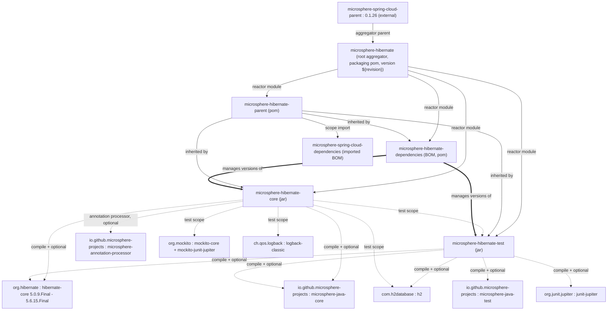
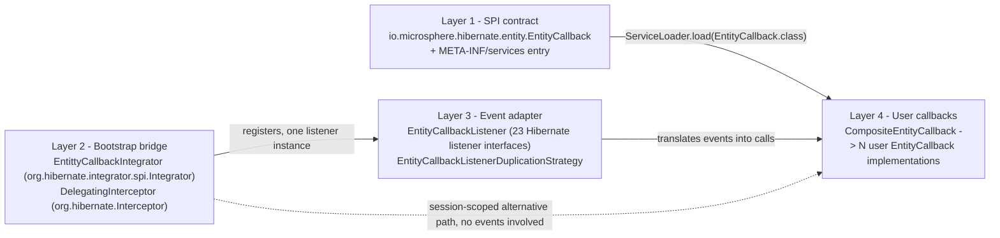

# Microsphere Hibernate — Developer Guide (1.x / 0.1.x)

This is the **developer guide** for the **0.1.x** version line of
[Microsphere Hibernate](https://github.com/microsphere-projects/microsphere-hibernate), taken from the
`release-1.x` branch (development branch: `dev-1.x`). It documents the architecture, the source code of every
class, the design patterns behind them, and the build/CI machinery — everything a contributor needs to read,
change or extend this code base.

Chinese version: [zh/README.md](zh/README.md)

> Reading order suggestion: this index → [microsphere-hibernate-core.md](microsphere-hibernate-core.md)
> (the whole runtime design lives there) → [microsphere-hibernate-test.md](microsphere-hibernate-test.md) →
> the two POM modules.

All source references (`File.java:line`) are relative to the **`release-1.x`** branch, e.g.
`microsphere-hibernate-core/src/main/java/io/microsphere/hibernate/entity/EntityCallbackListener.java:126`.

## 1. What this branch exists for

The 0.1.x line is the Hibernate 5 maintenance line of the same code base whose current line (0.2.x) targets
Hibernate 6.2+/7.x. Every source file is a *fork* of the current one, adapted so that it compiles and runs
against **Hibernate ORM 5.0.9.Final … 5.6.15.Final on JDK 8**. The upstream commit message for this work is
literally *"Adapt to older Hibernate APIs"* (`6e4254c`).

| **Item**                   | **Value (1.x)**                                                             |
|----------------------------|-----------------------------------------------------------------------------|
| Branch / version line      | `release-1.x` / `0.1.x`                                                     |
| In-development revision    | `0.1.11-SNAPSHOT` (root `pom.xml`, property `revision`)                     |
| Root aggregator            | `io.github.microsphere-projects:microsphere-hibernate` (packaging `pom`)     |
| Inherited upstream parent  | `io.github.microsphere-projects:microsphere-spring-cloud-parent:0.1.26`      |
| Hibernate coordinates      | `org.hibernate:hibernate-core` (Hibernate 5 groupId, **not** `org.hibernate.orm`) |
| Persistence API            | `javax.persistence` (**not** `jakarta.persistence`)                         |
| Java baseline              | JDK 8 (CI matrix entry `java: ['8']`)                                       |
| Maven wrapper              | `mvnw` / `mvnw.cmd` → Apache Maven 3.9.15 (`wrapperVersion=3.3.4`, `distributionType=only-script`) |

## 2. Development environment

### 2.1 Required toolchain

| **Tool**  | **Version**                                                                                                     |
|-----------|-----------------------------------------------------------------------------------------------------------------|
| JDK       | **8** is the authoritative baseline; JDK 11 / 17 / 21 / 25 are also covered by CI (see §3.2). Hibernate 5.0–5.2 profiles are only exercised on JDK 8. |
| Maven     | Provided by the wrapper (`./mvnw`, `mvnw.cmd`) — Apache Maven **3.9.15**; no local installation required          |
| Git       | Clone with `git clone -b release-1.x https://github.com/microsphere-projects/microsphere-hibernate.git`          |

### 2.2 Build commands

```bash
# full reactor build (default profile => hibernate-5.6)
./mvnw clean install

# CI-friendly version override (the reactor uses <version>${revision}</version>)
./mvnw -Drevision=0.1.11-SNAPSHOT clean install

# run the tests against a specific Hibernate 5 release
./mvnw -Phibernate-5.4 clean test

# the exact command used by GitHub Actions (JDK 8 matrix)
./mvnw --batch-mode --update-snapshots --file pom.xml -Drevision=0.0.1-SNAPSHOT test \
  --activate-profiles test,coverage,spring-cloud-hoxton,hibernate-5.6
```

Notes for contributors:

- `test` and `coverage` profiles are **inherited** from the upstream Microsphere parents (surefire + JaCoCo
  setup); `coverage` is what uploads to Codecov (`codecov.io/gh/microsphere-projects/microsphere-hibernate`,
  badge points at `dev-1.x`).
- When building on JDK 9+, a `java9+` profile (activated by `<jdk>[9,)</jdk>`) adds
  `javax.xml.bind:jaxb-api` to `microsphere-hibernate-core` and `microsphere-hibernate-test`, because
  Hibernate 5.x still needs the JAXB API that was removed from the JDK.
- The reactor resolves module cross-references from the local build, so `mvn test` in
  `microsphere-hibernate-core` requires `microsphere-hibernate-test` to be built first (it is a `test`-scope
  dependency; Maven orders it automatically).

### 2.3 Module map

| **Module**                           | **Packaging** | **Contents**                                                                                          | **Developer doc** |
|--------------------------------------|---------------|-------------------------------------------------------------------------------------------------------|-------------------|
| `microsphere-hibernate-parent`       | `pom`         | Hibernate 5 version pinning, BOM imports, 7 × `hibernate-5.x` profiles                                | [microsphere-hibernate-parent.md](microsphere-hibernate-parent.md) |
| `microsphere-hibernate-dependencies` | `pom`         | Project BOM: pins `microsphere-hibernate-core` and `microsphere-hibernate-test`                        | [microsphere-hibernate-dependencies.md](microsphere-hibernate-dependencies.md) |
| `microsphere-hibernate-core`         | `jar`         | `EntityCallback` SPI, `Integrator`, event listener, duplication strategy, `DelegatingInterceptor`, constants | [microsphere-hibernate-core.md](microsphere-hibernate-core.md) |
| `microsphere-hibernate-test`         | `jar`         | JUnit 5 `HibernateExtension`, `@HibernateTest` / `@HibernateRuntime`, abstract H2 test bases, sample entities | [microsphere-hibernate-test.md](microsphere-hibernate-test.md) |

### 2.4 Module dependency graph



Key facts encoded in the graph:

- `microsphere-hibernate-core` depends on `microsphere-hibernate-test` **only in `test` scope**
  (`microsphere-hibernate-core/pom.xml`), so the core tests reuse the annotation-driven H2 harness; there is no
  cycle, because the test module never depends on the core module.
- All "production" dependencies are `<optional>true</optional>` — consumers must provide `hibernate-core`
  and `microsphere-java-core` themselves. See
  [the user guide](../user-guide/README.md) for the integration contract.

## 3. Architecture at a glance

### 3.1 Layering

The core module is a four-layer bridge between Hibernate's event engine and application code:



- **Layer 1** is what an application author implements.
- **Layer 2** is the only code Hibernate ORM itself discovers: an `Integrator` published through
  `META-INF/services/org.hibernate.integrator.spi.Integrator`, plus the `Interceptor` decorator that the
  1.x line exposes for *session-scoped* interception.
- **Layer 3** adapts 23 `EventType`s to 23 `EntityCallback` methods with a single listener object.
- **Layer 4** fans a single event out to all discovered callbacks, in `Prioritized` order.

### 3.2 Continuous integration profiles

| **Workflow** | **File** | **Trigger** | **JDK** | **Hibernate profiles** | **Spring Cloud profiles** |
|---|---|---|---|---|---|
| Maven Build | `.github/workflows/maven-build.yml` | push / PR on `dev-1.x`, PR on `release-1.x` | 8 | `hibernate-5.6`, `5.5`, `5.4`, `5.3`, `5.2`, `5.1`, `5.0` | `spring-cloud-hoxton`, `spring-cloud-2020`, `spring-cloud-2021` |
| Maven Build (Java 11+) | `.github/workflows/maven-build-java11+.yml` | push / PR on `dev-1.x`, PR on `release-1.x` | 11, 17, 21, 25 | `hibernate-5.6`, `5.5`, `5.4`, `5.3` | `spring-cloud-hoxton`, `spring-cloud-2020`, `spring-cloud-2021` |
| Maven Publish | `.github/workflows/maven-publish.yml` | push on `release-1.x`, or `workflow_dispatch` with `revision` (`major.minor.patch`) | 17 | default (`hibernate-5.6`) | — (profiles `publish,ci`) |
| Sync branches from upstream | `.github/workflows/sync-branches-from-upstream.yml` | scheduled / manual | — | — | — |

The build matrix is the *executable specification* of the compatibility promise: any change to
`microsphere-hibernate-core` must still compile on JDK 8 against `hibernate-core` **5.0.9.Final**. This is why
several methods in this branch look redundant (see
[core: Hibernate 5 API adaptation points](microsphere-hibernate-core.md#6-hibernate-5-api-adaptation-points)).

## 4. Differences from the 0.2.x (current) architecture

The two lines share history; `release-1.x` is what remains after back-porting to Hibernate 5. Use this table
when you read a diff between the branches.

| **Topic** | **1.x (`release-1.x`)** | **0.2.x (`release` / `main`)** | **Why** |
|---|---|---|---|
| `DelegatingInterceptor` | **Present**, `io.microsphere.hibernate.DelegatingInterceptor` (165 lines) + `DelegatingInterceptorTest` | **Removed** (commit *"Remove upsert callbacks and DelegatingInterceptor*) | Hibernate 5 declares `Interceptor` with abstract methods and `Serializable id` / `EntityMode` / raw `Iterator` signatures; the delegating base class is the only way to decorate an interceptor without re-implementing ~18 methods. On 6.x the class needed a `Object id`/`RepresentationMode` twin set of overrides, so it was dropped there. |
| `Integrator` method implemented | only `integrate(Metadata, SessionFactoryImplementor, SessionFactoryServiceRegistry)` | also `integrate(Metadata, BootstrapContext, SessionFactoryImplementor)`, which adapts to the 3-arg form | The 3-arg form is the *abstract* method in Hibernate 5.x; Hibernate 6.2+ introduced the `BootstrapContext` form and kept the old one as a deprecated `default` method. |
| Cascade-context parameters of listener methods | raw `Map` / `Set` (`onDelete(DeleteEvent, Set)`, `onPersist(PersistEvent, Map)`, `onMerge(MergeEvent, Map)`, `onRefresh(RefreshEvent, Map)`) | typed contexts (`DeleteContext`, `PersistContext`, `MergeContext`, `RefreshContext`) | Hibernate 6 replaced the ad-hoc maps with context objects. |
| `PersistentCollection` | raw type | `PersistentCollection<?>` | The type became generic in Hibernate 6. |
| `EntityCallback#onLoad` | 7 parameters, no `readOnly` | 8 parameters, includes `Boolean readOnly` | `LoadEvent#getReadOnly()` does not exist in Hibernate 5. |
| `requiresPostCommit*` | **both** `requiresPostCommitHanding` (with `@Override`) and `requiresPostCommitHandling` | only `requiresPostCommitHandling` | Hibernate 5 spells the method with the historical typo `Handing`; Hibernate 6 renamed it to `Handling`. Declaring both keeps one source tree compiling on every version in the matrix. |
| Upsert events | absent | absent on both lines today (`PreUpsert`/`PostUpsert` were removed together with the Hibernate-6-only upsert events) | Hibernate 5 has no upsert event types. |
| `PropertyConstants` | identical constants and values | identical | Pure string constants, no Hibernate API involved. |
| JPA annotation used by the test extension | `javax.persistence.Entity` | `jakarta.persistence.Entity` | Follows the JPA namespace of the targeted Hibernate major version. |
| Test module: `StatelessSession` close guard | `if (statelessSession != null)` | `if (statelessSession != null && statelessSession.isOpen())` | `isOpen()` guard added on the current line. |
| `EntityCallbackListenerTest` | **absent** (listener is covered indirectly through `EntityCallbackIntegratorTest`) | present (`testRequiresPostCommitHandling`) | The 1.x listener exposes the misspelled variant, so the current-line unit test does not apply unchanged. |

## 5. Document index

| **File** | **Scope** |
|---|---|
| [README.md](README.md) | This index: toolchain, module graph, layering, CI profiles, 0.1.x vs 0.2.x |
| [microsphere-hibernate-parent.md](microsphere-hibernate-parent.md) | Parent POM anatomy: `revision`, `dependencyManagement`, `hibernate-5.0 … 5.6` profiles, how to add a version |
| [microsphere-hibernate-dependencies.md](microsphere-hibernate-dependencies.md) | BOM module: managed artifacts, flatten/CI-friendly versions, extension checklist |
| [microsphere-hibernate-core.md](microsphere-hibernate-core.md) | **Main source analysis**: SPI, integrator bootstrap sequence, listener mapping tables, duplication strategy, `DelegatingInterceptor` chain, design patterns, Hibernate 5 adaptation notes, tests |
| [microsphere-hibernate-test.md](microsphere-hibernate-test.md) | JUnit 5 extension internals: stores, injection rules, bootstrap configuration builder, abstract test bases, sample entity model |
| `zh/` | Chinese mirrors of all five documents, one-to-one |

## 6. Where to look in the source

```
microsphere-hibernate-core/src/main/java/io/microsphere/hibernate/
├── DelegatingInterceptor.java                     # Interceptor decorator (1.x only)
├── constants/PropertyConstants.java               # "microsphere.hibernate.*" keys
└── entity/
    ├── EntityCallback.java                        # SPI contract, 23 default methods
    ├── CompositeEntityCallback.java               # fan-out (public)
    ├── EntittyCallbackIntegrator.java             # Hibernate 5 Integrator (note the typo: "Entitty")
    ├── EntityCallbackListener.java                # package-private 23-interface adapter
    └── EntityCallbackListenerDuplicationStrategy.java  # package-private, KEEP_ORIGINAL

microsphere-hibernate-core/src/main/resources/META-INF/services/
└── org.hibernate.integrator.spi.Integrator        # -> io.microsphere.hibernate.entity.EntittyCallbackIntegrator

microsphere-hibernate-test/src/main/java/io/microsphere/hibernate/test/
├── HibernateTest.java                             # @ExtendWith(HibernateExtension.class), meta-annotation
├── HibernateRuntime.java                          # injection marker (FIELD, PARAMETER)
├── HibernateExtension.java                        # JUnit 5 lifecycle + parameter resolver
├── AbstractHibernateTest.java                     # package-private template-method base
├── AbstractHibernateH2Test.java                   # public H2 base with @Nested Session / Stateless tests
└── entity/{User,UserProfile,Order,Product}.java   # javax.persistence sample graph
```

## 7 Related documents

- User guide (1.x): [../user-guide/README.md](../user-guide/README.md)
- Current-line developer guide: [../../current/developer-guide/README.md](../../current/developer-guide/README.md)
- Repository README: [../../../README.md](../../../README.md) · [Release notes](../../../release-notes.md)
