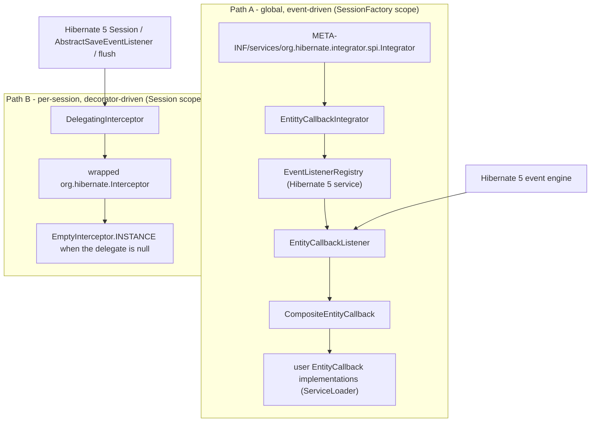
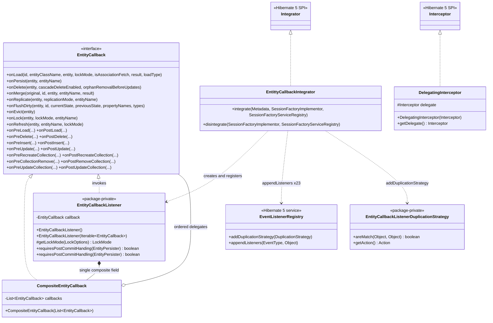
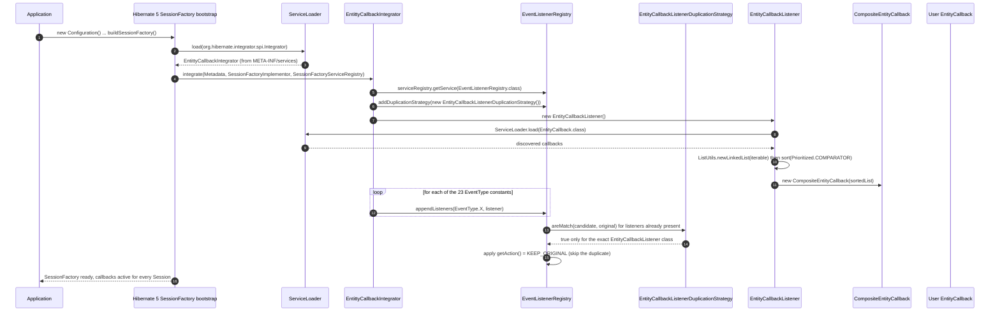
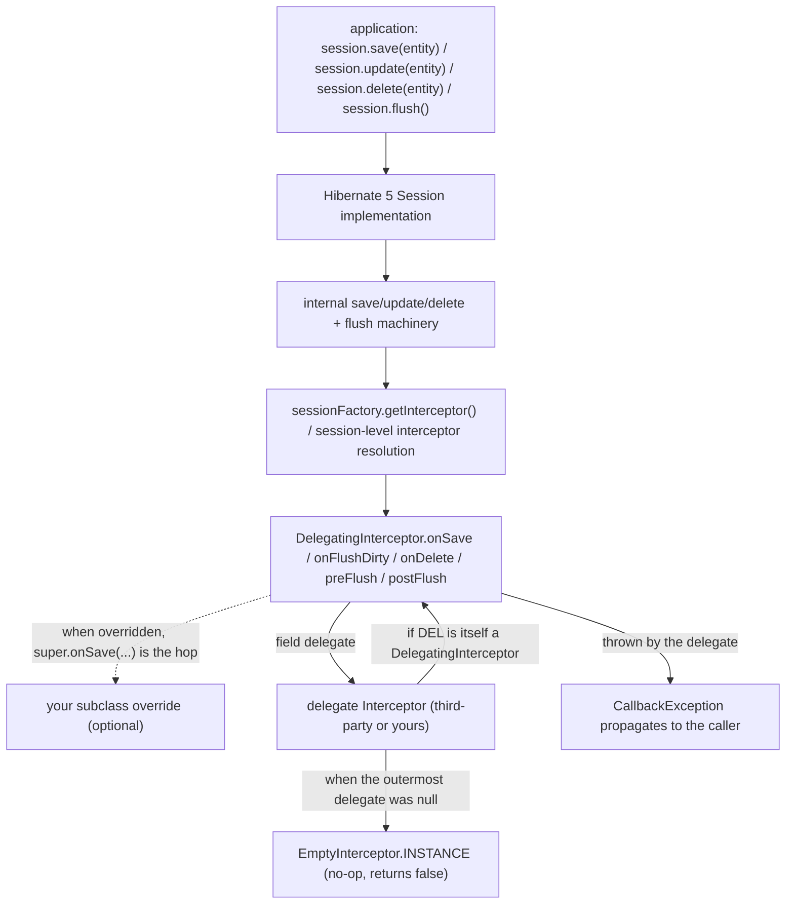
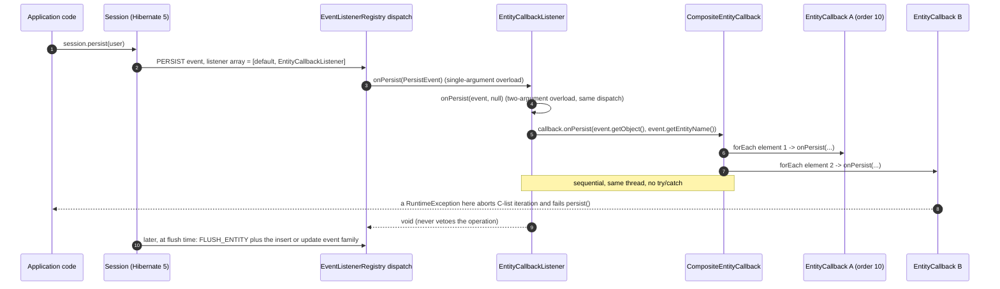

# microsphere-hibernate-core — Developer Guide (1.x)

Artifact: `io.github.microsphere-projects:microsphere-hibernate-core` · Packaging: `jar`
Source: `microsphere-hibernate-core/` (branch `release-1.x`) · Targets Hibernate ORM **5.0.9.Final – 5.6.15.Final** on **JDK 8**
Chinese version: [zh/microsphere-hibernate-core.md](zh/microsphere-hibernate-core.md)

This module is the whole product. Six production classes and one SPI resource implement a
`ServiceLoader`-driven entity lifecycle callback model on top of the Hibernate 5 event engine, and one extra
class exposes a reusable `Interceptor` decorator.

## 1. Module facts

| **Aspect** | **Value** |
|---|---|
| Parent | `microsphere-hibernate-parent` (`${revision}` = `0.1.11-SNAPSHOT`) |
| Compile dependencies (all `optional`) | `org.hibernate:hibernate-core`, `io.github.microsphere-projects:microsphere-java-core`, `io.github.microsphere-projects:microsphere-annotation-processor` |
| Test dependencies | `junit-jupiter`, `mockito-core`, `mockito-junit-jupiter`, `com.h2database:h2`, `ch.qos.logback:logback-classic`, and `io.github.microsphere-projects:microsphere-hibernate-test` (`test` scope) |
| JDK 9+ profile | `java9+` → optional `javax.xml.bind:jaxb-api` |
| Published SPI | `src/main/resources/META-INF/services/org.hibernate.integrator.spi.Integrator` → `io.microsphere.hibernate.entity.EntittyCallbackIntegrator` |
| Public API packages | `io.microsphere.hibernate`, `io.microsphere.hibernate.entity`, `io.microsphere.hibernate.constants` |
| Internal (package-private) API | `EntityCallbackListener`, `EntityCallbackListenerDuplicationStrategy` |

`hibernate-core` is `optional`, therefore **nothing** in this module reaches a consumer transitively:
`microsphere-java-core` (used for `ListUtils`, `Prioritized`, `Wrapper`, `@Nullable`, `io.microsphere.logging`)
must also be on the runtime classpath of an application that enables the callbacks.

## 2. Architecture

### 2.1 Two independent integration paths



- **Path A** is auto-discovered: adding the jar to the classpath installs the callbacks for every
  `SessionFactory` in the JVM. State is shared, one listener instance per `SessionFactory`.
- **Path B** is explicit and per-`Session`: `DelegatingInterceptor` is *not* wired to `EntityCallback` at all in
  this version line — it is a standalone building block for applications that need to decorate an existing
  interceptor (or that need callbacks scoped to one session/unit-of-work).

### 2.2 Class inventory

| **Class** | **Visibility** | **Implements** | **Lines** | **Responsibility** |
|---|---|---|---|---|
| `entity/EntityCallback` | public | — (interface) | 410 | SPI contract: 23 `default` no-op lifecycle methods |
| `entity/CompositeEntityCallback` | public | `EntityCallback` | 178 | Fan-out of one callback call to an ordered list of delegates |
| `entity/EntityCallbackListener` | **package-private** | 23 Hibernate `*EventListener` interfaces | 376 | Translates Hibernate events into `EntityCallback` invocations |
| `entity/EntittyCallbackIntegrator` | public | `org.hibernate.integrator.spi.Integrator` | 142 | Registers the listener for 23 `EventType`s + the duplication strategy |
| `entity/EntityCallbackListenerDuplicationStrategy` | **package-private** | `org.hibernate.event.service.spi.DuplicationStrategy` | 72 | Prevents double registration, keeps the first listener |
| `DelegatingInterceptor` | public | `org.hibernate.Interceptor`, `io.microsphere.lang.DelegatingWrapper` | 165 | Null-safe delegating interceptor base class |
| `constants/PropertyConstants` | public | — (interface of constants) | 75 | `microsphere.hibernate.` property namespace |

### 2.3 Class relationships



## 3. Bootstrap: how the listener gets registered



Relevant source: `EntittyCallbackIntegrator.java:89-137` (registration), `EntityCallbackListener.java:143-157`
(callback discovery and sorting), `EntityCallbackListenerDuplicationStrategy.java:56-71`.

Notes for maintainers:

- The integrator is instantiated **per `SessionFactory`**, so `ServiceLoader.load(EntityCallback.class)` runs once
  per factory. With several factories in one JVM you get one listener + one composite per factory, but the same
  callback *classes* (a new instance of each, because `ServiceLoader` creates them via the no-arg constructor with
  the thread-context class loader active at bootstrap time).
- `disintegrate(...)` (`EntittyCallbackIntegrator.java:139-141`) is an intentional no-op: the listener lives inside
  the `EventListenerRegistry`, which is disposed with the `SessionFactory` service registry.
- Registration order in `integrate()` is *not* the order of `EntityCallback`'s method declarations; it follows the
  `EventType` listing at `EntittyCallbackIntegrator.java:98-135`. Adding a new event type means adding one
  `appendListeners` line **and** the corresponding interface to `EntityCallbackListener`.

## 4. Source analysis

### 4.1 `EntityCallback` — the SPI contract

`microsphere-hibernate-core/src/main/java/io/microsphere/hibernate/entity/EntityCallback.java`

- Pure interface, **23 `default` methods that do nothing** (`EntityCallback.java:129-409`). An implementation
  overrides only the events it cares about, which keeps user classes small and keeps the SPI forward-compatible:
  adding a method to the interface does not break existing implementations.
- Every parameter is Hibernate-5-shaped on purpose: `Object id` (not `Serializable`), `String entityClassName`,
  `org.hibernate.LockMode`, `org.hibernate.ReplicationMode`, `org.hibernate.type.Type[]`, and
  `org.hibernate.event.spi.LoadEventListener.LoadType` — so the interface signature is coupled to Hibernate 5
  types but *not* to any Hibernate event class. That is what allows `CompositeEntityCallback` to stay
  version-agnostic within the 5.x range.
- No return values: `void` everywhere. A callback cannot veto or rewrite an event — the "can this be skipped"
  semantics that Hibernate's own `PreInsertEventListener#onPreInsert` returns are absorbed by the listener (see
  §4.3).
- **Deliberate omissions vs the 0.2.x line:** no `readOnly` parameter on `onLoad`, and no upsert (`onPreUpsert` /
  `onPostUpsert`) methods at all.

Javadoc note: the `<h3>Example Usage</h3>` block of `CompositeEntityCallback` (lines 41-42) still shows the
0.2.x 8-argument `onLoad(..., result, readOnly, loadType)` call; the 1.x method has seven parameters
(`EntityCallback.java:129`). It is documentation only — it does not affect compilation — but it is worth fixing on
the next touch of the file.

### 4.2 `CompositeEntityCallback` — the fan-out

`.../entity/CompositeEntityCallback.java:49-178`

- Holds `private final List<EntityCallback> callbacks` (line 51), supplied through the **public** constructor
  (line 59). No defensive copy: the list is iterated as-is, so a caller that mutates it afterwards affects
  dispatch — this is only used internally with a freshly built, already-sorted list.
- Each override is a one-liner: `forEach(this.callbacks, callback -> callback.onXxx(...))`, using
  `io.microsphere.collection.ListUtils.forEach` (static import at line 27), which is the null-safe iteration helper
  from `microsphere-java-core` — meaning a `null` list is tolerated while a `null` *element* inside it throws an
  `NullPointerException` at dispatch time.
- Dispatch is strictly sequential and **synchronous**: callbacks run on the thread that triggered the Hibernate
  event, in list order, one after another.
- **No `try`/`catch` anywhere.** If callback *n* throws, callbacks *n+1 … end* are skipped and the exception
  unwinds through the listener back into the Hibernate event engine, so the in-flight `persist`/`load`/`flush`
  fails. Documented behaviour; do not "improve" it silently — applications rely on a failing audit callback to
  roll a transaction back.

### 4.3 `EntityCallbackListener` — the Hibernate 5 adapter

`.../entity/EntityCallbackListener.java:126-376` · **package-private** (`class`, line 126)

```java
class EntityCallbackListener implements LoadEventListener, PersistEventListener, MergeEventListener,
        DeleteEventListener, ReplicateEventListener, FlushEntityEventListener,
        EvictEventListener, LockEventListener, RefreshEventListener,
        PreLoadEventListener, PostLoadEventListener,
        PreDeleteEventListener, PostDeleteEventListener,
        PreUpdateEventListener, PostUpdateEventListener,
        PreInsertEventListener, PostInsertEventListener,
        PreCollectionRecreateEventListener, PostCollectionRecreateEventListener,
        PreCollectionRemoveEventListener, PostCollectionRemoveEventListener,
        PreCollectionUpdateEventListener, PostCollectionUpdateEventListener {
```

Twenty-three listener interfaces on one class — that is the Observer/Adapter pivot of the whole design, and it maps
one-to-one onto the twenty-three `EventType` registrations in `EntittyCallbackIntegrator`.

**Construction**

| Constructor | Behaviour |
|---|---|
| `EntityCallbackListener()` (line 143) | `this(load(EntityCallback.class))` — `java.util.ServiceLoader.load` with the **thread-context** class loader |
| `EntityCallbackListener(Iterable<EntityCallback>)` (line 153) | `ListUtils.newLinkedList(callbacks)` → `sort(Prioritized.COMPARATOR)` → `new CompositeEntityCallback(list)` |

Sorting by `io.microsphere.lang.Prioritized.COMPARATOR` means implementations that implement `Prioritized` get an
explicit order (lower `getOrder()` first); the comparator is the shared Microsphere one, so ordering semantics are
consistent with the rest of the ecosystem. The single composite is stored in the `final` field
`private final EntityCallback callback` (line 137) and is the only state of the listener — it is therefore
effectively immutable and safe to register against many event types at once.

**Event → callback mapping (full)**

| **`EventType`** | **Listener method (line)** | **Extracted from the event** | **`EntityCallback` method** |
|---|---|---|---|
| `LOAD` | `onLoad(LoadEvent, LoadType)` (160) | `getEntityId()`, `getEntityClassName()`, `getInstanceToLoad()`, `getLockOptions()` → `LockMode`, `isAssociationFetch()`, `getResult()` | `onLoad` (7 args) |
| `PERSIST` | `onPersist(PersistEvent)` (176) / `onPersist(PersistEvent, Map)` (181) | `getObject()`, `getEntityName()` | `onPersist` |
| `MERGE` | `onMerge(MergeEvent)` (186) / `onMerge(MergeEvent, Map)` (191) | `getOriginal()`, `getRequestedId()`, `getEntity()`, `getEntityName()`, `getResult()` | `onMerge` |
| `DELETE` | `onDelete(DeleteEvent)` (166) / `onDelete(DeleteEvent, Set)` (171) | `getObject()`, `isCascadeDeleteEnabled()`, `isOrphanRemovalBeforeUpdates()` | `onDelete` |
| `REPLICATE` | `onReplicate(ReplicateEvent)` (197) | `getObject()`, `getReplicationMode()`, `getEntityName()` | `onReplicate` |
| `FLUSH_ENTITY` | `onFlushEntity(FlushEntityEvent)` (202) | `getEntityEntry()` → `getId()`, `getLoadedState()`, `getPersister()`; `getPropertyValues()`; persister `getPropertyNames()`/`getPropertyTypes()` | `onFlushDirty` |
| `EVICT` | `onEvict(EvictEvent)` (218) | `getObject()` | `onEvict` |
| `LOCK` | `onLock(LockEvent)` (223) | `getObject()`, `getLockOptions()` → `LockMode`, `getEntityName()` | `onLock` |
| `REFRESH` | `onRefresh(RefreshEvent)` (228) / `onRefresh(RefreshEvent, Map)` (233) | `getObject()`, `getEntityName()`, `getLockOptions()` → `LockMode` | `onRefresh` |
| `PRE_LOAD` | `onPreLoad(PreLoadEvent)` (238) | `getEntity()`, `getId()`, `getState()`, persister names/types | `onPreLoad` |
| `POST_LOAD` | `onPostLoad(PostLoadEvent)` (250) | `getEntity()`, `getId()`, persister names/types | `onPostLoad` |
| `PRE_DELETE` | `onPreDelete(PreDeleteEvent)` (260) | `getEntity()`, `getId()`, `getDeletedState()`, persister names/types | `onPreDelete` — then returns `false` |
| `POST_DELETE` | `onPostDelete(PostDeleteEvent)` (271) | same accessors | `onPostDelete` |
| `PRE_INSERT` | `onPreInsert(PreInsertEvent)` (281) | `getEntity()`, `getId()`, `getState()`, persister names/types | `onPreInsert` — then returns `false` |
| `POST_INSERT` | `onPostInsert(PostInsertEvent)` (292) | same accessors | `onPostInsert` |
| `PRE_UPDATE` | `onPreUpdate(PreUpdateEvent)` (302) | `getEntity()`, `getId()`, `getState()`, persister names/types | `onPreUpdate` — then returns `false` |
| `POST_UPDATE` | `onPostUpdate(PostUpdateEvent)` (313) | same accessors | `onPostUpdate` |
| `PRE_COLLECTION_RECREATE` | `onPreRecreateCollection` (323) | `getCollection()`, `collection.getKey()` | `onPreRecreateCollection` |
| `POST_COLLECTION_RECREATE` | `onPostRecreateCollection` (329) | same | `onPostRecreateCollection` |
| `PRE_COLLECTION_REMOVE` | `onPreRemoveCollection` (335) | same | `onPreCollectionRemove` |
| `POST_COLLECTION_REMOVE` | `onPostRemoveCollection` (341) | same | `onPostRemoveCollection` |
| `PRE_COLLECTION_UPDATE` | `onPreUpdateCollection` (347) | same | `onPreUpdateCollection` |
| `POST_COLLECTION_UPDATE` | `onPostUpdateCollection` (353) | same | `onPostUpdateCollection` |

**Conventions worth knowing before editing**

- *Boolean-returning pre-events always return `false`* (`onPreDelete` line 267, `onPreInsert` line 288,
  `onPreUpdate` line 309). In Hibernate 5 `true` means *"I handled the SQL myself, skip the operation"* — the
  listener never claims that, so callbacks are pure observers and the database write always proceeds. A user
  callback cannot abort an insert through this path; use `DelegatingInterceptor` or a listener of your own for
  vetoing.
- *`requiresPostCommit*` is `false`* — see the dual declaration below.
- *Null handling*: there is none, and that is intentional. `event.getPersister()`, `event.getEntityEntry()`
  (`onFlushEntity` line 203 dereferences it immediately) and `event.getLockOptions()` are assumed non-null, which
  Hibernate's own event construction guarantees for these event types. Collection events also assume
  `event.getCollection()` is non-null (otherwise `collection.getKey()` on line 325 NPEs).
- *Exception handling*: nothing is caught; `HibernateException` is only declared on the methods where the Hibernate
  interfaces declare it (`throws HibernateException`), the collection/`Pre*`/`Post*` overrides declare nothing.
- *State*: `Object[] state`, `previousState` and `String[] propertyNames` are handed out **by reference**. The
  Javadoc of `EntityCallback` (e.g. lines 184, 235, 264) explicitly discourages mutation; `onFlushDirty` even
  passes `entry.getLoadedState()` as `previousState`, which is the live load-time array of the `EntityEntry`.

**The two `requiresPostCommit…` methods** (`EntityCallbackListener.java:358-365`)

```java
@Override
public boolean requiresPostCommitHanding(EntityPersister persister) {
    return false;
}

public boolean requiresPostCommitHandling(EntityPersister persister) {
    return false;
}
```

The first name is the (historically misspelled) method declared by `PostActionEventListener` in Hibernate 5, the
second is the corrected spelling that Hibernate 6 uses. Only the first can carry `@Override` on this branch; the
second is an ordinary public method that keeps the class source-compatible in both directions — it is what allows
one body of listener code to be compiled against the 5.x line here and against 6.x/7.x on the current line, and it is
the method the current line's `EntityCallbackListenerTest` asserts.

**Extension point**: `protected LockMode getLockMode(LockOptions)` (line 373) is the only non-interface method.
Subclasses may override the lock-mode extraction; note that the class is package-private, so in practice this is an
internal seam (a subclass would have to live in `io.microsphere.hibernate.entity`).

### 4.4 `EntittyCallbackIntegrator` — the bootstrap bridge

`.../entity/EntittyCallbackIntegrator.java:79-142` · public

- `integrate(Metadata, SessionFactoryImplementor, SessionFactoryServiceRegistry)` — the Hibernate 5 abstract
  signature; `@Override` is absent on this branch (line 89) while `disintegrate` at line 139 carries it.
- One lookup, one strategy, one listener, 23 registrations (lines 90-135) — see §3.
- No filtering: even when **no** `EntityCallback` implementation is found by the `ServiceLoader`, the listener is
  still registered for all 23 event types and every event then executes an empty `CompositeEntityCallback`. That is
  the price of not reading a switch — see the `PropertyConstants` section: the `microsphere.hibernate.enabled`
  property is declared but **never consulted** by this class on the 1.x line.
- The class name contains a typo (`Entitty`) and the typo is **published**, because
  `META-INF/services/org.hibernate.integrator.spi.Integrator` contains exactly
  `io.microsphere.hibernate.entity.EntittyCallbackIntegrator`. Renaming the class therefore requires editing that
  one-line resource in the same commit; the file has no trailing newline, which is harmless but breaks naive
  text-matching scripts.

### 4.5 `EntityCallbackListenerDuplicationStrategy` — the idempotence guard

`.../entity/EntityCallbackListenerDuplicationStrategy.java:45-72` · **package-private**

```java
public boolean areMatch(Object listener, Object original) {
    Class<?> listenerClass = listener.getClass();
    return Objects.equals(listenerClass, original.getClass())
            && EntityCallbackListener.class.equals(listenerClass);
}

public Action getAction() {
    return KEEP_ORIGINAL;
}
```

- Hibernate consults registered strategies whenever a listener is appended to a type that already has listeners.
  `Action.KEEP_ORIGINAL` means the already-registered listener wins and the new one is dropped, so a second
  `integrate()` call (for example a manually registered `EntittyCallbackIntegrator` *plus* the SPI-discovered one,
  or an integrator being applied twice on the same registry) cannot duplicate every callback invocation.
- Matching is **exact class identity in both directions**: `Objects.equals(listenerClass, original.getClass())` and
  `EntityCallbackListener.class.equals(listenerClass)`. Consequences: (a) a user-defined subclass of
  `EntityCallbackListener` is *not* deduplicated, (b) two different Microsphere listener classes never cancel each
  other out. The unit test `EntityCallbackListenerDuplicationStrategyTest.testAreMatch` pins exactly this, using
  `DefaultLoadEventListener` as the negative case.
- The strategy is stateless and allocation-free to construct; a new instance is created inside `integrate()` rather
  than being cached in a static field.

### 4.6 `DelegatingInterceptor` — the Hibernate 5 interceptor decorator

`microsphere-hibernate-core/src/main/java/io/microsphere/hibernate/DelegatingInterceptor.java:56-165` · public,
**1.x only**

```java
public class DelegatingInterceptor implements Interceptor, DelegatingWrapper {
    protected final Interceptor delegate;

    public DelegatingInterceptor(@Nullable Interceptor delegate) {
        this.delegate = delegate == null ? INSTANCE : delegate;   // INSTANCE == org.hibernate.EmptyInterceptor.INSTANCE
    }
```

Design decisions encoded here:

1. **`@Nullable` in, non-null out.** The constructor normalises `null` to `EmptyInterceptor.INSTANCE`
   (`org.hibernate.EmptyInterceptor.INSTANCE`, static import at line 30), so every delegating method is
   null-free and subclasses can always call `super.onXxx(...)` safely. Verified by
   `DelegatingInterceptorTest.testConstructorWithNullDelegate`.
2. **`protected final` field + `getDelegate()`** (lines 58, 161-164). Subclasses read the field directly; external
   callers use the `DelegatingWrapper` API.
3. **Implements `Interceptor` directly, does not extend `EmptyInterceptor`.** In Hibernate 5 `Interceptor` is an
   interface whose ~18 methods are all abstract and whose `id`/`key` parameters are `Serializable`; there are no
   `default` methods to lean on, which is precisely why this class exists on the 1.x line and why it could not be
   carried over unchanged to Hibernate 6. Implementing `DelegatingWrapper` also brings the `unwrap(Class)` /
   `isWrapperFor(Class)` default methods from `io.microsphere.lang.Wrapper`, letting callers dig through an
   arbitrarily deep decorator stack.
4. **Straight delegation, one hop.** Each method is a single `return delegate.onXxx(...)` / `delegate.onXxx(...)`;
   no logging, no copying of arrays, no exception translation. `CallbackException` is declared where the Hibernate
   interface declares it (`onLoad`, `onFlushDirty`, `onSave`, `onDelete`, collection hooks, `instantiate`,
   `getEntityName`, `getEntity`, `preFlush`, `postFlush`) and is *not* declared on `isTransient`, `findDirty`, the
   three transaction hooks or `onPrepareStatement`.

**Hook inventory (as delegated on this branch)**

| **Category** | **Methods** (lines) | **Return contract** |
|---|---|---|
| Entity state | `onLoad` (71), `onFlushDirty` (76), `onSave` (81), `onDelete` (86) | `boolean` = "the state array was modified" for the first three; `onDelete` is `void` |
| Collection state | `onCollectionRecreate` (91), `onCollectionRemove` (96), `onCollectionUpdate` (101) | `void` |
| Flush lifecycle | `preFlush` (106), `postFlush` (111) | `void`, raw `Iterator entities` (Hibernate 5 has no `Iterator<Object>`) |
| Transience / dirty detection | `isTransient` (116), `findDirty` (121) | `Boolean` (nullable tri-state: `null` = "let Hibernate decide"), `int[]` (nullable) |
| Instantiation / naming | `instantiate(String, EntityMode, Serializable)` (126), `getEntityName` (131), `getEntity` (136) | `Object` (may be `null` for `getEntity`), `String` |
| Transaction | `afterTransactionBegin` (141), `beforeTransactionCompletion` (146), `afterTransactionCompletion` (151) | `void` |
| SQL | `onPrepareStatement(String)` (155-159) | `String`; annotated `@Deprecated` (Hibernate replaced this hook with `StatementInspector` in later majors) — still mandatory here because Hibernate 5 declares it |

**Call chain through a `Session`**



Because `DelegatingInterceptor` forwards to *one* delegate, a "chain" is obtained by nesting:
`new DelegatingInterceptor(new DelegatingInterceptor(auditInterceptor))`, or by subclassing and calling
`super.onXxx(...)` — the Javadoc example at lines 36-49 shows both the wrapping and the `null` fallback.

**Wiring it up** (consumer side, for completeness):

```java
// per-session
Session session = sessionFactory.withOptions().interceptor(new DelegatingInterceptor(existing)).openSession();
// or globally
configuration.setProperty("hibernate.session_factory.interceptor", MyDelegatingInterceptorSubclass.class.getName());
```

**Cautions**

- In Hibernate 5, `Interceptor` extends `Serializable`; a `DelegatingInterceptor` therefore has to keep its
  delegate serializable if the session/interceptor is ever serialized. `EmptyInterceptor.INSTANCE` is.
- An interceptor is **per-`Session`** and single-threaded, unlike the `EntityCallback` machinery which is
  per-`SessionFactory` and shared. Put per-unit-of-work state in the interceptor, not in a callback.
- `isTransient` returning `null` (forwarded as-is) means "fall back to Hibernate's own check" — do not coerce it to
  `false` in a subclass without thinking.

### 4.7 `PropertyConstants`

`.../constants/PropertyConstants.java:48-75`

| **Constant** | **Resolved value** | **Defined at** |
|---|---|---|
| `MICROSPHERE_HIBERNATE_PROPERTY_NAME_PREFIX` | `microsphere.hibernate.` | line 53 |
| `DEFAULT_MICROSPHERE_HIBERNATE_ENABLED_PROPERTY_VALUE` | `"true"` | line 58 |
| `DEFAULT_MICROSPHERE_HIBERNATE_ENABLED` | `true` (parsed) | line 63 |
| `MICROSPHERE_HIBERNATE_ENABLED_PROPERTY_NAME` | `microsphere.hibernate.enabled` | line 73 |

Composition comes from `microsphere-java-core`: `MICROSPHERE_PROPERTY_NAME_PREFIX` + `"hibernate"` +
`SymbolConstants.DOT`, and `+ ENABLED_PROPERTY_NAME`. The enabled property is annotated
`@ConfigurationProperty(type = boolean.class, defaultValue = "true", source = SYSTEM_PROPERTIES_SOURCE)`, which
`microsphere-annotation-processor` (an `optional` dependency of the module) turns into configuration-metadata at
compile time.

**Current state on `release-1.x`:** the constant is *declared only* — `EntittyCallbackIntegrator` does not read it,
and no other production class does either; the only reference in the module is `PropertyConstantsTest`. Treat it as
a documented extension point, not as a working kill switch (see the recipe in §8.3).

## 5. Runtime: event → callback forwarding



The same shape applies to all 23 event types; only the accessors that unpack the event differ (§4.3 table). A single
call on a `Session` can produce **several** events (the entity event at call time, then the flush-time events such
as `FLUSH_ENTITY` and the insert/update/delete family whose exact set depends on the Hibernate 5 minor version, the
id generator and whether the operation happened through a `StatelessSession`), and the flush-time hooks may fire for
entities your callback never saw. Design callbacks to be order-tolerant and idempotent rather than assuming a strict
`onPreXxx` → `onXxx` → `onPostXxx` sequence per entity.

## 6. Hibernate 5 API adaptation points

This is the reason the branch exists. Each row is a place where the 1.x source *intentionally* differs from the
0.2.x source; reverting any of them breaks one end of the `hibernate-5.0 … 5.6` matrix.

| **#** | **Adaptation in 1.x** | **Source** | **Hibernate 5 fact** | **0.2.x counterpart** |
|---|---|---|---|---|
| 1 | only `integrate(Metadata, SessionFactoryImplementor, SessionFactoryServiceRegistry)` | `EntittyCallbackIntegrator.java:89` | this 3-argument form is the abstract method of `Integrator` in 5.x | also implements `integrate(Metadata, BootstrapContext, SessionFactoryImplementor)` (Hibernate 6.2+) and adapts by delegating |
| 2 | `disintegrate` implemented as a no-op with `@Override` | `EntittyCallbackIntegrator.java:139-141` | abstract in Hibernate 5, so it must be implemented | same, but documented as "no-op" |
| 3 | no `org.hibernate.boot.spi.BootstrapContext` import | `EntittyCallbackIntegrator.java:20-25` | the type is not part of the 5.x integrator contract | imported on the current line |
| 4 | raw `Map` / `Set` second parameters | `EntityCallbackListener.java:171, 181, 191, 233` | `onDelete(DeleteEvent, Set)`, `onPersist(PersistEvent, Map)`, `onMerge(MergeEvent, Map)`, `onRefresh(RefreshEvent, Map)` | `DeleteContext` / `PersistContext` / `MergeContext` / `RefreshContext` |
| 5 | raw `PersistentCollection` | `EntityCallbackListener.java:324, 330, 336, 342, 348, 354` | not generic in Hibernate 5 | `PersistentCollection<?>` |
| 6 | `onLoad` has no `readOnly` argument | `EntityCallbackListener.java:160-163`, `EntityCallback.java:129` | `LoadEvent#getReadOnly()` does not exist in 5.x | 8-parameter `onLoad(..., Boolean readOnly, LoadType)` |
| 7 | `requiresPostCommitHanding` (+ a plain `requiresPostCommitHandling`) | `EntityCallbackListener.java:358-365` | Hibernate 5 declares the misspelled name | only `requiresPostCommitHandling` |
| 8 | `Serializable` ids in the interceptor and `EntityMode`-based `instantiate`, raw `Iterator` flush hooks | `DelegatingInterceptor.java:71-128` | the Hibernate 5 `Interceptor` signatures | class removed on the current line (6.x uses `Object id`, `RepresentationMode`, `Iterator<Object>`, extra `onInsert`/`onUpdate`/`onUpsert` hooks) |
| 9 | `@Deprecated` on `onPrepareStatement(String)` with `@Override` | `DelegatingInterceptor.java:155-159` | still declared by Hibernate 5's `Interceptor` | superseded by `StatementInspector` |
| 10 | `javax.persistence.Entity` (test module), `javax.xml.bind:jaxb-api` under the `java9+` profile | `microsphere-hibernate-test`, `microsphere-hibernate-core/pom.xml` | Java EE namespace era | `jakarta.persistence` |
| 11 | no upsert callbacks / `PreUpsert`/`PostUpsert` | `EntityCallback.java`, `EntittyCallbackIntegrator.java` | no upsert `EventType` in 5.x | removed there as well |

**Rule of thumb when porting a fix from `main` into `release-1.x`**: any change that touches an event class,
`LoadEvent`, `PersistentCollection`, `Interceptor`, `Integrator` or `PostActionEventListener` must be re-checked
against rows 1-9 before it is merged, and then run against at least `hibernate-5.0` and `hibernate-5.6`.

## 7. Design patterns

| **Pattern** | **Where** | **Evidence (line)** | **Notes** |
|---|---|---|---|
| **Observer** (push) | `EntityCallbackListener` implements 23 Hibernate listener interfaces; Hibernate is the subject | `EntityCallbackListener.java:126-135`, registration `EntittyCallbackIntegrator.java:98-135` | One concrete observer subscribed to many event types; stateless apart from the composite |
| **Composite** | `CompositeEntityCallback` implements `EntityCallback` and holds `List<EntityCallback>` | `CompositeEntityCallback.java:49-61`, e.g. `onPersist` line 69-71 | Uniform leaf/composite interface: a composite can nest arbitrarily; every method is pure fan-out |
| **Adapter / Wrapper** | `EntityCallbackListener` adapts `*Event` objects to `EntityCallback` arguments | `EntityCallbackListener.java:202-215` (`FlushEntityEvent` + `EntityEntry` + `EntityPersister` → `onFlushDirty`) | Also a *narrowing* adapter: `boolean` veto results of the Hibernate interfaces are flattened to `false` |
| **SPI (Service Provider Interface)** | `EntityCallback` + `META-INF/services/io.microsphere.hibernate.entity.EntityCallback`; `Integrator` + `META-INF/services/org.hibernate.integrator.spi.Integrator` | resource files, `EntityCallbackListener.java:144` (`load(EntityCallback.class)`) | Two nested SPI layers: Hibernate discovers the integrator, the integrator's listener discovers the callbacks |
| **Strategy** | `EntityCallbackListenerDuplicationStrategy implements DuplicationStrategy` (`areMatch` + `getAction`) | `EntityCallbackListenerDuplicationStrategy.java:56-71`, installed at `EntittyCallbackIntegrator.java:93` | Pluggable duplicate-resolution policy handed to Hibernate's registry |
| **Delegation / Proxy (Decorator)** | `DelegatingInterceptor` forwards all `Interceptor` hooks to `delegate`, is itself an `Interceptor`, and `DelegatingWrapper` supplies `unwrap` | `DelegatingInterceptor.java:58, 66-68, 71-159, 161-164` | Null-object (`EmptyInterceptor.INSTANCE`) as the fallback; subclass overrides + `super.onXxx(...)` form the extensible chain |
| **Template Method** | the `protected` hooks of the test bases and `getLockMode` seam | `EntityCallbackListener.java:373`, (`HibernateExtension`/`AbstractHibernateH2Test` in the test module) | Keeps the event unpacking overridable |
| **Null Object** | `null` delegate → `EmptyInterceptor.INSTANCE` | `DelegatingInterceptor.java:67` | Removes every `if (delegate != null)` from the 18 forwarding methods |

## 8. Contributing recipes

### 8.1 Add support for one more Hibernate event type

1. `EntityCallback`: add a `default` no-op method with a Hibernate-5-safe signature (prefer `Object id`,
   `String entityName`, `Object[] state`, `Type[]` over raw event classes) — `EntityCallback.java`.
2. `EntityCallbackListener`: implement the matching `*EventListener` interface, add it to the `implements` clause,
   unpack the event, forward to `this.callback`, and return `false` if the interface returns `boolean`
   (`EntityCallbackListener.java:126-320`).
3. `CompositeEntityCallback`: add the one-line `forEach` override.
4. `EntittyCallbackIntegrator`: `eventListenerRegistry.appendListeners(NEW_EVENT_TYPE, listener)`.
5. Check §6: the event class and its accessors must exist in **5.0.9.Final**, not just in 5.6.
6. Add a fixture: extend `TestEntityCallback` (it overrides all 23 methods and logs at `trace`) and exercise the
   new path in `AbstractHibernateH2Test`'s nested `SessionTest` / `StatelessSessionTest`.
7. Run the whole matrix (`./mvnw -Phibernate-5.0 test` … `hibernate-5.6`).

### 8.2 Write / debug a user callback

```java
public class AuditingEntityCallback implements EntityCallback, Prioritized {
    @Override public int getOrder() { return 100; }              // sorted by Prioritized.COMPARATOR
    @Override public void onPostInsert(Object entity, Object id, Object[] state,
                                     String[] propertyNames, Type[] propertyTypes) {
        // never throw here unless you want insert() to fail
    }
}
// src/main/resources/META-INF/services/io.microsphere.hibernate.entity.EntityCallback
// com.acme.AuditingEntityCallback
```

Debugging tip: register `TestEntityCallback`-style logging at `trace` and keep `hibernate.show_sql=true` (the H2
test bases do this) — the callback log lines interleave with the SQL and make the event chain readable.

### 8.3 Wire the `microsphere.hibernate.enabled` kill switch

The property exists (`PropertyConstants.java:73`) but is not honoured. A minimal, matrix-safe change:

```java
// EntittyCallbackIntegrator#integrate, as the first statement
boolean enabled = parseBoolean(System.getProperty(MICROSPHERE_HIBERNATE_ENABLED_PROPERTY_NAME,
        DEFAULT_MICROSPHERE_HIBERNATE_ENABLED_PROPERTY_VALUE));
if (!enabled) {
    return;
}
```

If you add it, also add the guard to the duplication-strategy path (skip `addDuplicationStrategy` too) and document
the behaviour in the user guide, because disabling the integrator silently changes the listener topology that
`KEEP_ORIGINAL` assumes.

### 8.4 Style conventions of this module

- ASF license header on every file; `@author <a href="mailto:mercyblitz@gmail.com">Mercy</a>` and `@since` tags.
- Public types carry an `<h3>Example Usage</h3>` Javadoc block with a `{@code ...}` sample (all six core classes do).
- Static imports are used aggressively for `EventType` constants
  (`import static org.hibernate.event.spi.EventType.LOAD;` …) and for Microsphere helpers
  (`ListUtils.newLinkedList`, `Prioritized.COMPARATOR`, `ServiceLoader.load`, `EmptyInterceptor.INSTANCE`).
- Package-private by default: only `EntityCallback`, `CompositeEntityCallback`, `EntittyCallbackIntegrator`,
  `DelegatingInterceptor` and `PropertyConstants` are public. Keep new machinery internal.
- Class-name typos are part of the published surface (`EntittyCallbackIntegrator`) — do not "fix" them without an
  update to the `META-INF/services` file and a note in the release notes.

## 9. Tests of this module

| **Test** | **Location** | **What it pins** |
|---|---|---|
| `DelegatingInterceptorTest` | `src/test/java/io/microsphere/hibernate/DelegatingInterceptorTest.java` | `@ExtendWith(MockitoExtension.class)`, a `@Mock Interceptor`; one test per hook: null-delegate → `assertSame(INSTANCE, getDelegate())`; `assertTrue`/`assertFalse` pass-through for `onLoad`/`onFlushDirty`/`onSave`; `verify` for `onDelete`, the three collection hooks, `preFlush`/`postFlush` (with `Collections.emptyIterator()`), the transaction hooks; `assertSame` for `findDirty` (`int[]`) and `instantiate(..., EntityMode.POJO, 1L)`; `isTransient` returns `Boolean.TRUE`; `onPrepareStatement` round-trip under `@SuppressWarnings("deprecation")`; `getDelegate()` identity |
| `EntityCallbackListenerDuplicationStrategyTest` | `.../entity/EntityCallbackListenerDuplicationStrategyTest.java` | `areMatch(listener, listener)` is `true`; `areMatch` with `DefaultLoadEventListener` on either side is `false`; `getAction()` is `KEEP_ORIGINAL`. Relies on same-package access to the package-private class |
| `PropertyConstantsTest` | `.../constants/PropertyConstantsTest.java` | the four constant values (`microsphere.hibernate.`, `"true"`, `true`, `microsphere.hibernate.enabled`) |
| `EntityCallbackIntegratorTest` | `.../entity/EntityCallbackIntegratorTest.java` | **empty body**, `extends AbstractHibernateH2Test` — the whole integrator → listener → callback pipeline is exercised by the inherited nested `SessionTest` / `StatelessSessionTest` classes against in-memory H2, with `TestEntityCallback` discovered through the test-scope SPI file |
| `TestEntityCallback` (fixture, not a test) | `.../entity/TestEntityCallback.java` | implements all 23 methods, logs each at `trace` via `io.microsphere.logging` and then calls `EntityCallback.super.onXxx(...)`; registered in `src/test/resources/META-INF/services/io.microsphere.hibernate.entity.EntityCallback` |

Coverage model, and what is *not* covered: `EntityCallbackListener` has no direct unit test on this branch (the
current line has `EntityCallbackListenerTest` for `requiresPostCommitHandling`, which does not transfer 1:1 because
of the `Handing` spelling); its behaviour is asserted end-to-end by `EntityCallbackIntegratorTest` +
`AbstractHibernateH2Test`. If you change event unpacking, add a listener-level unit test rather than relying on the
H2 run, because the H2 run only asserts "nothing throws" and SQL visibility, not the callback arguments.

Running them:

```bash
./mvnw -pl microsphere-hibernate-core -Phibernate-5.6 test
./mvnw -pl microsphere-hibernate-core -am -Phibernate-5.0 -Drevision=0.0.1-SNAPSHOT test   # also builds microsphere-hibernate-test
```

## 10 Next

- [microsphere-hibernate-test.md](microsphere-hibernate-test.md) — the H2 harness these tests stand on
- [microsphere-hibernate-parent.md](microsphere-hibernate-parent.md) — where `${hibernate.version}` comes from
- User guide: [../user-guide/microsphere-hibernate-core.md](../user-guide/microsphere-hibernate-core.md) · Index: [README.md](README.md)
