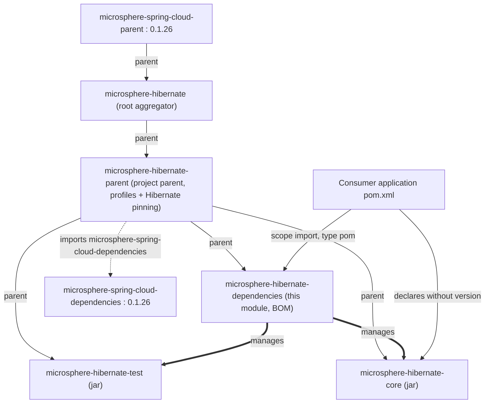

# microsphere-hibernate-dependencies — Developer Guide (1.x)

Artifact: `io.github.microsphere-projects:microsphere-hibernate-dependencies` · Packaging: `pom`
Source: `microsphere-hibernate-dependencies/pom.xml` (branch `release-1.x`)
Chinese version: [zh/microsphere-hibernate-dependencies.md](zh/microsphere-hibernate-dependencies.md)

## 1. Role

`microsphere-hibernate-dependencies` is the project **BOM** (Bill of Materials). It is the artifact users import
in their own `<dependencyManagement>` section so that every Microsphere Hibernate module resolves to one single,
self-consistent version line.

It is intentionally the smallest module in the repository: it inherits everything from
`microsphere-hibernate-parent` and contributes exactly one thing — version pinning for the two jars this project
publishes.

```xml
<dependencyManagement>
    <dependencies>
        <dependency>
            <groupId>io.github.microsphere-projects</groupId>
            <artifactId>microsphere-hibernate-core</artifactId>
            <version>${revision}</version>
        </dependency>
        <dependency>
            <groupId>io.github.microsphere-projects</groupId>
            <artifactId>microsphere-hibernate-test</artifactId>
            <version>${revision}</version>
        </dependency>
    </dependencies>
</dependencyManagement>
```

## 2. Position in the POM hierarchy



Because the BOM is a **child of `microsphere-hibernate-parent`**, it inherits the Hibernate pinning and the
`microsphere-spring-cloud-dependencies` import as *its own* dependency management. Two consequences:

1. A consumer that imports only `microsphere-hibernate-dependencies` does **not** automatically get those managed
   versions — an imported BOM brings its own `<dependencyManagement>` entries, and the *inherited* ones are part
   of the published BOM's effective management, so `hibernate-core` and the third-party stack do come along in the
   flattened POM. This is exactly what the "Compatibility" promise of the 0.1.x line relies on: the BOM pins the
   Hibernate 5 version that the modules were built against.
2. The BOM must stay *after* the parent in any reactor ordering, which is why the root POM lists
   `microsphere-hibernate-parent` first in `<modules>`.

## 3. `revision` and the flattened POM

All three POM-level versions in this module (`parent` version, own `version`, and the managed module versions)
are the literal string `${revision}`. On its own this is not deployable — Maven Central forbids publishing a POM
with an unresolvable version — so the inherited **flatten-maven-plugin** resolves the effective POM and replaces
`${revision}` with the concrete value before `install`/`deploy`:

```
mvn -Drevision=0.1.10 deploy
  -> .flattened-pom.xml for this module contains <version>0.1.10</version>
  -> the managed microsphere-hibernate-core entry also reads 0.1.10
```

The generated `.flattened-pom.xml` files are ignored by Git (`.gitignore`) and are the only place where a literal
version appears. Never commit a hard-coded version into this module.

## 4. What the BOM does **not** manage

| **Not managed here**           | **Where it is managed instead** |
|--------------------------------|---------------------------------|
| `org.hibernate:hibernate-core` | `microsphere-hibernate-parent` (`${hibernate.version}` from the active profile) |
| JUnit 5 / Mockito / H2 / Logback / JAXB | `microsphere-spring-cloud-dependencies:0.1.26` (imported by the parent) |
| `microsphere-java-core`, `microsphere-java-test`, `microsphere-annotation-processor` | same upstream BOM |
| `microsphere-hibernate-parent` itself as a parent | consumers reference it directly with an explicit version |

If a future module (for example a `microsphere-hibernate-spring-boot` starter) is added, it must be registered in
this BOM — that is the only place the project promises version alignment to its users.

## 5. How to extend this module

1. **Add a module to the BOM**: append a `<dependency>` block with
   `<groupId>io.github.microsphere-projects</groupId>`, the new `artifactId`, and `<version>${revision}</version>`.
   No `<type>`/`<scope>` unless the artifact is not a jar.
2. **Add it to the reactor** as well (`<modules>` in the root `pom.xml`), otherwise `${revision}` will resolve to a
   version that was never built.
3. **Do not** introduce third-party version properties into this module; that belongs to
   `microsphere-hibernate-parent` (project-wide build policy) or upstream (platform policy).
4. Sanity-check after a change:

   ```bash
   ./mvnw -q -Drevision=0.0.1-SNAPSHOT -pl microsphere-hibernate-dependencies install
   ./mvnw -q -Drevision=0.0.1-SNAPSHOT -pl microsphere-hibernate-core dependency:tree \
     -Dincludes=io.github.microsphere-projects
   ```

## 6. Consumer-side usage (for reference)

```xml
<dependencyManagement>
    <dependencies>
        <dependency>
            <groupId>io.github.microsphere-projects</groupId>
            <artifactId>microsphere-hibernate-dependencies</artifactId>
            <version>${microsphere-hibernate.version}</version> <!-- 0.1.x only -->
            <type>pom</type>
            <scope>import</scope>
        </dependency>
    </dependencies>
</dependencyManagement>
```

Reminder: the 0.1.x BOM must not be imported into a project that also imports the 0.2.x BOM or
`org.hibernate.orm:hibernate-platform`; the two lines resolve different Hibernate coordinate spaces
(`org.hibernate` vs `org.hibernate.orm`, `javax.persistence` vs `jakarta.persistence`).

## 7 Next

- [microsphere-hibernate-parent.md](microsphere-hibernate-parent.md) — where the profiles live
- [microsphere-hibernate-core.md](microsphere-hibernate-core.md) — the jar this BOM pins
- Index: [README.md](README.md)
