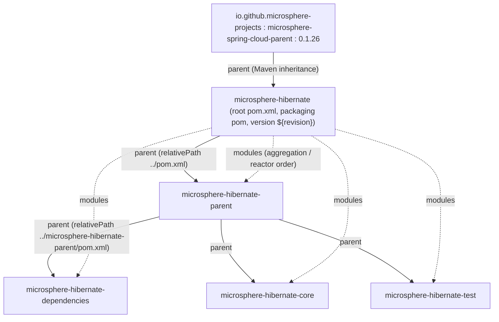
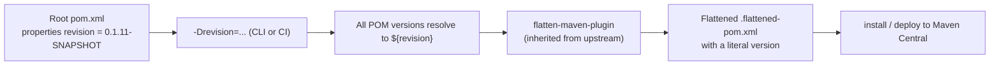

# microsphere-hibernate-parent — Developer Guide (1.x)

Artifact: `io.github.microsphere-projects:microsphere-hibernate-parent` · Packaging: `pom`
Source: `microsphere-hibernate-parent/pom.xml` (branch `release-1.x`)
Chinese version: [zh/microsphere-hibernate-parent.md](zh/microsphere-hibernate-parent.md)

## 1. Role in the reactor

`microsphere-hibernate-parent` is the **build parent** of every artifact-producing module (`core`, `test`) and of
the BOM (`dependencies`). It owns three things:

1. the version of the upstream Microsphere Spring Cloud platform (`microsphere-spring-cloud.version`),
2. the `dependencyManagement` entries that are Hibernate-specific,
3. the **Hibernate 5 version profiles** (`hibernate-5.0 … hibernate-5.6`) that define what
   `${hibernate.version}` means.

It produces no jar and contains no code; it is pure build policy.

### 1.1 Inheritance vs aggregation

Two distinct relationships are in play — a frequent source of confusion when editing these POMs:



- **Inheritance**: `microsphere-spring-cloud-parent:0.1.26` → root `microsphere-hibernate` →
  `microsphere-hibernate-parent` → `dependencies` / `core` / `test`. Plugin management, the `test` and `coverage`
  profiles and the Java 8 compiler settings come down this chain.
- **Aggregation**: the root POM lists all four modules in `<modules>`, so `./mvnw` at the repository root builds
  them in dependency order.

`microsphere-hibernate-parent` itself declares `<version>${revision}</version>` and repeats the `groupId`, so it
can also be referenced from outside the reactor (e.g. by example projects) as a plain parent.

## 2. Anatomy of the POM

### 2.1 Coordinates and properties

```xml
<parent>
    <groupId>io.github.microsphere-projects</groupId>
    <artifactId>microsphere-hibernate</artifactId>
    <version>${revision}</version>
    <relativePath>../pom.xml</relativePath>
</parent>

<artifactId>microsphere-hibernate-parent</artifactId>
<version>${revision}</version>
<packaging>pom</packaging>

<properties>
    <microsphere-spring-cloud.version>0.1.26</microsphere-spring-cloud.version>
</properties>
```

| **Property** | **Value** | **Consumers** |
|---|---|---|
| `revision` | `0.1.11-SNAPSHOT` (declared in the root `pom.xml`) | every module's `<version>` — CI-friendly numbering |
| `microsphere-spring-cloud.version` | `0.1.26` | the imported `microsphere-spring-cloud-dependencies` BOM |
| `hibernate.version` | set **only** by the profiles below | the `org.hibernate:hibernate-core` managed version |

The 1.x root POM does **not** declare `<java.version>17</java.version>` (the current line does); the JDK 8
baseline is what the `release-1.x` parent chain implies and what the JDK 8 CI matrix verifies.

### 2.2 `dependencyManagement`

```xml
<dependencyManagement>
    <dependencies>
        <dependency>
            <groupId>org.hibernate</groupId>
            <artifactId>hibernate-core</artifactId>
            <version>${hibernate.version}</version>
        </dependency>
        <dependency>
            <groupId>io.github.microsphere-projects</groupId>
            <artifactId>microsphere-spring-cloud-dependencies</artifactId>
            <version>${microsphere-spring-cloud.version}</version>
            <type>pom</type>
            <scope>import</scope>
        </dependency>
    </dependencies>
</dependencyManagement>
```

Two points that matter when you change this file:

- **Hibernate is pinned as a single jar (`org.hibernate:hibernate-core`), not as a platform BOM.** The 0.2.x line
  imports `org.hibernate.orm:hibernate-platform` (`<type>pom</type><scope>import</scope>`); Hibernate 5 has no
  equivalent platform artifact, so 1.x manages `hibernate-core` directly and lets Maven's transitive resolution
  pull `hibernate-commons-annotations`, `byte-buddy`, `jandex`, `classmate`, `javax.persistence-api`, … .
- **Import order wins.** `hibernate-core` is declared *before* the Microsphere Spring Cloud BOM import, so the
  Hibernate version resolved here is the one that survives (an imported BOM cannot override an explicitly managed
  entry earlier in the list).

All other third-party versions used by the modules (`junit-jupiter`, `mockito-core`, `mockito-junit-jupiter`,
`h2`, `logback-classic`, `jaxb-api`, `microsphere-java-core`, `microsphere-java-test`,
`microsphere-annotation-processor`) are managed by `microsphere-spring-cloud-dependencies:0.1.26`, which itself
imports the Spring Boot / Spring Cloud BOMs per active profile. That is why the module POMs declare dependencies
**without** `<version>`.

## 3. Hibernate 5 version profiles

Seven profiles, all of which only set `hibernate.version`:

| **Profile id** | **`hibernate.version`** | **Activation** | **Notes** |
|---|---|---|---|
| `hibernate-5.6` | `5.6.15.Final` | `activeByDefault = true` | Default build target; the only line present in **both** CI matrices (JDK 8, 11, 17, 21, 25) |
| `hibernate-5.5` | `5.5.9.Final` | manual | Java 11+ matrix entry |
| `hibernate-5.4` | `5.4.33.Final` | manual | Java 11+ matrix entry |
| `hibernate-5.3` | `5.3.38.Final` | manual | Java 11+ matrix entry |
| `hibernate-5.2` | `5.2.18.Final` | manual | JDK 8 only in CI |
| `hibernate-5.1` | `5.1.9.Final` | manual | JDK 8 only in CI |
| `hibernate-5.0` | `5.0.9.Final` | manual | JDK 8 only in CI; the floor of the supported range |

Because `hibernate-5.6` is `activeByDefault`, **any** other profile must be activated explicitly and note that a
default profile is automatically deactivated as soon as another profile in the same POM is activated on the
command line — that is what makes `-Phibernate-5.4` behave as expected.

Verifying the resolved version:

```bash
./mvnw -N -Phibernate-5.0 help:evaluate -Dexpression=hibernate.version -DforceStdout
./mvnw -pl microsphere-hibernate-core -Phibernate-5.3 dependency:tree -Dincludes=org.hibernate:hibernate-core
```

## 4. Profiles inherited from upstream

The parent POM does not define them, but the CI command lines activate them, so document them here:

| **Profile** | **Defined in** | **Effect** |
|---|---|---|
| `spring-cloud-hoxton` | `microsphere-spring-cloud-parent:0.1.26` | `spring-boot.version=2.3.12.RELEASE`, `spring-cloud.version=Hoxton.SR12`, `spring-cloud-alibaba.version=2.2.10` |
| `spring-cloud-2020` | same | `spring-cloud.version=2020.0.5` |
| `spring-cloud-2021` | same | `spring-cloud.version=2021.0.9` |
| `testcontainers` | same | adds the Testcontainers BOM (not used by this repository) |
| `test`, `coverage` | Microsphere build parents (transitively) | surefire execution + JaCoCo agent/report, used by `maven-build.yml` |
| `publish`, `ci` | Microsphere build parents | sources/javadoc jars, GPG signing, Sonatype OSSRH deployment, used by `maven-publish.yml` |
| `java9+` | declared **locally** in `microsphere-hibernate-core/pom.xml` and `microsphere-hibernate-test/pom.xml` | `<activation><jdk>[9,)</jdk></activation>` adds optional `javax.xml.bind:jaxb-api` |

The Spring Cloud profile dimension is largely orthogonal for this project (neither `core` nor `test` uses Spring
at runtime), but it is kept in the matrix because `microsphere-java-core` / `microsphere-java-test` are published
against those platforms.

## 5. `revision` / CI-friendly version management



Rules to keep in mind:

- Every module uses `<version>${revision}</version>` for itself *and* for its `<parent>` reference; never
  hard-code a literal version in `core`, `test`, `dependencies` or `parent`.
- Publishing (`maven-publish.yml`) requires `revision` to match `^[0-9]+\.[0-9]+\.[0-9]+$` — the workflow
  validates it and tags the release with the same value.
- CI test builds deliberately use `-Drevision=0.0.1-SNAPSHOT` so a matrix run can never overwrite a real
  artifact.
- After each release, `release-1.x` is bumped to the next patch (e.g. `0.1.10` published → `revision`
  `0.1.11-SNAPSHOT`) by the automation commits *"chore: bump version to next patch after publishing"*.

## 6. How to extend this module

### 6.1 Add a new Hibernate 5 patch/minor to the matrix

1. Add a profile block to `microsphere-hibernate-parent/pom.xml` following the existing shape:

   ```xml
   <profile>
       <id>hibernate-5.6-new</id>
       <properties>
           <hibernate.version>5.6.16.Final</hibernate.version>
       </properties>
   </profile>
   ```

2. Add the id to the `maven-hibernate` list in `.github/workflows/maven-build.yml` (JDK 8) and, if the line is
   expected to work on modern JDKs, to `maven-build-java11+.yml`.
3. Re-check the two API-sensitive spots described in
   [core §6 — Hibernate 5 API adaptation points](microsphere-hibernate-core.md#6-hibernate-5-api-adaptation-points):
   the `requiresPostCommitHanding` spelling and the raw `Map`/`Set` listener overloads.

### 6.2 Bump the platform

Changing `microsphere-spring-cloud.version` moves the whole third-party stack (JUnit, Mockito, H2, Logback,
`microsphere-java-core`). Do it in **this** file only — the module POMs never repeat the version — and run the
full matrix locally afterwards:

```bash
for p in hibernate-5.0 hibernate-5.1 hibernate-5.2 hibernate-5.3 hibernate-5.4 hibernate-5.5 hibernate-5.6; do
  ./mvnw -q -Drevision=0.0.1-SNAPSHOT -Ptest,coverage,spring-cloud-2021,$p clean test || echo "FAILED: $p"
done
```

### 6.3 Conventions used by these POMs

- Module `<name>`/`<description>` follow `Microsphere :: Hibernate :: <Module>`; keep the prefix.
- The license header (`Apache License 2.0`), `<organization>`, `<developers>` and `<scm>` blocks live only in the
  root POM and are inherited.
- Dependency comments (`<!-- Hibernate -->`, `<!-- Testing -->`, …) are part of the house style; every dependency
  in `core`/`test` is grouped and commented.

## 7 Next

- [microsphere-hibernate-dependencies.md](microsphere-hibernate-dependencies.md) — the BOM that consumes this parent
- [microsphere-hibernate-core.md](microsphere-hibernate-core.md) — the code whose Hibernate API usage justifies the profile matrix
- Index: [README.md](README.md)
