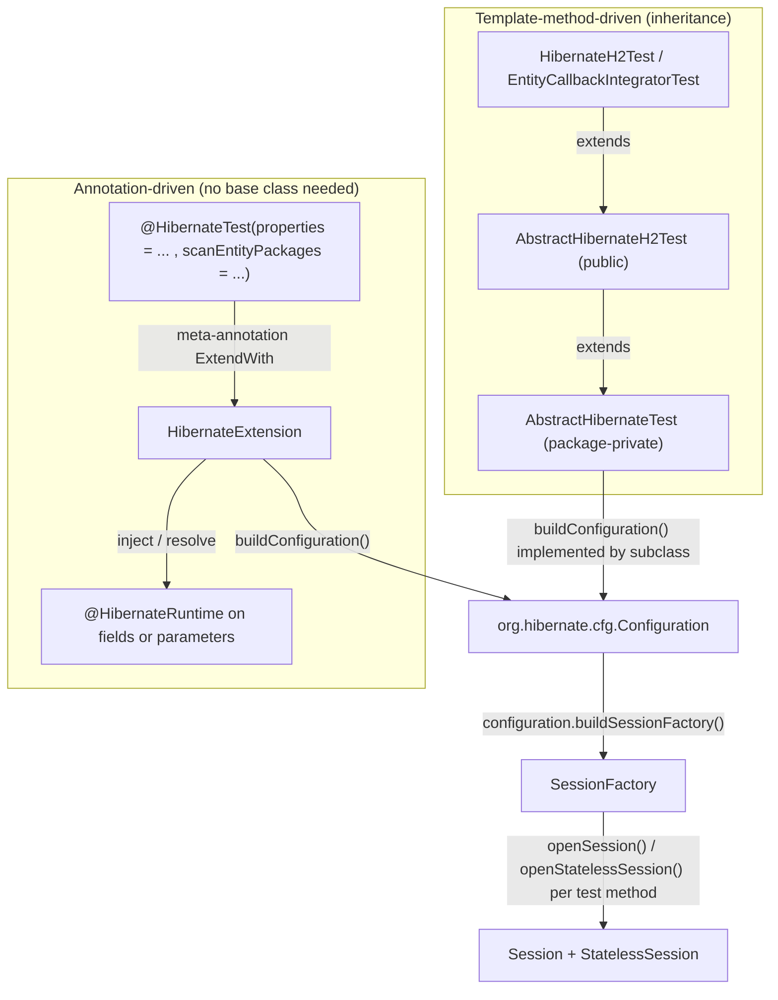
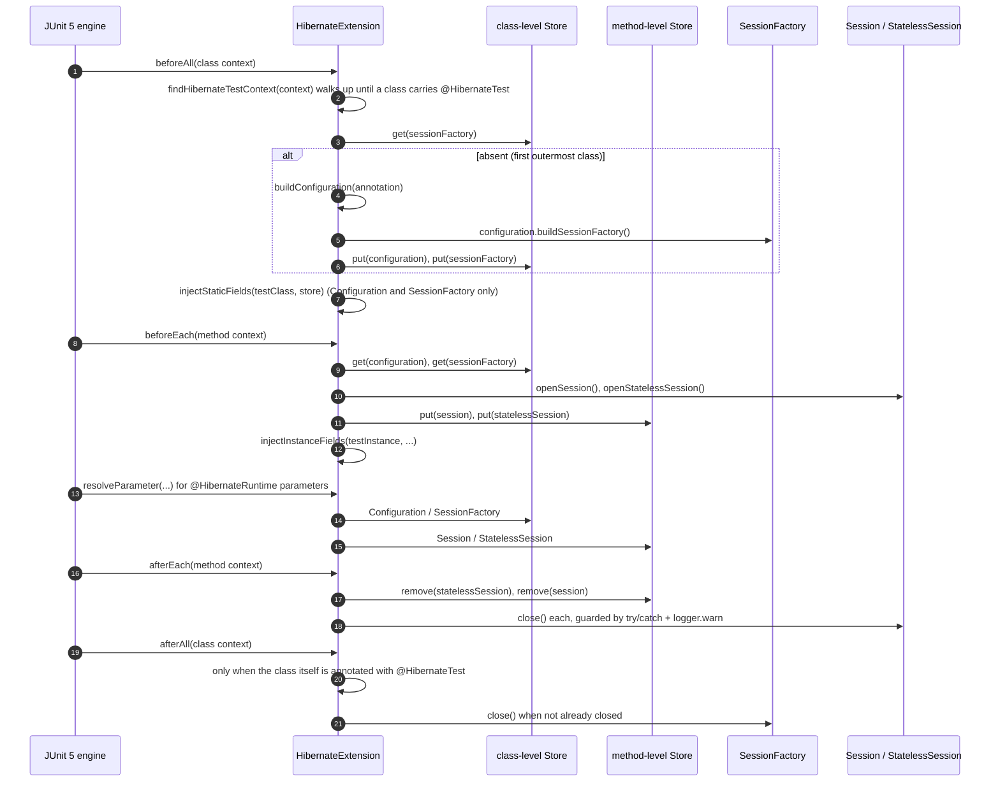
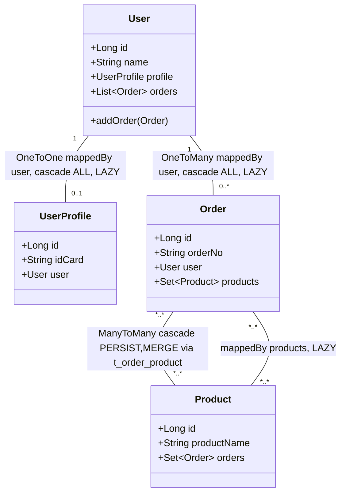

# microsphere-hibernate-test — Developer Guide (1.x)

Artifact: `io.github.microsphere-projects:microsphere-hibernate-test` · Packaging: `jar`
Source: `microsphere-hibernate-test/` (branch `release-1.x`)
Chinese version: [zh/microsphere-hibernate-test.md](zh/microsphere-hibernate-test.md)

A published **test-support library** (not a test suite of its own): it packages a JUnit 5 extension, two
annotations, two abstract test bases and four sample entities so that both this repository's tests and third-party
projects can bootstrap a Hibernate 5 `SessionFactory` without boilerplate.

## 1. Module facts

| **Aspect** | **Value** |
|---|---|
| Parent | `microsphere-hibernate-parent`; `<version>${revision}</version>` |
| Compile dependencies (all `optional`) | `hibernate-core` (`org.hibernate`), `microsphere-java-core`, `microsphere-java-test`, `junit-jupiter`, `mockito-core`, `mockito-junit-jupiter`, `com.h2database:h2`, `logback-classic`, `microsphere-annotation-processor` |
| JDK 9+ | `java9+` profile adds `javax.xml.bind:jaxb-api` (Hibernate 5 needs JAXB on the module path) |
| Depends on `microsphere-hibernate-core`? | **No** — the module is deliberately independent; the core module depends on *it* in `test` scope |
| Namespace | `javax.persistence` (Hibernate 5 / JPA 2.x era) |
| Own tests | `HibernateH2Test`, `HibernateAnnotationTest`, `entity/{User,UserProfile,Order,Product}Test` |

Why everything is `optional`: the artifact is designed to sit on a test classpath next to a *consumer's* own
Hibernate/JUnit/H2 versions. Making them optional means this library never dictates or duplicates them; the cost is
that consumers must declare JUnit 5, Hibernate and H2 themselves.

## 2. Two ways to get a Hibernate test runtime



| **Dimension** | **`@HibernateTest` + `HibernateExtension`** | **`AbstractHibernateTest` / `AbstractHibernateH2Test`** |
|---|---|---|
| Composition vs inheritance | composition, no superclass slot consumed | inheritance (template method) |
| Entity discovery | classpath scan by package (`SimpleClassScanner`), `@Entity` filter | explicit `addAnnotatedClass(...)` |
| `SessionFactory` scope | **once per test class**, shared with `@Nested` classes | rebuilt **before every test method** |
| `Session` scope | opened/closed per test method | per test method (in `setUp`/`tearDown`) |
| Injection | fields + method parameters | `protected` fields |
| Used by | `HibernateAnnotationTest` | `HibernateH2Test`, and core's `EntityCallbackIntegratorTest` |

## 3. `HibernateExtension` internals

`microsphere-hibernate-test/src/main/java/io/microsphere/hibernate/test/HibernateExtension.java:67-397` · public

```java
public class HibernateExtension implements BeforeAllCallback, BeforeEachCallback,
        AfterEachCallback, AfterAllCallback, ParameterResolver {
```

### 3.1 The store model

One `Namespace` (`Namespace.create(HibernateExtension.class)`, line 72) and five keys (lines 74-77):

| **Key** | **Stored in** | **Lifetime** | **Written at** |
|---|---|---|---|
| `configuration` | store of the `@HibernateTest`-annotated context | test class | `beforeAll` line 103 |
| `sessionFactory` | same | test class | `beforeAll` line 104 |
| `session` | store of the **method** context | test method | `beforeEach` line 135 |
| `statelessSession` | same | test method | `beforeEach` line 136 |

This two-level store is the mechanism that makes nested test classes share a single `SessionFactory` while still
getting a clean `Session` per test.

### 3.2 Lifecycle



### 3.3 Bootstrap configuration building (`buildConfiguration`, lines 241-268)

1. `new Configuration()` — the Hibernate 5 programmatic bootstrap entry point (no `ServiceRegistryBuilder`, no
   `hibernate.cfg.xml`, no `persistence.xml`).
2. Properties from `@HibernateTest#properties()` are parsed as `key=value` strings:
   `int separatorIndex = property.indexOf('=')`; anything with `separatorIndex <= 0` is **warned about and skipped**
   (so `=value` and bare tokens are ignored rather than failing the test), and both halves are `trim()`-ed before
   `configuration.setProperty(key, value)`.
3. Entities: for each package in `@HibernateTest#scanEntityPackages()`,
   `SimpleClassScanner.INSTANCE.scan(classLoader, packageName, true, true)` is run against
   `Thread.currentThread().getContextClassLoader()`, and only classes carrying `javax.persistence.Entity` are added
   via `addAnnotatedClass`. Every accepted class is logged at `debug`.

That is the full contract — no `AnnotatedTypeScanner`, no `hibernate.hbm2ddl.auto` default, no dialect inference. A
test that forgets `hibernate.dialect`/`hbm2ddl.auto` gets whatever Hibernate 5 infers, which is why
`HibernateAnnotationTest` spells all six properties out.

### 3.4 Injection rules

| Target | `Configuration` | `SessionFactory` | `Session` | `StatelessSession` |
|---|---|---|---|---|
| `static` field annotated `@HibernateRuntime` | yes | yes | **never** (stays `null`) | **never** (stays `null`) |
| instance field annotated `@HibernateRuntime` | yes | yes | yes | yes |
| test-method parameter annotated `@HibernateRuntime` | yes | yes | yes | yes |

Implemented by `injectStaticFields` (277-296, called from `beforeAll`), `injectInstanceFields` (302-320, from
`beforeEach`) and `resolveValueForType` (332-345) / `resolveComponent` (351-375). `getAllDeclaredFields`
(388-396) walks the superclass chain up to but excluding `Object`, so inherited annotated fields in abstract bases
work too. Fields are set with `setAccessible(true)` and only when a non-null value was resolved — an unsupported
declared type is silently left untouched rather than raising.

`supportsParameter` (205-209) requires **both** the `@HibernateRuntime` annotation and one of the four supported
types (`isSupportedType`, 377-382), so the extension never interferes with other `ParameterResolver`s.

### 3.5 Robustness conventions

- `beforeAll` / `afterAll` return early when `context.getTestClass()` is absent (method-level or lambda contexts).
- `beforeEach` bails out if the `SessionFactory` was never created (`sessionFactory == null`, line 127) — a nested
  class whose outer class is not annotated simply runs without Hibernate support instead of throwing.
- All three `close()` calls (`statelessSession`, `session`, `sessionFactory`) are wrapped in `try/catch (Exception)`
  with `logger.warn`, and the `Session` is closed only `if (session.isOpen())`. Note that, unlike the 0.2.x line,
  the `StatelessSession` guard here is a plain null check — Hibernate 5's `StatelessSession` is closed
  unconditionally.
- `afterAll` removes the `configuration` key only in the annotated-class branch (line 196), which is also the only
  place the factory is closed; that pairing is what keeps `@Nested` classes from closing the shared factory early.
- Logging goes through `io.microsphere.logging.Logger` (`LoggerFactory.getLogger`, line 70), **not** SLF4J directly —
  the module relies on the `microsphere-java-core`/`microsphere-logging` facade, which is why `logback-classic` is
  only needed at test runtime.

## 4. The two annotations

### 4.1 `@HibernateTest` (`HibernateTest.java:51-71`)

```java
@Target(ElementType.TYPE)
@Retention(RetentionPolicy.RUNTIME)
@Documented
@Inherited
@ExtendWith(HibernateExtension.class)
public @interface HibernateTest {
    String[] properties() default {};
    String[] scanEntityPackages() default {};
}
```

`@ExtendWith` makes it a **meta-annotation**: registering the extension requires no `@ExtendWith` on the test class
itself. `@Inherited` plus `findHibernateTestContext` (225-236) means a subclass of an annotated base class also
gets the runtime. Defaults are empty arrays: with `properties = {}` Hibernate 5 falls back to
`hibernate.properties`/`hibernate.cfg.xml` on the classpath, and with `scanEntityPackages = {}` nothing is mapped —
both are legal but usually not what you want.

### 4.2 `@HibernateRuntime` (`HibernateRuntime.java:42-46`)

`@Target({ElementType.FIELD, ElementType.PARAMETER})`, `@Retention(RUNTIME)`, `@Documented` — a pure marker with no
members; the type of the field/parameter selects the component (see §3.4). The 1.x branch spells the meta-annotation
arguments with qualified names (`ElementType.FIELD`) where the current line static-imports them, and the Javadoc
explicitly documents that `Session`/`StatelessSession` are unavailable for static fields.

## 5. `AbstractHibernateTest` — the package-private base

`AbstractHibernateTest.java:56-115` · `abstract class` (**package-private**)

| **Method** | **Line** | **Contract** |
|---|---|---|
| `setUp()` `final`, `@BeforeEach` | 66-75 | `configuration = buildConfiguration()` → `customizeConfiguration(configuration)` → `sessionFactory = configuration.buildSessionFactory()` → `session = openSession()` → `statelessSession = openStatelessSession()` → `init()` |
| `tearDown()` `final`, `@AfterEach` | 77-83 | `destroy()` → `session.close()` → `statelessSession.close()` → `sessionFactory.close()` — **no try/catch**: a failing `destroy()` leaks the session, and the factory is rebuilt per method anyway |
| `protected abstract Configuration buildConfiguration()` | 91 | the single mandatory hook |
| `protected void customizeConfiguration(Configuration)` | 99 | no-op hook |
| `protected void init()` / `destroy()` | 106 / 113 | no-op hooks around the fixture lifecycle |
| `protected` fields `configuration`, `sessionFactory`, `session`, `statelessSession` | 58-64 | direct access, no injection needed |

Being package-private, this base is *not* subclassable from outside `io.microsphere.hibernate.test`; the published
entry point is `AbstractHibernateH2Test`. `EntityCallbackIntegratorTest` in the core module is only able to extend
it because `AbstractHibernateH2Test` is public (its own supertype is resolved within its own package at compile
time of the test module).

## 6. `AbstractHibernateH2Test` — the reusable H2 suite

`AbstractHibernateH2Test.java:71-335` · `public abstract`

- `buildConfiguration()` (108-123): four `addAnnotatedClass` calls plus nine hard-coded properties — H2 driver,
  `jdbc:h2:mem:test_db;DB_CLOSE_DELAY=-1`, `sa`/empty password, `H2Dialect`, `format_sql`, `show_sql`,
  `hbm2ddl.auto=update`. Because `DB_CLOSE_DELAY=-1` keeps the in-memory database alive for the JVM, data written by
  one test class can be visible to another; the per-method `SessionFactory` + `hbm2ddl.auto=update` combination
  relies on H2's tolerant DDL updates rather than a clean schema.
- `init()` (76-79) builds the `user` fixture via the overridable `createUser()` (87-105), which assembles a
  `User` + `@OneToOne UserProfile` + `Order` (`@ManyToOne` back to `User`, `@ManyToMany` to `Product`) graph —
  exactly the associations needed to fire collection events.
- `doInAction(Runnable)` (130-132) = `assertDoesNotThrow`. The nested classes define their own
  `doInTransaction(Runnable)` that begins and commits a `Transaction` around the action
  (`SessionTest` line 272, `StatelessSessionTest` line 326).
- `@Nested @DisplayName("Session Test")` (134-279): `persist & get`, `persist & merge`, `persist & delete`,
  `persist & replicate`, `persist & flush`, `persist & evict`, `persist & lock`, `persist & refresh`,
  `persist & load`, `persist & FROM User` — one per meaningful stateful event family, so an `EntityCallback` change
  is immediately visible.
- `@Nested @DisplayName("Stateless Session Test")` (281-333): `insert & get`, `insert & delete`,
  `insert & update`, `insert & refresh` — the counterpart of the stateful suite: every operation goes through
  `StatelessSession` (`insert`/`get`/`update`/`delete`/`refresh`) instead of a persistent context and a flush cycle.
  Which of the `PRE_*`/`POST_*` events each call produces is Hibernate's decision; what the suite guarantees is that
  both session shapes are driven, so the listener registration for all 23 `EventType`s is exercised.

The nested classes are **inner** (non-static) classes, so they see `session` / `statelessSession` / `user` from the
enclosing instance; JUnit creates a fresh outer instance per nested test, which is what makes the per-method
bootstrap of `AbstractHibernateTest` still correct here.

## 7. Sample entities (`io.microsphere.hibernate.test.entity`)



| **Entity** | **Table** | **Id** | **Notable mapping detail** |
|---|---|---|---|
| `User` | `t_user` | `@Id @GeneratedValue(IDENTITY) Long id` | owning `profile` and `orders` are `LAZY`/`ALL`; `addOrder(Order)` keeps both sides in sync |
| `UserProfile` | `t_user_profile` | identity | owning side of the `@OneToOne` with `@JoinColumn(name = "user_id")` |
| `Order` | `t_order` | identity | `@ManyToOne @JoinColumn(name = "user_id")`, `@ManyToMany` with an explicit `@JoinTable(name = "t_order_product", …)` |
| `Product` | `t_product` | identity | inverse `@ManyToMany(mappedBy = "products", fetch = LAZY)` |

All four implement `equals`/`hashCode` from the identifier plus one business field (`id` + `name` for `User`,
`id` + `idCard` for `UserProfile`, `id` + `orderNo` for `Order`, `id` + `productName` for `Product`); `Order` and
`Product` declare `equals` `final`, `User` and `UserProfile` do not. The assertions in `AbstractHibernateH2Test`
(`assertEquals(user, user1)`) rely on that: because the identifier participates in the comparison, a reloaded
instance only compares equal after the `IDENTITY` generator has back-populated `id` on the original object, which is
why every such test persists inside a transaction first. The four `*Test` classes in `src/test/java` are pure POJO
tests of those contracts (defaults, getters/setters, `addOrder` bidirectionality, equals/hashCode incl. null-id
cases) and need no database.

## 8. Own tests of this module

| **Test** | **Style** | **Covers** |
|---|---|---|
| `HibernateAnnotationTest` | `@HibernateTest(properties = {6 keys}, scanEntityPackages = {"io.microsphere.hibernate.test.entity"})`, no base class | static-field injection (`Configuration`, `SessionFactory` non-null; `Session`, `StatelessSession` **assertNull**), `@Nested FieldTest` (all four injected), `@Nested ParameterTest` (all four resolved as method parameters) |
| `HibernateH2Test` | `public class ... extends AbstractHibernateH2Test`, overrides `customizeConfiguration` only | the whole inherited nested suite; the default H2 configuration path |
| `entity/UserTest`, `entity/UserProfileTest`, `entity/OrderTest`, `entity/ProductTest` | plain JUnit 5 | POJO/mapping metadata contracts |

`HibernateAnnotationTest` is the only place in the repository where the *annotation* path is asserted, and it doubles
as the canonical example for the user guide.

## 9. Extension recipes

**Add a supported injectable type** (e.g. `org.hibernate.StatelessSession` is already there; `SessionBuilder` is
not): extend `isSupportedType`, `resolveValueForType` and `resolveComponent` together — the three lists must stay in
sync or a parameter will be "supported" but resolved to `null` (which JUnit then rejects with a
`ParameterResolver` error). Update the `HibernateRuntime` Javadoc list as well.

**Add an entity to the sample graph**: create it under `io.microsphere.hibernate.test.entity` with
`javax.persistence` annotations (never `jakarta`), register it in
`AbstractHibernateH2Test#buildConfiguration()` (`addAnnotatedClass`), and — because `HibernateAnnotationTest`
discovers entities by scanning that same package — verify the package scan still finds only intended `@Entity`
classes. Then wire an association into `createUser()` so the nested event tests exercise it.

**Change the store scoping**: keeping `Configuration`/`SessionFactory` in the annotated-class store and
`Session`/`StatelessSession` in the method store is the invariant that makes `@Nested` classes work. Moving a
session into the class store would leak it across tests and break the "clean unit of work per method" promise;
moving the factory into the method store would rebuild a `SessionFactory` per test and slow the H2 suite down
dramatically.

**Run it**:

```bash
./mvnw -pl microsphere-hibernate-test -Phibernate-5.6 test
./mvnw -pl microsphere-hibernate-core -am test     # proves the core -> test (test scope) coupling still builds
```

## 10 Next

- [microsphere-hibernate-core.md](microsphere-hibernate-core.md) — what these H2 tests actually switch on
- Index: [README.md](README.md) · User guide: [../user-guide/microsphere-hibernate-test.md](../user-guide/microsphere-hibernate-test.md)
