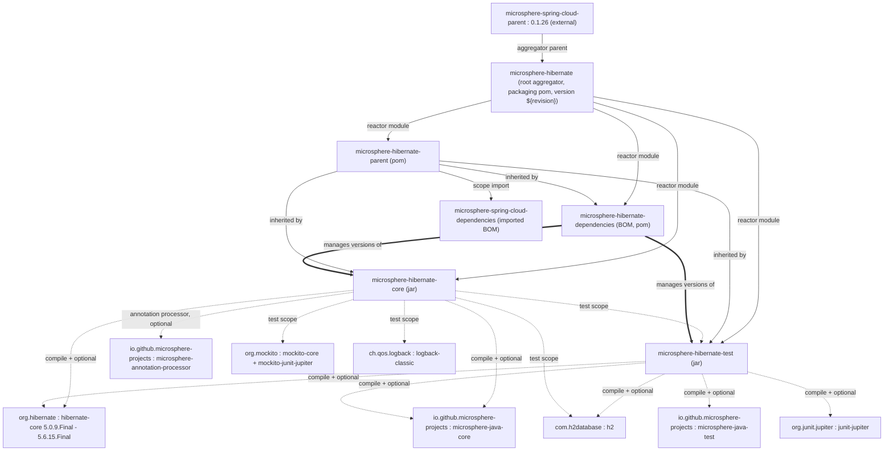
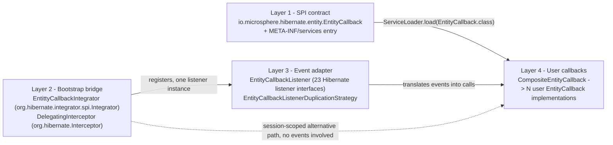

# Microsphere Hibernate — 开发者文档（1.x / 0.1.x）

本文档对应 [Microsphere Hibernate](https://github.com/microsphere-projects/microsphere-hibernate) 的
**0.1.x** 版本线，源码取自 `release-1.x` 分支（开发分支为 `dev-1.x`）。它面向**贡献者**：解释架构分层、逐类精读
源码、梳理设计模式、说明构建与 CI 机制，帮助你阅读、修改或扩展本代码库。

英文原版：[../README.md](../README.md)

> 建议阅读顺序：本索引 → [microsphere-hibernate-core.md](microsphere-hibernate-core.md)（运行期设计全在这里）→
> [microsphere-hibernate-test.md](microsphere-hibernate-test.md) → 两个 POM 模块文档。

文中所有源码引用（`File.java:line`）均以 **`release-1.x`** 分支为基准，例如
`microsphere-hibernate-core/src/main/java/io/microsphere/hibernate/entity/EntityCallbackListener.java:126`。

## 1. 这条分支为什么存在

0.1.x 是同一代码库面向 Hibernate 5 的维护线，其当前线（0.2.x）面向 Hibernate 6.2+/7.x。本分支的每个源文件都是
当前线源码的**分叉**，被改写为能在 **Hibernate ORM 5.0.9.Final … 5.6.15.Final + JDK 8** 上编译运行。上游对应的
提交信息就是 *"Adapt to older Hibernate APIs"*（`6e4254c`）。

| **项目** | **取值（1.x）** |
|---|---|
| 分支 / 版本线 | `release-1.x` / `0.1.x` |
| 开发中版本 | `0.1.11-SNAPSHOT`（根 `pom.xml` 的 `revision` 属性） |
| 根聚合 POM | `io.github.microsphere-projects:microsphere-hibernate`（packaging `pom`） |
| 继承的上游父 POM | `io.github.microsphere-projects:microsphere-spring-cloud-parent:0.1.26` |
| Hibernate 坐标 | `org.hibernate:hibernate-core`（Hibernate 5 的 groupId，**不是** `org.hibernate.orm`） |
| 持久化 API | `javax.persistence`（**不是** `jakarta.persistence`） |
| Java 基线 | JDK 8（CI matrix 中的 `java: ['8']`） |
| Maven Wrapper | `mvnw` / `mvnw.cmd` → Apache Maven 3.9.15（`wrapperVersion=3.3.4`、`distributionType=only-script`） |

## 2. 开发环境

### 2.1 工具链要求

| **工具** | **版本** |
|---|---|
| JDK | **8** 为权威基线；CI 同时覆盖 JDK 11 / 17 / 21 / 25（见 §3.2）。`hibernate-5.0` … `hibernate-5.2` 仅在 JDK 8 上验证 |
| Maven | 由 wrapper 提供（`./mvnw`、`mvnw.cmd`），Apache Maven **3.9.15**，无需本机安装 |
| Git | `git clone -b release-1.x https://github.com/microsphere-projects/microsphere-hibernate.git` |

### 2.2 构建命令

```bash
# 整个 reactor 构建（默认 profile => hibernate-5.6）
./mvnw clean install

# CI 友好的版本覆盖（reactor 内所有模块使用 <version>${revision}</version>）
./mvnw -Drevision=0.1.11-SNAPSHOT clean install

# 针对某个 Hibernate 5 版本跑测试
./mvnw -Phibernate-5.4 clean test

# GitHub Actions（JDK 8 matrix）实际执行的命令
./mvnw --batch-mode --update-snapshots --file pom.xml -Drevision=0.0.1-SNAPSHOT test \
  --activate-profiles test,coverage,spring-cloud-hoxton,hibernate-5.6
```

贡献者须知：

- `test` 与 `coverage` profile **继承自上游 Microsphere 父 POM**（surefire + JaCoCo 配置）；`coverage` 的产物用于
  上传 Codecov（`codecov.io/gh/microsphere-projects/microsphere-hibernate`，徽章指向 `dev-1.x`）。
- 在 JDK 9+ 上构建时，`java9+` profile（由 `<jdk>[9,)</jdk>` 激活）会为 `microsphere-hibernate-core` 与
  `microsphere-hibernate-test` 追加 `javax.xml.bind:jaxb-api`，因为 Hibernate 5.x 仍需要被 JDK 移除的 JAXB 类。
- 在 `microsphere-hibernate-core` 目录里单独 `mvn test` 需要先构建 `microsphere-hibernate-test`（它以 `test`
  scope 依赖后者）；在 reactor 中构建时 Maven 会自动排序。

### 2.3 模块一览

| **模块** | **Packaging** | **内容** | **开发者文档** |
|---|---|---|---|
| `microsphere-hibernate-parent` | `pom` | Hibernate 5 版本锚定、BOM 导入、7 个 `hibernate-5.x` profile | [microsphere-hibernate-parent.md](microsphere-hibernate-parent.md) |
| `microsphere-hibernate-dependencies` | `pom` | 项目 BOM：钉住 `microsphere-hibernate-core` 与 `microsphere-hibernate-test` | [microsphere-hibernate-dependencies.md](microsphere-hibernate-dependencies.md) |
| `microsphere-hibernate-core` | `jar` | `EntityCallback` SPI、`Integrator`、事件监听器、重复策略、`DelegatingInterceptor`、常量 | [microsphere-hibernate-core.md](microsphere-hibernate-core.md) |
| `microsphere-hibernate-test` | `jar` | JUnit 5 `HibernateExtension`、`@HibernateTest` / `@HibernateRuntime`、抽象 H2 测试基类、示例实体 | [microsphere-hibernate-test.md](microsphere-hibernate-test.md) |

### 2.4 模块依赖总图



图中蕴含的关键事实：

- `microsphere-hibernate-core` 只在 **`test` scope** 依赖 `microsphere-hibernate-test`
  （见 `microsphere-hibernate-core/pom.xml`），core 的测试因此复用注解驱动的 H2 harness；由于 test 模块从不依赖
  core，二者不构成循环。
- 所有"生产"依赖都是 `<optional>true</optional>` —— 使用者必须自己提供 `hibernate-core` 与
  `microsphere-java-core`。集成契约见[用户文档](../../user-guide/zh/README.md)。

## 3. 架构总览

### 3.1 分层

core 模块是 Hibernate 事件引擎与应用代码之间的四层桥接：



- **第 1 层**是应用开发者实现的接口。
- **第 2 层**是 Hibernate ORM 唯一会自行发现/接管的代码：通过
  `META-INF/services/org.hibernate.integrator.spi.Integrator` 发布的 `Integrator`，以及 1.x 线为
  *session 作用域*拦截保留的 `Interceptor` 装饰器。
- **第 3 层**用**一个**监听器对象把 23 个 `EventType` 适配到 23 个 `EntityCallback` 方法。
- **第 4 层**把一个事件扇出给全部被发现的回调，顺序由 `Prioritized` 决定。

### 3.2 持续集成 profiles

| **Workflow** | **文件** | **触发** | **JDK** | **Hibernate profiles** | **Spring Cloud profiles** |
|---|---|---|---|---|---|
| Maven Build | `.github/workflows/maven-build.yml` | `dev-1.x` push/PR，`release-1.x` PR | 8 | `hibernate-5.6`、`5.5`、`5.4`、`5.3`、`5.2`、`5.1`、`5.0` | `spring-cloud-hoxton`、`spring-cloud-2020`、`spring-cloud-2021` |
| Maven Build (Java 11+) | `.github/workflows/maven-build-java11+.yml` | `dev-1.x` push/PR，`release-1.x` PR | 11、17、21、25 | `hibernate-5.6`、`5.5`、`5.4`、`5.3` | 同上 |
| Maven Publish | `.github/workflows/maven-publish.yml` | `release-1.x` push，或 `workflow_dispatch` 传入 `revision`（`major.minor.patch`） | 17 | 默认（`hibernate-5.6`） | —（使用 `publish,ci`） |
| Sync branches from upstream | `.github/workflows/sync-branches-from-upstream.yml` | 定时 / 手动 | — | — | — |

构建 matrix 就是兼容性承诺的**可执行规格**：对 `microsphere-hibernate-core` 的任何改动都必须在 JDK 8 上、
针对 `hibernate-core` **5.0.9.Final** 仍然可编译。这正是本分支若干方法看起来"多余"的原因（见
[core 文档第 6 节](microsphere-hibernate-core.md#6-hibernate-5-api-适配点)）。

## 4. 与 0.2.x（当前线）架构差异

两条线同源；`release-1.x` 是向 Hibernate 5 回移（back-port）后的结果。阅读两分支 diff 时对照下表。

| **主题** | **1.x（`release-1.x`）** | **0.2.x（`release` / `main`）** | **原因** |
|---|---|---|---|
| `DelegatingInterceptor` | **存在**，`io.microsphere.hibernate.DelegatingInterceptor`（165 行）+ `DelegatingInterceptorTest` | **已删除**（提交 *"Remove upsert callbacks and DelegatingInterceptor"*） | Hibernate 5 的 `Interceptor` 全部方法都是抽象方法，且签名是 `Serializable id` / `EntityMode` / 裸 `Iterator`；不做委托基类就得重写约 18 个方法。迁到 6.x 需要再补一套 `Object id`/`RepresentationMode` 覆写，因此当前线把它删掉了 |
| 实现的 `Integrator` 方法 | 只有 `integrate(Metadata, SessionFactoryImplementor, SessionFactoryServiceRegistry)` | 额外实现 `integrate(Metadata, BootstrapContext, SessionFactoryImplementor)` 并转调三参版本 | 三参形态在 Hibernate 5.x 是抽象方法；6.2+ 引入 `BootstrapContext` 形态并把旧形态保留为 deprecated `default` 方法 |
| 监听器级联上下文参数 | 裸 `Map` / `Set`（`onDelete(DeleteEvent, Set)`、`onPersist(PersistEvent, Map)`、`onMerge(MergeEvent, Map)`、`onRefresh(RefreshEvent, Map)`） | 类型化上下文（`DeleteContext`、`PersistContext`、`MergeContext`、`RefreshContext`） | Hibernate 6 用上下文对象替换了这些临时 Map |
| `PersistentCollection` | 裸类型 | `PersistentCollection<?>` | 该类型在 Hibernate 6 才泛型化 |
| `EntityCallback#onLoad` | 7 个参数，无 `readOnly` | 8 个参数，含 `Boolean readOnly` | Hibernate 5 的 `LoadEvent` 没有 `getReadOnly()` |
| `requiresPostCommit*` | **同时存在** `requiresPostCommitHanding`（带 `@Override`）与 `requiresPostCommitHandling` | 只有 `requiresPostCommitHandling` | Hibernate 5 沿用了历史上的拼写错误 `Handing`，Hibernate 6 改为 `Handling`；两个都声明可让同一份源码在 matrix 全版本编译 |
| upsert 事件 | 不存在 | 两条线现在都不存在（`PreUpsert`/`PostUpsert` 随 Hibernate 6 专属的 upsert 事件一起被移除） | Hibernate 5 没有 upsert 的 `EventType` |
| `PropertyConstants` | 常量与取值完全相同 | 相同 | 纯字符串常量，不涉及 Hibernate API |
| 测试模块使用的 JPA 注解 | `javax.persistence.Entity` | `jakarta.persistence.Entity` | 跟随目标 Hibernate 大版本的 JPA 命名空间 |
| 测试模块 `StatelessSession` 关闭判定 | `if (statelessSession != null)` | `if (statelessSession != null && statelessSession.isOpen())` | `isOpen()` 判定是当前线后加上的 |
| `EntityCallbackListenerTest` | **不存在**（监听器通过 `EntityCallbackIntegratorTest` 间接覆盖） | 存在（`testRequiresPostCommitHandling`） | 1.x 监听器暴露的是拼写错误版本，当前线的单测无法原样搬过来 |

## 5. 文档索引

| **文件** | **范围** |
|---|---|
| [README.md](README.md) | 本索引：工具链、模块总图、分层、CI profiles、1.x 与 0.2.x 差异 |
| [microsphere-hibernate-parent.md](microsphere-hibernate-parent.md) | 父 POM 解剖：`revision`、`dependencyManagement`、`hibernate-5.0 … 5.6` profiles、如何新增版本 |
| [microsphere-hibernate-dependencies.md](microsphere-hibernate-dependencies.md) | BOM 模块：受管制品、flatten/CI 友好版本、扩展清单 |
| [microsphere-hibernate-core.md](microsphere-hibernate-core.md) | **源码精读**：SPI、Integrator 引导时序、监听器映射表、重复策略、`DelegatingInterceptor` 委托链、设计模式、Hibernate 5 适配点、测试 |
| [microsphere-hibernate-test.md](microsphere-hibernate-test.md) | JUnit 5 扩展内部机制：Store 分层、注入规则、bootstrap 配置构建、抽象测试基类、示例实体模型 |
| `zh/` | 以上五篇的中文镜像，一一对应（即本目录） |

## 6. 源码定位

```
microsphere-hibernate-core/src/main/java/io/microsphere/hibernate/
├── DelegatingInterceptor.java                     # Interceptor 装饰器（仅 1.x）
├── constants/PropertyConstants.java               # "microsphere.hibernate.*" 属性命名空间
└── entity/
    ├── EntityCallback.java                        # SPI 契约，23 个 default 方法
    ├── CompositeEntityCallback.java               # 扇出（public）
    ├── EntittyCallbackIntegrator.java             # Hibernate 5 Integrator（注意拼写："Entitty"）
    ├── EntityCallbackListener.java                # package-private，23 接口适配器
    └── EntityCallbackListenerDuplicationStrategy.java  # package-private，KEEP_ORIGINAL

microsphere-hibernate-core/src/main/resources/META-INF/services/
└── org.hibernate.integrator.spi.Integrator        # -> io.microsphere.hibernate.entity.EntittyCallbackIntegrator

microsphere-hibernate-test/src/main/java/io/microsphere/hibernate/test/
├── HibernateTest.java                             # @ExtendWith(HibernateExtension.class) 元注解
├── HibernateRuntime.java                          # 注入标记（FIELD、PARAMETER）
├── HibernateExtension.java                        # JUnit 5 生命周期 + 参数解析
├── AbstractHibernateTest.java                     # package-private 模板方法基类
├── AbstractHibernateH2Test.java                   # public H2 基类，内含 @Nested Session / Stateless 测试
└── entity/{User,UserProfile,Order,Product}.java   # javax.persistence 示例实体图
```

## 7 相关文档

- 用户文档（1.x）：[../../user-guide/zh/README.md](../../user-guide/zh/README.md)
- 当前线开发者文档：[../../../current/developer-guide/zh/README.md](../../../current/developer-guide/zh/README.md)
- 仓库 README：[../../../../README.md](../../../../README.md) · [发布说明](../../../../release-notes.md)
