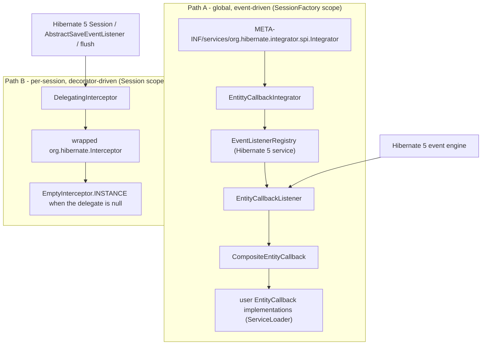
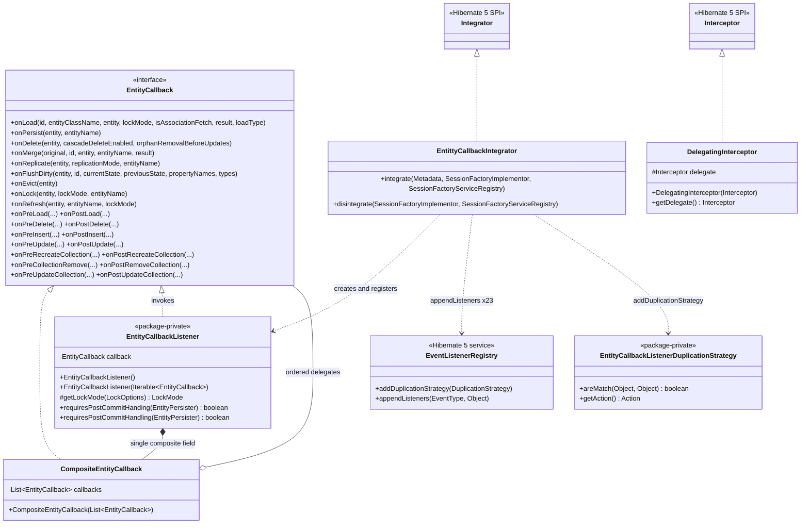
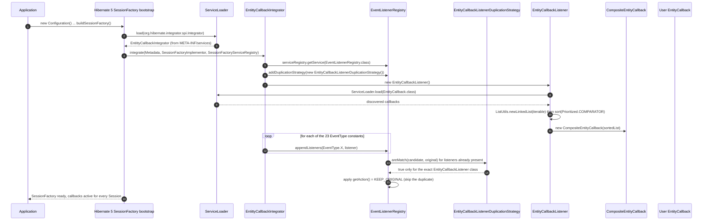
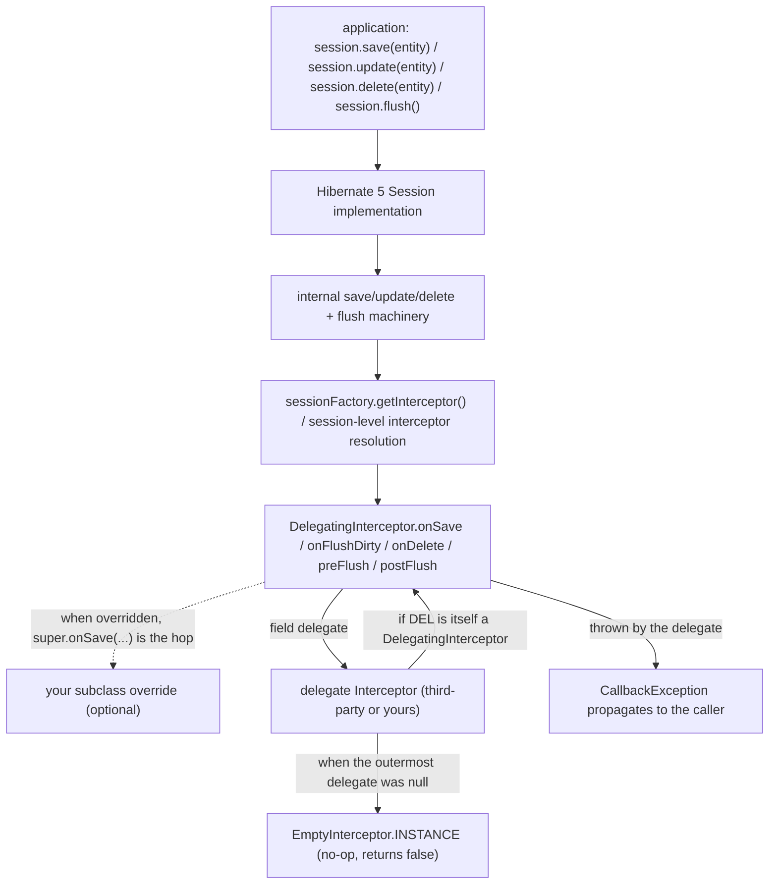
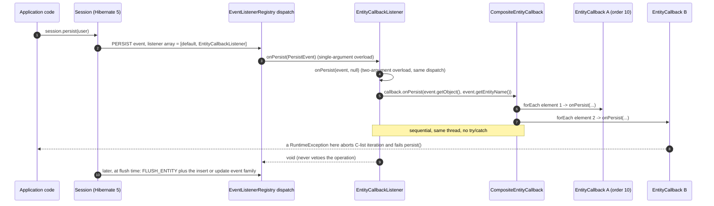

# microsphere-hibernate-core — 开发者文档（1.x）

制品：`io.github.microsphere-projects:microsphere-hibernate-core` · Packaging：`jar`
源码：`microsphere-hibernate-core/`（分支 `release-1.x`）· 目标：Hibernate ORM **5.0.9.Final – 5.6.15.Final** + **JDK 8**
英文版：[../microsphere-hibernate-core.md](../microsphere-hibernate-core.md)

本模块就是产品本身：6 个生产类 + 1 个 SPI 资源，在 Hibernate 5 事件引擎之上实现了基于 `ServiceLoader` 的实体生命
周期回调模型；另外 1 个类对外提供了可复用的 `Interceptor` 装饰器。

## 1. 模块事实

| **方面** | **取值** |
|---|---|
| parent | `microsphere-hibernate-parent`（`${revision}` = `0.1.11-SNAPSHOT`） |
| 编译依赖（全部 `optional`） | `org.hibernate:hibernate-core`、`io.github.microsphere-projects:microsphere-java-core`、`io.github.microsphere-projects:microsphere-annotation-processor` |
| 测试依赖 | `junit-jupiter`、`mockito-core`、`mockito-junit-jupiter`、`com.h2database:h2`、`ch.qos.logback:logback-classic`，以及 `test` scope 的 `io.github.microsphere-projects:microsphere-hibernate-test` |
| JDK 9+ | `java9+` profile → 可选 `javax.xml.bind:jaxb-api` |
| 发布的 SPI | `src/main/resources/META-INF/services/org.hibernate.integrator.spi.Integrator` → `io.microsphere.hibernate.entity.EntittyCallbackIntegrator` |
| 公开 API 包 | `io.microsphere.hibernate`、`io.microsphere.hibernate.entity`、`io.microsphere.hibernate.constants` |
| 内部（package-private）API | `EntityCallbackListener`、`EntityCallbackListenerDuplicationStrategy` |

`hibernate-core` 是 `optional` 的，因此本模块**没有任何**依赖会传递到使用方：启用回调能力的应用，运行期必须自行
提供 `microsphere-java-core`（`ListUtils`、`Prioritized`、`Wrapper`、`@Nullable`、`io.microsphere.logging` 都来自
它）以及 `hibernate-core`。

## 2. 架构

### 2.1 两条互相独立的集成路径



- **路径 A** 自动发现：把 jar 放进 classpath，就等于为 JVM 内**每一个** `SessionFactory` 安装了回调能力。状态是
  共享的，每个 `SessionFactory` 一个监听器实例。
- **路径 B** 显式且**按 Session 生效**：在 1.x 线上 `DelegatingInterceptor` 与 `EntityCallback` **完全没有关联**，
  它是一个独立构件，服务于"装饰既有 interceptor"或"回调需要限定在单个 session/工作单元内"的场景。

### 2.2 类清单

| **类** | **可见性** | **实现** | **行数** | **职责** |
|---|---|---|---|---|
| `entity/EntityCallback` | public | —（接口） | 410 | SPI 契约：23 个 `default` 空实现方法 |
| `entity/CompositeEntityCallback` | public | `EntityCallback` | 178 | 把一次回调调用扇出给一个有序委托列表 |
| `entity/EntityCallbackListener` | **package-private** | 23 个 Hibernate `*EventListener` 接口 | 376 | 把 Hibernate 事件翻译为 `EntityCallback` 调用 |
| `entity/EntittyCallbackIntegrator` | public | `org.hibernate.integrator.spi.Integrator` | 142 | 为 23 个 `EventType` 注册监听器 + 注册重复策略 |
| `entity/EntityCallbackListenerDuplicationStrategy` | **package-private** | `org.hibernate.event.service.spi.DuplicationStrategy` | 72 | 阻止重复注册，保留首个监听器 |
| `DelegatingInterceptor` | public | `org.hibernate.Interceptor`、`io.microsphere.lang.DelegatingWrapper` | 165 | 空安全的拦截器委托基类 |
| `constants/PropertyConstants` | public | —（常量接口） | 75 | `microsphere.hibernate.` 属性命名空间 |

### 2.3 类关系



## 3. 引导注册：监听器是如何挂上去的



相关源码：`EntittyCallbackIntegrator.java:89-137`（注册流程）、`EntityCallbackListener.java:143-157`（回调发现
与排序）、`EntityCallbackListenerDuplicationStrategy.java:56-71`。

维护者须知：

- integrator 是**按 `SessionFactory` 实例化**的，因此 `ServiceLoader.load(EntityCallback.class)` 每个工厂执行一次。
  同一 JVM 内多个工厂会得到每工厂一份 listener + composite，但回调**类**相同（`ServiceLoader` 通过无参构造新建
  实例，引导期使用的是当时的线程上下文 ClassLoader）。
- `disintegrate(...)`（`EntittyCallbackIntegrator.java:139-141`）是刻意留空的：监听器活在 `EventListenerRegistry`
  里，随 `SessionFactory` 服务注册表一起销毁。
- `integrate()` 中的注册顺序**不等于** `EntityCallback` 方法的声明顺序，而是 `EntittyCallbackIntegrator.java:98-135`
  里 `EventType` 的罗列顺序。新增事件类型意味着同时改两处：加一行 `appendListeners`，并把对应接口加到
  `EntityCallbackListener`。

## 4. 源码精读

### 4.1 `EntityCallback` —— SPI 契约

`microsphere-hibernate-core/src/main/java/io/microsphere/hibernate/entity/EntityCallback.java`

- 纯接口，**23 个 `default` 方法全部是空实现**（`EntityCallback.java:129-409`）。实现类只覆盖自己关心的事件，
  既让用户代码保持简短，也让 SPI 具备前向兼容：接口以后加方法不会破坏已有实现。
- 每个参数都是 Hibernate 5 形态：`Object id`（而非 `Serializable`）、`String entityClassName`、
  `org.hibernate.LockMode`、`org.hibernate.ReplicationMode`、`org.hibernate.type.Type[]`、
  `org.hibernate.event.spi.LoadEventListener.LoadType` —— 也就是说接口签名与 Hibernate 5 **类型**耦合，但**不**与任何
  Hibernate 事件类耦合。这正是 `CompositeEntityCallback` 得以在整个 5.x 区间内保持版本无关的原因。
- 无返回值：全部 `void`。回调既不能否决也不能改写事件——Hibernate 自有 `PreInsertEventListener#onPreInsert` 的
  "是否已由我处理"语义在监听器层被吸收掉了（见 §4.3）。
- **相较 0.2.x 线的刻意取舍**：`onLoad` 没有 `readOnly` 参数；完全没有 upsert（`onPreUpsert` / `onPostUpsert`）方法。

Javadoc 备注：`CompositeEntityCallback` 的 `<h3>Example Usage</h3>`（第 41-42 行）仍写着 0.2.x 的 8 参
`onLoad(..., result, readOnly, loadType)` 调用；1.x 的 `onLoad` 是 7 参（`EntityCallback.java:129`）。它只是文档，
不影响编译，但下次触碰该文件时值得一并修正。

### 4.2 `CompositeEntityCallback` —— 扇出

`.../entity/CompositeEntityCallback.java:49-178`

- 持有 `private final List<EntityCallback> callbacks`（第 51 行），通过**public** 构造器注入（第 59 行）。没有做
  防御性拷贝：列表按原样迭代，构造后修改列表会影响分发——目前内部只用于传入一个刚建好且已排序的列表。
- 每个 override 都是一行：`forEach(this.callbacks, callback -> callback.onXxx(...))`，`forEach` 来自
  `io.microsphere.collection.ListUtils`（第 27 行静态导入），是 `microsphere-java-core` 提供的空安全迭代工具——
  也就是**列表为 null 可容忍**，而列表里出现 **null 元素**则会在分发时抛 `NullPointerException`。
- 分发严格**顺序、同步**：回调在触发 Hibernate 事件的那个线程上按列表顺序逐个执行。
- **全程没有 `try`/`catch`。** 若第 n 个回调抛异常，第 n+1 到末尾的回调会被跳过，异常穿过监听器回到 Hibernate 事件
  引擎，从而使正在执行的 `persist`/`load`/`flush` 失败。这是文档化行为，请勿"悄悄优化"——有的应用正是依赖审计
  回调失败来回滚事务。

### 4.3 `EntityCallbackListener` —— Hibernate 5 适配层

`.../entity/EntityCallbackListener.java:126-376` · **package-private**（第 126 行就是 `class`）

```java
class EntityCallbackListener implements LoadEventListener, PersistEventListener, MergeEventListener,
        DeleteEventListener, ReplicateEventListener, FlushEntityEventListener,
        EvictEventListener, LockEventListener, RefreshEventListener,
        PreLoadEventListener, PostLoadEventListener,
        PreDeleteEventListener, PostDeleteEventListener,
        PreUpdateEventListener, PostUpdateEventListener,
        PreInsertEventListener, PostInsertEventListener,
        PreCollectionRecreateEventListener, PostCollectionRecreateEventListener,
        PreCollectionRemoveEventListener, PostCollectionRemoveEventListener,
        PreCollectionUpdateEventListener, PostCollectionUpdateEventListener {
```

一个类实现 23 个监听器接口——这就是整套设计的 Observer/Adapter 支点，并与
`EntittyCallbackIntegrator` 的 23 处 `EventType` 注册一一对应。

**构造**

| 构造器 | 行为 |
|---|---|
| `EntityCallbackListener()`（第 143 行） | `this(load(EntityCallback.class))` —— 即用 `java.util.ServiceLoader.load`，走**线程上下文** ClassLoader |
| `EntityCallbackListener(Iterable<EntityCallback>)`（第 153 行） | `ListUtils.newLinkedList(callbacks)` → `sort(Prioritized.COMPARATOR)` → `new CompositeEntityCallback(list)` |

按 `io.microsphere.lang.Prioritized.COMPARATOR` 排序意味着实现了 `Prioritized` 的类会按 `getOrder()`（小者在前）
获得显式顺序；由于用的是 Microsphere 通用比较器，排序语义与生态其他模块一致。唯一的组合体存放在
`final` 字段 `private final EntityCallback callback`（第 137 行），因此该监听器除它之外没有状态，事实上不可变，
可以同时注册到多种事件类型上。

**事件 → 回调映射（完整）**

| **`EventType`** | **监听器方法（行号）** | **从事件中取出的数据** | **`EntityCallback` 方法** |
|---|---|---|---|
| `LOAD` | `onLoad(LoadEvent, LoadType)`（160） | `getEntityId()`、`getEntityClassName()`、`getInstanceToLoad()`、`getLockOptions()` → `LockMode`、`isAssociationFetch()`、`getResult()` | `onLoad`（7 参） |
| `PERSIST` | `onPersist(PersistEvent)`（176）/ `onPersist(PersistEvent, Map)`（181） | `getObject()`、`getEntityName()` | `onPersist` |
| `MERGE` | `onMerge(MergeEvent)`（186）/ `onMerge(MergeEvent, Map)`（191） | `getOriginal()`、`getRequestedId()`、`getEntity()`、`getEntityName()`、`getResult()` | `onMerge` |
| `DELETE` | `onDelete(DeleteEvent)`（166）/ `onDelete(DeleteEvent, Set)`（171） | `getObject()`、`isCascadeDeleteEnabled()`、`isOrphanRemovalBeforeUpdates()` | `onDelete` |
| `REPLICATE` | `onReplicate(ReplicateEvent)`（197） | `getObject()`、`getReplicationMode()`、`getEntityName()` | `onReplicate` |
| `FLUSH_ENTITY` | `onFlushEntity(FlushEntityEvent)`（202） | `getEntityEntry()` → `getId()`、`getLoadedState()`、`getPersister()`；`getPropertyValues()`；persister 的 `getPropertyNames()`/`getPropertyTypes()` | `onFlushDirty` |
| `EVICT` | `onEvict(EvictEvent)`（218） | `getObject()` | `onEvict` |
| `LOCK` | `onLock(LockEvent)`（223） | `getObject()`、`getLockOptions()` → `LockMode`、`getEntityName()` | `onLock` |
| `REFRESH` | `onRefresh(RefreshEvent)`（228）/ `onRefresh(RefreshEvent, Map)`（233） | `getObject()`、`getEntityName()`、`getLockOptions()` → `LockMode` | `onRefresh` |
| `PRE_LOAD` | `onPreLoad(PreLoadEvent)`（238） | `getEntity()`、`getId()`、`getState()`、persister 名称/类型 | `onPreLoad` |
| `POST_LOAD` | `onPostLoad(PostLoadEvent)`（250） | `getEntity()`、`getId()`、persister 名称/类型 | `onPostLoad` |
| `PRE_DELETE` | `onPreDelete(PreDeleteEvent)`（260） | `getEntity()`、`getId()`、`getDeletedState()`、persister 名称/类型 | `onPreDelete` —— 随后返回 `false` |
| `POST_DELETE` | `onPostDelete(PostDeleteEvent)`（271） | 同上访问器 | `onPostDelete` |
| `PRE_INSERT` | `onPreInsert(PreInsertEvent)`（281） | `getEntity()`、`getId()`、`getState()`、persister 名称/类型 | `onPreInsert` —— 随后返回 `false` |
| `POST_INSERT` | `onPostInsert(PostInsertEvent)`（292） | 同上访问器 | `onPostInsert` |
| `PRE_UPDATE` | `onPreUpdate(PreUpdateEvent)`（302） | `getEntity()`、`getId()`、`getState()`、persister 名称/类型 | `onPreUpdate` —— 随后返回 `false` |
| `POST_UPDATE` | `onPostUpdate(PostUpdateEvent)`（313） | 同上访问器 | `onPostUpdate` |
| `PRE_COLLECTION_RECREATE` | `onPreRecreateCollection`（323） | `getCollection()`、`collection.getKey()` | `onPreRecreateCollection` |
| `POST_COLLECTION_RECREATE` | `onPostRecreateCollection`（329） | 同上 | `onPostRecreateCollection` |
| `PRE_COLLECTION_REMOVE` | `onPreRemoveCollection`（335） | 同上 | `onPreCollectionRemove` |
| `POST_COLLECTION_REMOVE` | `onPostRemoveCollection`（341） | 同上 | `onPostRemoveCollection` |
| `PRE_COLLECTION_UPDATE` | `onPreUpdateCollection`（347） | 同上 | `onPreUpdateCollection` |
| `POST_COLLECTION_UPDATE` | `onPostUpdateCollection`（353） | 同上 | `onPostUpdateCollection` |

**改动前必须知道的约定**

- *返回 `boolean` 的 pre 事件一律返回 `false`*（`onPreDelete` 第 267 行、`onPreInsert` 第 288 行、`onPreUpdate`
  第 309 行）。在 Hibernate 5 里 `true` 的含义是*"我已自行处理该 SQL，跳过原操作"*——监听器从不声称这一点，因此
  回调是纯观察者，数据库写入一定会继续。想否决插入不能走这条路径，请用 `DelegatingInterceptor` 或自建监听器。
- *`requiresPostCommit*` 恒为 `false`* —— 见下面的双声明。
- *空值处理*：完全没有，且是刻意的。`event.getPersister()`、`event.getEntityEntry()`（`onFlushEntity` 第 203 行
  立刻解引用）与 `event.getLockOptions()` 都被假定为非 null，这对 Hibernate 自身构造的这些事件是成立的。集合事件
  同样假定 `event.getCollection()` 非 null（否则第 325 行的 `collection.getKey()` 会 NPE）。
- *异常处理*：不做任何捕获；`HibernateException` 只出现在 Hibernate 接口本身声明了它的方法上
  （`throws HibernateException`），集合事件与 `Pre*`/`Post*` 覆写不声明异常。
- *状态数据*：`Object[] state`、`previousState` 与 `String[] propertyNames` 是**按引用**交出的。`EntityCallback` 的
  Javadoc（如第 184、235、264 行）明确不鼓励修改；`onFlushDirty` 更是把 `entry.getLoadedState()` 作为
  `previousState` 传出，那正是 `EntityEntry` 中装载期状态的活引用。

**两个 `requiresPostCommit…` 方法**（`EntityCallbackListener.java:358-365`）

```java
@Override
public boolean requiresPostCommitHanding(EntityPersister persister) {
    return false;
}

public boolean requiresPostCommitHandling(EntityPersister persister) {
    return false;
}
```

前者是 Hibernate 5 中 `PostActionEventListener` 声明的方法名（历史上拼写错误的那个），后者是 Hibernate 6 采用的
正确拼写。在本分支上只有第一个能带 `@Override`；第二个是普通的 public 方法，让这个类在两个方向上都保持源码兼容
——同一份监听器代码在本分支编译于 5.x，在当前线编译于 6.x/7.x，而当前线的 `EntityCallbackListenerTest` 断言的
正是第二个方法。

**扩展点**：`protected LockMode getLockMode(LockOptions)`（第 373 行）是唯一非接口方法，子类可覆写锁模式提取。
但该类是 package-private，因此实际上这是内部缝隙（子类必须也放在 `io.microsphere.hibernate.entity` 包内）。

### 4.4 `EntittyCallbackIntegrator` —— 引导桥接

`.../entity/EntittyCallbackIntegrator.java:79-142` · public

- `integrate(Metadata, SessionFactoryImplementor, SessionFactoryServiceRegistry)` —— Hibernate 5 的抽象签名；本分支
  第 89 行**没有** `@Override`，而第 139 行的 `disintegrate` 有。
- 一次服务查询、一个策略、一个监听器、23 次注册（第 90-135 行）—— 见 §3。
- 不做任何过滤：即使 `ServiceLoader` **没有**发现任何 `EntityCallback` 实现，监听器依然会为全部 23 个事件类型注册，
  于是每个事件都会执行一次空的 `CompositeEntityCallback`。这是不读开关的代价——见 `PropertyConstants` 一节：
  `microsphere.hibernate.enabled` 属性在本分支被声明但**从未被读取**。
- 类名有拼写错误（`Entitty`），而且这个错误是**已发布契约的一部分**，因为
  `META-INF/services/org.hibernate.integrator.spi.Integrator` 的内容正是
  `io.microsphere.hibernate.entity.EntittyCallbackIntegrator`。因此改名必须在同一次提交里改掉那个一行文件；该文件
  没有结尾换行符，无害但会让朴素的文本匹配脚本踩坑。

### 4.5 `EntityCallbackListenerDuplicationStrategy` —— 幂等保障

`.../entity/EntityCallbackListenerDuplicationStrategy.java:45-72` · **package-private**

```java
public boolean areMatch(Object listener, Object original) {
    Class<?> listenerClass = listener.getClass();
    return Objects.equals(listenerClass, original.getClass())
            && EntityCallbackListener.class.equals(listenerClass);
}

public Action getAction() {
    return KEEP_ORIGINAL;
}
```

- 当向已经存在监听器的事件类型追加监听器时，Hibernate 会咨询已注册的策略。`Action.KEEP_ORIGINAL` 表示保留已注册
  的那个、丢弃新来的，因此第二次 `integrate()`（例如手动注册了一个 `EntittyCallbackIntegrator`，同时又有一个由
  SPI 自动发现的；或者同一注册表被应用了两次 integrator）不会把每次回调调用重复一遍。
- 匹配是**双向精确类身份**：`Objects.equals(listenerClass, original.getClass())` 且
  `EntityCallbackListener.class.equals(listenerClass)`。推论：(a) 用户自定义的 `EntityCallbackListener` 子类
  **不会**被去重；(b) 两个不同的 Microsphere 监听器类之间不会互相抵消。单测
  `EntityCallbackListenerDuplicationStrategyTest.testAreMatch` 正是钉住这些行为，并用
  `DefaultLoadEventListener` 作为反例。
- 该策略无状态、构造零开销；`integrate()` 每次都新建实例，而不是缓存到 static 字段。

### 4.6 `DelegatingInterceptor` —— Hibernate 5 拦截器装饰器

`microsphere-hibernate-core/src/main/java/io/microsphere/hibernate/DelegatingInterceptor.java:56-165` · public，
**仅 1.x 存在**

```java
public class DelegatingInterceptor implements Interceptor, DelegatingWrapper {
    protected final Interceptor delegate;

    public DelegatingInterceptor(@Nullable Interceptor delegate) {
        this.delegate = delegate == null ? INSTANCE : delegate;   // INSTANCE == org.hibernate.EmptyInterceptor.INSTANCE
    }
```

这里编码了四个设计决定：

1. **入参可空，字段恒非空。** 构造器把 `null` 归一化为 `EmptyInterceptor.INSTANCE`（第 30 行的静态导入），于是所有
   委托方法都不需要判空，子类也可以放心调用 `super.onXxx(...)`。由
   `DelegatingInterceptorTest.testConstructorWithNullDelegate` 验证。
2. **`protected final` 字段 + `getDelegate()`**（第 58、161-164 行）。子类直接读字段，外部调用者走
   `DelegatingWrapper` API。
3. **直接 `implements Interceptor`，不继承 `EmptyInterceptor`。** Hibernate 5 的 `Interceptor` 是一个约 18 个方法
   全为抽象方法、且 `id`/`key` 参数为 `Serializable` 的接口，没有 `default` 方法可依赖——这正是 1.x 必须有此类、而
   它无法原样搬到 Hibernate 6 的根本原因。同时实现 `DelegatingWrapper`，从 `io.microsphere.lang.Wrapper` 获得
   `unwrap(Class)` / `isWrapperFor(Class)` 的默认实现，使调用方能够穿透任意深度的装饰器栈。
4. **纯委托，一跳直达。** 每个方法都是单行 `return delegate.onXxx(...)` 或 `delegate.onXxx(...)`：不打日志、不拷贝
   数组、不做异常翻译。`CallbackException` 只在 Hibernate 接口声明它的地方出现（`onLoad`、`onFlushDirty`、
   `onSave`、`onDelete`、集合钩子、`instantiate`、`getEntityName`、`getEntity`、`preFlush`、`postFlush`），而
   `isTransient`、`findDirty`、三个事务钩子和 `onPrepareStatement` 不声明。

**钩子清单（本分支的委托形态）**

| **类别** | **方法**（行号） | **返回约定** |
|---|---|---|
| 实体状态 | `onLoad`（71）、`onFlushDirty`（76）、`onSave`（81）、`onDelete`（86） | 前三个的 `boolean` 表示"状态数组是否被改写"；`onDelete` 为 `void` |
| 集合状态 | `onCollectionRecreate`（91）、`onCollectionRemove`（96）、`onCollectionUpdate`（101） | `void` |
| Flush 生命周期 | `preFlush`（106）、`postFlush`（111） | `void`，参数是裸 `Iterator entities`（Hibernate 5 没有 `Iterator<Object>`） |
| 瞬态判定 / 脏字段探测 | `isTransient`（116）、`findDirty`（121） | `Boolean`（可空的三态：`null` = 交给 Hibernate 判断）、`int[]`（可为 null） |
| 实例化 / 名称解析 | `instantiate(String, EntityMode, Serializable)`（126）、`getEntityName`（131）、`getEntity`（136） | `Object`（`getEntity` 可为 `null`）、`String` |
| 事务 | `afterTransactionBegin`（141）、`beforeTransactionCompletion`（146）、`afterTransactionCompletion`（151） | `void` |
| SQL | `onPrepareStatement(String)`（155-159） | `String`；标注了 `@Deprecated`（Hibernate 后续大版本以 `StatementInspector` 取代该钩子）——但因为 Hibernate 5 声明了它，这里必须实现 |

**在 `Session` 操作中的调用链**



由于 `DelegatingInterceptor` 只委托给**一个** delegate，"委托链"要靠嵌套获得：
`new DelegatingInterceptor(new DelegatingInterceptor(auditInterceptor))`；或者靠继承：在子类覆写后调用
`super.onXxx(...)`——第 36-49 行的 Javadoc 示例同时演示了包装形态与 `null` 兜底形态。

**如何接线**（使用方视角，为完整性列出）：

```java
// 按 session
Session session = sessionFactory.withOptions().interceptor(new DelegatingInterceptor(existing)).openSession();
// 或全局
configuration.setProperty("hibernate.session_factory.interceptor", MyDelegatingInterceptorSubclass.class.getName());
```

**注意事项**

- Hibernate 5 中 `Interceptor` 继承 `Serializable`；如果 session/interceptor 可能被序列化，`DelegatingInterceptor`
  的 delegate 也必须是可序列化的。`EmptyInterceptor.INSTANCE` 是可序列化的。
- interceptor 是**按 `Session`** 且单线程使用的，而 `EntityCallback` 机制是**按 `SessionFactory`** 且共享的。
  与单元工作相关的状态请放在 interceptor 里，不要放在回调里。
- `isTransient` 返回 `null`（原样转发）表示"回落到 Hibernate 自身的判断"——不要不假思索地在子类里把它强制改成
  `false`。

### 4.7 `PropertyConstants`

`.../constants/PropertyConstants.java:48-75`

| **常量** | **解析结果** | **定义位置** |
|---|---|---|
| `MICROSPHERE_HIBERNATE_PROPERTY_NAME_PREFIX` | `microsphere.hibernate.` | 第 53 行 |
| `DEFAULT_MICROSPHERE_HIBERNATE_ENABLED_PROPERTY_VALUE` | `"true"` | 第 58 行 |
| `DEFAULT_MICROSPHERE_HIBERNATE_ENABLED` | `true`（解析后的布尔） | 第 63 行 |
| `MICROSPHERE_HIBERNATE_ENABLED_PROPERTY_NAME` | `microsphere.hibernate.enabled` | 第 73 行 |

组合方式来自 `microsphere-java-core`：`MICROSPHERE_PROPERTY_NAME_PREFIX` + `"hibernate"` + `SymbolConstants.DOT`，
enabled 键再拼上 `ENABLED_PROPERTY_NAME`。该键带有
`@ConfigurationProperty(type = boolean.class, defaultValue = "true", source = SYSTEM_PROPERTIES_SOURCE)`，编译期由
`microsphere-annotation-processor`（本模块的 `optional` 依赖）生成配置元数据。

**`release-1.x` 现状**：该常量*只是声明*——`EntittyCallbackIntegrator` 并不读取它，其他生产类也不读取；模块内唯一
的引用是 `PropertyConstantsTest`。请把它当作一个文档化的扩展点，而不是可用的总开关（做法见 §8.3）。

## 5. 运行期：事件 → 用户回调转发



23 个事件类型都是同一个形状，差别只在于解包事件时使用哪些访问器（§4.3 映射表）。一次 `Session` 调用可能产生**多个**
事件（调用当下的实体事件，随后是 flush 期的 `FLUSH_ENTITY` 以及插入/更新那一族事件——具体集合取决于 Hibernate 5
的小版本、主键生成器以及是否经由 `StatelessSession`），而且 flush 期的钩子可能对"你的回调从未见过"的实体触发。
因此回调要按**顺序不敏感 + 幂等**来设计，不要假设每个实体都会严格走 `onPreXxx` → `onXxx` → `onPostXxx`。

## 6. Hibernate 5 API 适配点

这就是本分支存在的原因。下表中每一处都是 1.x 源码与 0.2.x 源码*有意*不同之处；任何一处被"改回去"都会让
`hibernate-5.0 … 5.6` matrix 的某一端编译或运行失败。

| **#** | **1.x 的适配写法** | **源码位置** | **Hibernate 5 事实** | **0.2.x 对应写法** |
|---|---|---|---|---|
| 1 | 只实现 `integrate(Metadata, SessionFactoryImplementor, SessionFactoryServiceRegistry)` | `EntittyCallbackIntegrator.java:89` | 这个三参形态在 5.x 是 `Integrator` 的抽象方法 | 同时实现 `integrate(Metadata, BootstrapContext, SessionFactoryImplementor)`（Hibernate 6.2+），并转调三参形态 |
| 2 | `disintegrate` 以 `@Override` 实现为空方法 | `EntittyCallbackIntegrator.java:139-141` | 在 5.x 是抽象方法，必须实现 | 同样实现，但被文档化为 no-op |
| 3 | 不 import `org.hibernate.boot.spi.BootstrapContext` | `EntittyCallbackIntegrator.java:20-25` | 该类型不属于 5.x 的 integrator 契约 | 当前线会 import |
| 4 | 裸 `Map` / `Set` 第二参数 | `EntityCallbackListener.java:171, 181, 191, 233` | `onDelete(DeleteEvent, Set)`、`onPersist(PersistEvent, Map)`、`onMerge(MergeEvent, Map)`、`onRefresh(RefreshEvent, Map)` | `DeleteContext` / `PersistContext` / `MergeContext` / `RefreshContext` |
| 5 | 裸 `PersistentCollection` | `EntityCallbackListener.java:324, 330, 336, 342, 348, 354` | Hibernate 5 中它不是泛型类 | `PersistentCollection<?>` |
| 6 | `onLoad` 不带 `readOnly` 参数 | `EntityCallbackListener.java:160-163`、`EntityCallback.java:129` | 5.x 的 `LoadEvent` 没有 `getReadOnly()` | 8 参 `onLoad(..., Boolean readOnly, LoadType)` |
| 7 | `requiresPostCommitHanding`（另加一个 `requiresPostCommitHandling`） | `EntityCallbackListener.java:358-365` | Hibernate 5 声明的是拼写错误的那个名字 | 只有 `requiresPostCommitHandling` |
| 8 | interceptor 使用 `Serializable` 主键、`EntityMode` 版 `instantiate`、裸 `Iterator` 的 flush 钩子 | `DelegatingInterceptor.java:71-128` | 这是 Hibernate 5 `Interceptor` 的签名 | 当前线已删除该类（6.x 是 `Object id`、`RepresentationMode`、`Iterator<Object>`，并新增 `onInsert`/`onUpdate`/`onUpsert`） |
| 9 | `onPrepareStatement(String)` 带 `@Deprecated` + `@Override` | `DelegatingInterceptor.java:155-159` | Hibernate 5 的 `Interceptor` 仍然声明它 | 后续由 `StatementInspector` 取代 |
| 10 | `javax.persistence.Entity`（测试模块）、`java9+` profile 下的 `javax.xml.bind:jaxb-api` | `microsphere-hibernate-test`、`microsphere-hibernate-core/pom.xml` | Java EE 命名空间时代 | `jakarta.persistence` |
| 11 | 无 upsert 回调 / `PreUpsert`、`PostUpsert` | `EntityCallback.java`、`EntittyCallbackIntegrator.java` | 5.x 没有 upsert 的 `EventType` | 当前线同样已移除 |

**从 `main` 向 `release-1.x` 移植修复的经验法则**：凡涉及事件类、`LoadEvent`、`PersistentCollection`、
`Interceptor`、`Integrator`、`PostActionEventListener` 的改动，合并前都要对照第 1-9 行逐条复核，然后至少针对
`hibernate-5.0` 与 `hibernate-5.6` 各跑一遍。

## 7. 设计模式

| **模式** | **落点** | **证据（行号）** | **说明** |
|---|---|---|---|
| **观察者（Observer，推送式）** | `EntityCallbackListener` 实现 23 个 Hibernate 监听器接口，Hibernate 是被观察主题 | `EntityCallbackListener.java:126-135`、注册 `EntittyCallbackIntegrator.java:98-135` | 一个具体观察者订阅多种事件类型；除组合体外无状态 |
| **组合（Composite）** | `CompositeEntityCallback` 实现 `EntityCallback` 并持有 `List<EntityCallback>` | `CompositeEntityCallback.java:49-61`，如 `onPersist` 第 69-71 行 | 叶子与组件同接口，可任意嵌套；每个方法都是纯扇出 |
| **适配器 / 包装器（Adapter）** | `EntityCallbackListener` 把 `*Event` 对象适配成 `EntityCallback` 的实参 | `EntityCallbackListener.java:202-215`（`FlushEntityEvent` + `EntityEntry` + `EntityPersister` → `onFlushDirty`） | 同时是"收窄"适配：Hibernate 接口返回的 `boolean` 否决位被压平为 `false` |
| **SPI（Service Provider Interface）** | `EntityCallback` + `META-INF/services/io.microsphere.hibernate.entity.EntityCallback`；`Integrator` + `META-INF/services/org.hibernate.integrator.spi.Integrator` | 资源文件本身、`EntityCallbackListener.java:144`（`load(EntityCallback.class)`） | 两层嵌套 SPI：Hibernate 发现 integrator，integrator 的监听器发现回调 |
| **策略（Strategy）** | `EntityCallbackListenerDuplicationStrategy implements DuplicationStrategy`（`areMatch` + `getAction`） | `EntityCallbackListenerDuplicationStrategy.java:56-71`，安装点 `EntittyCallbackIntegrator.java:93` | 把"重复监听器如何解决"的策略交给 Hibernate 注册表 |
| **委托 / 代理（Decorator）** | `DelegatingInterceptor` 把全部 `Interceptor` 钩子转发给 `delegate`，自身也是 `Interceptor`，并由 `DelegatingWrapper` 提供 `unwrap` | `DelegatingInterceptor.java:58, 66-68, 71-159, 161-164` | 以 Null Object（`EmptyInterceptor.INSTANCE`）兜底；子类覆写 + `super.onXxx(...)` 构成可扩展链条 |
| **模板方法（Template Method）** | `protected` 钩子 `getLockMode`（以及测试模块的 `AbstractHibernate*`） | `EntityCallbackListener.java:373` | 让事件解包保持可覆写 |
| **空对象（Null Object）** | `null` delegate → `EmptyInterceptor.INSTANCE` | `DelegatingInterceptor.java:67` | 让 18 个转发方法里一个判空都不需要 |

## 8. 贡献指南（配方）

### 8.1 支持再多一个 Hibernate 事件类型

1. `EntityCallback`：新增一个 `default` 空实现方法，签名必须是 Hibernate 5 安全的（优先 `Object id`、
   `String entityName`、`Object[] state`、`Type[]`，不要直接暴露事件类）——`EntityCallback.java`。
2. `EntityCallbackListener`：实现对应的 `*EventListener` 接口、加进 `implements` 列表、解包事件并转发给
   `this.callback`；若该接口方法返回 `boolean`，最后 `return false`（`EntityCallbackListener.java:126-320`）。
3. `CompositeEntityCallback`：补一行 `forEach` 覆写。
4. `EntittyCallbackIntegrator`：加 `eventListenerRegistry.appendListeners(NEW_EVENT_TYPE, listener)`。
5. 对照 §6 复核：该事件类及其访问器必须在 **5.0.9.Final** 就存在，而不是只在 5.6 有。
6. 补测试夹具：扩展 `TestEntityCallback`（它覆写了全部 23 个方法并以 `trace` 记录），并在
   `AbstractHibernateH2Test` 的嵌套 `SessionTest` / `StatelessSessionTest` 中触发新路径。
7. 跑完整 matrix（`./mvnw -Phibernate-5.0 test` … `hibernate-5.6`）。

### 8.2 编写 / 调试一个用户回调

```java
public class AuditingEntityCallback implements EntityCallback, Prioritized {
    @Override public int getOrder() { return 100; }              // 由 Prioritized.COMPARATOR 排序
    @Override public void onPostInsert(Object entity, Object id, Object[] state,
                                     String[] propertyNames, Type[] propertyTypes) {
        // 除非你确实希望 insert() 失败，否则不要在这里抛异常
    }
}
// src/main/resources/META-INF/services/io.microsphere.hibernate.entity.EntityCallback
// com.acme.AuditingEntityCallback
```

调试技巧：仿照 `TestEntityCallback` 注册一个 `trace` 级日志回调，并保留 `hibernate.show_sql=true`（H2 测试基类默认
就这么做）——回调日志与 SQL 交错输出，事件链一眼可读。

### 8.3 把 `microsphere.hibernate.enabled` 总开关接上

该属性存在（`PropertyConstants.java:73`）但目前不被理会。最小且对 matrix 安全的改法：

```java
// EntittyCallbackIntegrator#integrate 的第一条语句
boolean enabled = parseBoolean(System.getProperty(MICROSPHERE_HIBERNATE_ENABLED_PROPERTY_NAME,
        DEFAULT_MICROSPHERE_HIBERNATE_ENABLED_PROPERTY_VALUE));
if (!enabled) {
    return;
}
```

若真的加上，请同时跳过重复策略的注册（`addDuplicationStrategy` 也不要执行），并在用户文档写明该行为：禁用
integrator 会静默改变 `KEEP_ORIGINAL` 所假定的监听器拓扑。

### 8.4 本模块的代码风格约定

- 每个文件都有 ASF license 头；`@author <a href="mailto:mercyblitz@gmail.com">Mercy</a>` 与 `@since` 标签。
- public 类型的 Javadoc 都带 `<h3>Example Usage</h3>` 的 `{@code ...}` 示例（core 的六个类都遵循）。
- 大量使用静态导入：`EventType` 常量（`import static org.hibernate.event.spi.EventType.LOAD;` 等）以及 Microsphere
  工具（`ListUtils.newLinkedList`、`Prioritized.COMPARATOR`、`ServiceLoader.load`、`EmptyInterceptor.INSTANCE`）。
- 默认 package-private：公开的只有 `EntityCallback`、`CompositeEntityCallback`、`EntittyCallbackIntegrator`、
  `DelegatingInterceptor`、`PropertyConstants`。新增机制请保持内部可见性。
- 类名拼写错误（`EntittyCallbackIntegrator`）已经是发布面的一部分——不同步修改 `META-INF/services` 文件并在发布
  说明中记录，就不要"顺手修正"。

## 9. 本模块的测试

| **测试** | **位置** | **钉住的行为** |
|---|---|---|
| `DelegatingInterceptorTest` | `src/test/java/io/microsphere/hibernate/DelegatingInterceptorTest.java` | `@ExtendWith(MockitoExtension.class)` + `@Mock Interceptor`；每个钩子一个用例：null 委托 → `assertSame(INSTANCE, getDelegate())`；`onLoad`/`onFlushDirty`/`onSave` 的 `assertTrue`/`assertFalse` 透传；`onDelete`、三个集合钩子、`preFlush`/`postFlush`（用 `Collections.emptyIterator()`）、三个事务钩子用 `verify`；`findDirty`（`int[]`）与 `instantiate(..., EntityMode.POJO, 1L)` 用 `assertSame`；`isTransient` 返回 `Boolean.TRUE`；`onPrepareStatement` 往返（带 `@SuppressWarnings("deprecation")`）；`getDelegate()` 身份 |
| `EntityCallbackListenerDuplicationStrategyTest` | `.../entity/EntityCallbackListenerDuplicationStrategyTest.java` | `areMatch(listener, listener)` 为 `true`；与 `DefaultLoadEventListener` 任一组合均为 `false`；`getAction()` 为 `KEEP_ORIGINAL`。依赖同包访问 package-private 类 |
| `PropertyConstantsTest` | `.../constants/PropertyConstantsTest.java` | 四个常量的取值（`microsphere.hibernate.`、`"true"`、`true`、`microsphere.hibernate.enabled`） |
| `EntityCallbackIntegratorTest` | `.../entity/EntityCallbackIntegratorTest.java` | **方法体为空**，`extends AbstractHibernateH2Test` —— 整条 integrator → 监听器 → 回调链路通过继承来的嵌套 `SessionTest` / `StatelessSessionTest` 在内存 H2 上被完整跑一遍，`TestEntityCallback` 经 test scope 的 SPI 文件被发现 |
| `TestEntityCallback`（夹具，不是测试） | `.../entity/TestEntityCallback.java` | 覆写全部 23 个方法，先用 `io.microsphere.logging` 打 `trace` 再调用 `EntityCallback.super.onXxx(...)`；注册在 `src/test/resources/META-INF/services/io.microsphere.hibernate.entity.EntityCallback` |

覆盖模型与**未被覆盖**之处：本分支没有针对 `EntityCallbackListener` 的直接单测（当前线有
`EntityCallbackListenerTest`，但因 `Handing`/`Handling` 拼写差异无法照搬），其行为由
`EntityCallbackIntegratorTest` + `AbstractHibernateH2Test` 端到端断言。若你改动事件解包逻辑，请补一个监听器层的直接
单测，而不是依赖 H2 跑批——后者只保证"不抛异常"与 SQL 可见，不校验回调实参。

运行方式：

```bash
./mvnw -pl microsphere-hibernate-core -Phibernate-5.6 test
./mvnw -pl microsphere-hibernate-core -am -Phibernate-5.0 -Drevision=0.0.1-SNAPSHOT test   # 同时构建 microsphere-hibernate-test
```

## 10 下一步

- [microsphere-hibernate-test.md](microsphere-hibernate-test.md) —— 这些 H2 测试所依赖的 harness
- [microsphere-hibernate-parent.md](microsphere-hibernate-parent.md) —— `${hibernate.version}` 的来源
- 用户文档：[../../user-guide/zh/microsphere-hibernate-core.md](../../user-guide/zh/microsphere-hibernate-core.md) · 索引：[README.md](README.md)
