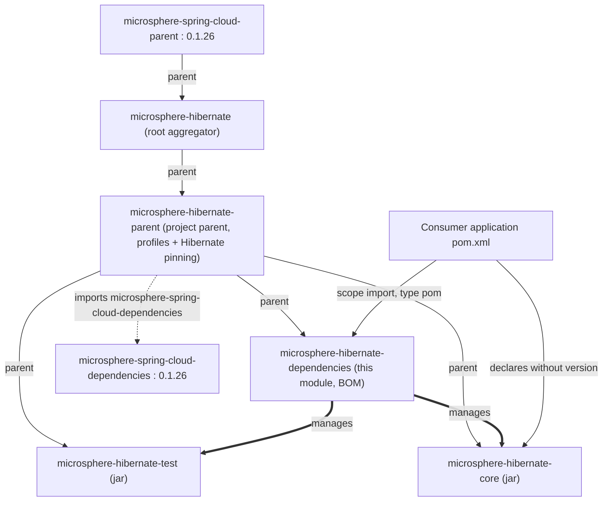

# microsphere-hibernate-dependencies — 开发者文档（1.x）

制品：`io.github.microsphere-projects:microsphere-hibernate-dependencies` · Packaging：`pom`
源码：`microsphere-hibernate-dependencies/pom.xml`（分支 `release-1.x`）
英文版：[../microsphere-hibernate-dependencies.md](../microsphere-hibernate-dependencies.md)

## 1. 定位

`microsphere-hibernate-dependencies` 是本项目的 **BOM**（Bill of Materials）。用户在自身工程的
`<dependencyManagement>` 中 import 它，从而让所有 Microsphere Hibernate 模块落在同一个自洽的版本线上。

它是仓库中最小的模块：一切从 `microsphere-hibernate-parent` 继承，自身只贡献一件事——为本项目发布的两个 jar 做
版本钉定。

```xml
<dependencyManagement>
    <dependencies>
        <dependency>
            <groupId>io.github.microsphere-projects</groupId>
            <artifactId>microsphere-hibernate-core</artifactId>
            <version>${revision}</version>
        </dependency>
        <dependency>
            <groupId>io.github.microsphere-projects</groupId>
            <artifactId>microsphere-hibernate-test</artifactId>
            <version>${revision}</version>
        </dependency>
    </dependencies>
</dependencyManagement>
```

## 2. 在 POM 层级中的位置



由于 BOM 是 `microsphere-hibernate-parent` 的**子 POM**，它把 Hibernate 版本钉定与
`microsphere-spring-cloud-dependencies` 的 import 一并继承为自己的依赖管理。由此产生两个结果：

1. 只 import `microsphere-hibernate-dependencies` 的使用方并**不会**"自动"得到这些受管版本——import 只带入该 BOM
   自身的 `<dependencyManagement>`；但被**继承**的条目会出现在 flatten 之后的 BOM 有效 POM 中，于是
   `hibernate-core` 与三方栈确实一起被带进来。这正是 0.1.x 兼容性承诺的落点：BOM 钉住的是这些模块构建时所用的
   Hibernate 5 版本。
2. BOM 在 reactor 排序中必须位于 parent 之后，这也是根 POM 的 `<modules>` 把 `microsphere-hibernate-parent` 列在
   第一位的原因。

## 3. `revision` 与 flatten 后的 POM

本模块三处版本（parent 版本、自身版本、被管理的模块版本）都是字面量 `${revision}`。Maven Central 不允许发布版本
无法解析的 POM，因此继承而来的 **flatten-maven-plugin** 会在 `install`/`deploy` 前计算有效 POM，并把 `${revision}`
替换为具体值：

```
mvn -Drevision=0.1.10 deploy
  -> 本模块的 .flattened-pom.xml 中 <version>0.1.10</version>
  -> 被管理的 microsphere-hibernate-core 条目同样是 0.1.10
```

生成的 `.flattened-pom.xml` 已被 `.gitignore` 忽略，也是唯一出现字面版本的地方。不要在本模块提交硬编码版本。

## 4. BOM **不**负责管理的内容

| **不在此处管理** | **实际由谁管理** |
|---|---|
| `org.hibernate:hibernate-core` | `microsphere-hibernate-parent`（`${hibernate.version}` 由激活的 profile 决定） |
| JUnit 5 / Mockito / H2 / Logback / JAXB | `microsphere-spring-cloud-dependencies:0.1.26`（被 parent import） |
| `microsphere-java-core`、`microsphere-java-test`、`microsphere-annotation-processor` | 同上（上游 BOM） |
| 作为 parent 使用的 `microsphere-hibernate-parent` 自身 | 使用方直接显式指定版本引用 |

若未来新增模块（例如 `microsphere-hibernate-spring-boot` starter），**必须**登记进本 BOM——这是本项目唯一向使用方
承诺版本对齐的地方。

## 5. 扩展本模块的步骤

1. **把新模块加入 BOM**：追加 `<dependency>`，`<groupId>io.github.microsphere-projects</groupId>`、新的
   `artifactId`、`<version>${revision}</version>`。除非制品不是 jar，否则不要写 `<type>`/`<scope>`。
2. **同时加入 reactor**（根 `pom.xml` 的 `<modules>`），否则 `${revision}` 会解析成一个从未被构建过的版本。
3. **不要**在本模块引入三方版本属性；那属于 `microsphere-hibernate-parent`（项目级构建策略）或上游（平台策略）。
4. 改动后自检：

   ```bash
   ./mvnw -q -Drevision=0.0.1-SNAPSHOT -pl microsphere-hibernate-dependencies install
   ./mvnw -q -Drevision=0.0.1-SNAPSHOT -pl microsphere-hibernate-core dependency:tree \
     -Dincludes=io.github.microsphere-projects
   ```

## 6. 使用方视角（仅作参考）

```xml
<dependencyManagement>
    <dependencies>
        <dependency>
            <groupId>io.github.microsphere-projects</groupId>
            <artifactId>microsphere-hibernate-dependencies</artifactId>
            <version>${microsphere-hibernate.version}</version> <!-- 只能是 0.1.x -->
            <type>pom</type>
            <scope>import</scope>
        </dependency>
    </dependencies>
</dependencyManagement>
```

提醒：0.1.x 的 BOM 不能与 0.2.x 的 BOM 或 `org.hibernate.orm:hibernate-platform` 同时 import 到同一工程——两条线
解析的是不同的坐标空间（`org.hibernate` vs `org.hibernate.orm`、`javax.persistence` vs `jakarta.persistence`）。

## 7 下一步

- [microsphere-hibernate-parent.md](microsphere-hibernate-parent.md) —— profile 所在处
- [microsphere-hibernate-core.md](microsphere-hibernate-core.md) —— 本 BOM 钉定的目标 jar
- 索引：[README.md](README.md)
