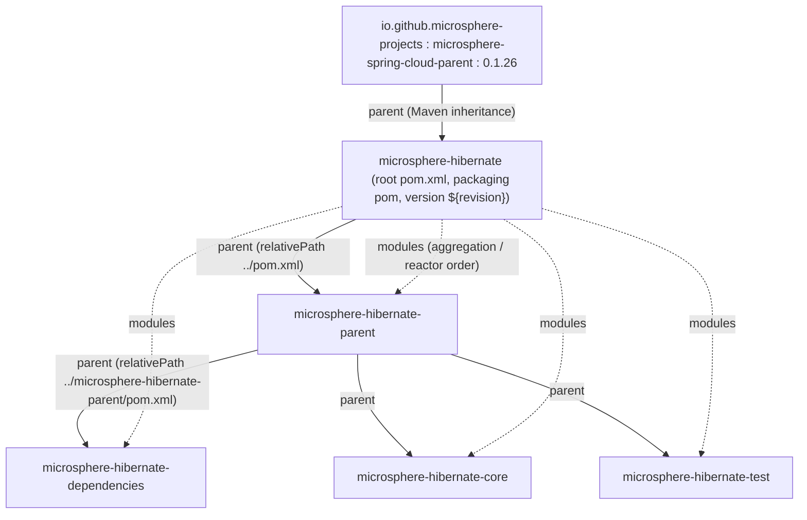
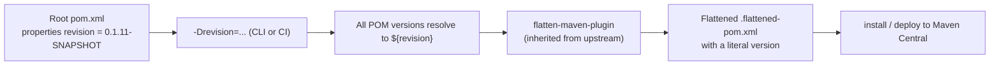

# microsphere-hibernate-parent — 开发者文档（1.x）

制品：`io.github.microsphere-projects:microsphere-hibernate-parent` · Packaging：`pom`
源码：`microsphere-hibernate-parent/pom.xml`（分支 `release-1.x`）
英文版：[../microsphere-hibernate-parent.md](../microsphere-hibernate-parent.md)

## 1. 在 reactor 中的角色

`microsphere-hibernate-parent` 是本项目所有产出制品模块（`core`、`test`）以及 BOM（`dependencies`）的**构建父
POM**。它只负责三件事：

1. 上游 Microsphere Spring Cloud 平台的版本（`microsphere-spring-cloud.version`）；
2. Hibernate 专属的 `dependencyManagement` 条目；
3. **Hibernate 5 版本 profiles**（`hibernate-5.0 … hibernate-5.6`），即 `${hibernate.version}` 的取值来源。

它不产出 jar，也没有代码，是纯粹的构建策略载体。

### 1.1 继承 vs 聚合

修改这些 POM 时最容易混淆的两种关系：



- **继承链**：`microsphere-spring-cloud-parent:0.1.26` → 根 `microsphere-hibernate` →
  `microsphere-hibernate-parent` → `dependencies` / `core` / `test`。插件管理、`test`/`coverage` profile 以及
  JDK 8 编译配置都沿这条链下发。
- **聚合关系**：根 POM 的 `<modules>` 列出四个模块，因此仓库根目录执行 `./mvnw` 会按依赖顺序构建它们。

`microsphere-hibernate-parent` 自身也声明了 `<version>${revision}</version>` 并重复写了 `groupId`，因此它也可以被
reactor 之外的工程（例如示例工程）直接当作 parent 引用。

## 2. POM 解剖

### 2.1 坐标与属性

```xml
<parent>
    <groupId>io.github.microsphere-projects</groupId>
    <artifactId>microsphere-hibernate</artifactId>
    <version>${revision}</version>
    <relativePath>../pom.xml</relativePath>
</parent>

<artifactId>microsphere-hibernate-parent</artifactId>
<version>${revision}</version>
<packaging>pom</packaging>

<properties>
    <microsphere-spring-cloud.version>0.1.26</microsphere-spring-cloud.version>
</properties>
```

| **属性** | **取值** | **消费方** |
|---|---|---|
| `revision` | `0.1.11-SNAPSHOT`（声明在根 `pom.xml`） | 所有模块的 `<version>` —— CI 友好版本 |
| `microsphere-spring-cloud.version` | `0.1.26` | 被 import 的 `microsphere-spring-cloud-dependencies` BOM |
| `hibernate.version` | **只**由下面的 profiles 设置 | `org.hibernate:hibernate-core` 的受管版本 |

1.x 的根 POM **没有**声明 `<java.version>17</java.version>`（当前线有）；JDK 8 基线由 `release-1.x` 的父链隐含，
并由 JDK 8 的 CI matrix 条目验证。

### 2.2 `dependencyManagement`

```xml
<dependencyManagement>
    <dependencies>
        <dependency>
            <groupId>org.hibernate</groupId>
            <artifactId>hibernate-core</artifactId>
            <version>${hibernate.version}</version>
        </dependency>
        <dependency>
            <groupId>io.github.microsphere-projects</groupId>
            <artifactId>microsphere-spring-cloud-dependencies</artifactId>
            <version>${microsphere-spring-cloud.version}</version>
            <type>pom</type>
            <scope>import</scope>
        </dependency>
    </dependencies>
</dependencyManagement>
```

改动本文件时最需要注意两点：

- **Hibernate 是以单个 jar 钉版本的（`org.hibernate:hibernate-core`），而不是 platform BOM。** 0.2.x 线 import 的是
  `org.hibernate.orm:hibernate-platform`（`<type>pom</type><scope>import</scope>`）；Hibernate 5 没有对应的
  platform 制品，所以 1.x 直接管 `hibernate-core`，由 Maven 传递解析带出 `hibernate-commons-annotations`、
  `byte-buddy`、`jandex`、`classmate`、`javax.persistence-api` 等。
- **声明顺序优先。** `hibernate-core` 写在 `microsphere-spring-cloud-dependencies` import **之前**，因此这里解析出的
  Hibernate 版本会胜出（靠后的 import BOM 无法覆盖前面已显式管理的条目）。

模块用到的其余三方版本（`junit-jupiter`、`mockito-core`、`mockito-junit-jupiter`、`h2`、`logback-classic`、
`jaxb-api`、`microsphere-java-core`、`microsphere-java-test`、`microsphere-annotation-processor`）全部由
`microsphere-spring-cloud-dependencies:0.1.26` 管理，而后者又按激活的 profile import Spring Boot / Spring Cloud
BOM。这就是模块 POM 中依赖**不写** `<version>` 的原因。

## 3. Hibernate 5 版本 profiles

共 7 个 profile，且每个只设置 `hibernate.version`：

| **Profile id** | **`hibernate.version`** | **激活方式** | **说明** |
|---|---|---|---|
| `hibernate-5.6` | `5.6.15.Final` | `activeByDefault = true` | 默认构建目标；唯一同时出现在两套 CI matrix（JDK 8、11、17、21、25）中的版本线 |
| `hibernate-5.5` | `5.5.9.Final` | 手动 | Java 11+ matrix 条目 |
| `hibernate-5.4` | `5.4.33.Final` | 手动 | Java 11+ matrix 条目 |
| `hibernate-5.3` | `5.3.38.Final` | 手动 | Java 11+ matrix 条目 |
| `hibernate-5.2` | `5.2.18.Final` | 手动 | CI 中仅 JDK 8 |
| `hibernate-5.1` | `5.1.9.Final` | 手动 | CI 中仅 JDK 8 |
| `hibernate-5.0` | `5.0.9.Final` | 手动 | CI 中仅 JDK 8；支持范围的下界 |

由于 `hibernate-5.6` 是 `activeByDefault`，选择其他版本线必须显式激活；同时注意：同一个 POM 内一旦有别的 profile
被命令行激活，default profile 会被自动关掉——这正是 `-Phibernate-5.4` 能按预期生效的机制。

验证解析结果：

```bash
./mvnw -N -Phibernate-5.0 help:evaluate -Dexpression=hibernate.version -DforceStdout
./mvnw -pl microsphere-hibernate-core -Phibernate-5.3 dependency:tree -Dincludes=org.hibernate:hibernate-core
```

## 4. 从上游继承的 profiles

这些不由本父 POM 定义，但 CI 命令行会激活，因此在此登记：

| **Profile** | **定义位置** | **作用** |
|---|---|---|
| `spring-cloud-hoxton` | `microsphere-spring-cloud-parent:0.1.26` | `spring-boot.version=2.3.12.RELEASE`、`spring-cloud.version=Hoxton.SR12`、`spring-cloud-alibaba.version=2.2.10` |
| `spring-cloud-2020` | 同上 | `spring-cloud.version=2020.0.5` |
| `spring-cloud-2021` | 同上 | `spring-cloud.version=2021.0.9` |
| `testcontainers` | 同上 | 追加 Testcontainers BOM（本仓库未使用） |
| `test`、`coverage` | 上游 Microsphere 构建父 POM（逐级继承） | surefire 执行 + JaCoCo agent/report，被 `maven-build.yml` 使用 |
| `publish`、`ci` | 同上 | sources/javadoc jar、GPG 签名、Sonatype OSSRH 发布，被 `maven-publish.yml` 使用 |
| `java9+` | **本仓库局部**声明于 `microsphere-hibernate-core/pom.xml` 与 `microsphere-hibernate-test/pom.xml` | `<activation><jdk>[9,)</jdk></activation>` 追加可选依赖 `javax.xml.bind:jaxb-api` |

对等项目本身，Spring Cloud 这个维度其实基本正交（`core`、`test` 运行期都不依赖 Spring），但 matrix 仍保留它，
因为 `microsphere-java-core` / `microsphere-java-test` 是针对这些平台发布的。

## 5. `revision` 与 CI 友好版本管理



必须遵守的规则：

- 每个模块自身的 `<version>` 与其 `<parent>` 引用一律写 `${revision}`；**绝不要**在 `core`、`test`、
  `dependencies`、`parent` 中硬编码字面版本。
- 发布（`maven-publish.yml`）要求 `revision` 匹配 `^[0-9]+\.[0-9]+\.[0-9]+$`；workflow 会先校验，并用同一个值打 tag。
- CI 测试构建刻意使用 `-Drevision=0.0.1-SNAPSHOT`，确保 matrix 跑批不可能覆盖真实制品。
- 每次发布后 `release-1.x` 会自增到下一个 patch（例如发布 `0.1.10` → `revision` 变为 `0.1.11-SNAPSHOT`），由自动化
  提交 *"chore: bump version to next patch after publishing"* 完成。

## 6. 扩展本模块的方式

### 6.1 新增一个 Hibernate 5 版本到 matrix

1. 在 `microsphere-hibernate-parent/pom.xml` 中按现有形态追加 profile：

   ```xml
   <profile>
       <id>hibernate-5.6-new</id>
       <properties>
           <hibernate.version>5.6.16.Final</hibernate.version>
       </properties>
   </profile>
   ```

2. 把该 id 加入 `.github/workflows/maven-build.yml` 的 `maven-hibernate` 列表（JDK 8）；若预期新线在现代 JDK 上也可用，
   同步加入 `maven-build-java11+.yml`。
3. 复核 [core 文档第 6 节](microsphere-hibernate-core.md#6-hibernate-5-api-适配点) 中两个对 API 敏感的位点：
   `requiresPostCommitHanding` 的拼写、以及裸 `Map`/`Set` 的监听器重载。

### 6.2 升级平台版本

修改 `microsphere-spring-cloud.version` 会带动整个三方栈（JUnit、Mockito、H2、Logback、`microsphere-java-core`）。
**只**在本文件里改（模块 POM 从不重复该版本），改完本地全量跑一遍 matrix：

```bash
for p in hibernate-5.0 hibernate-5.1 hibernate-5.2 hibernate-5.3 hibernate-5.4 hibernate-5.5 hibernate-5.6; do
  ./mvnw -q -Drevision=0.0.1-SNAPSHOT -Ptest,coverage,spring-cloud-2021,$p clean test || echo "FAILED: $p"
done
```

### 6.3 本仓库 POM 的书写惯例

- 模块 `<name>`/`<description>` 采用 `Microsphere :: Hibernate :: <Module>` 格式，前缀不可变。
- ASF license 头、`<organization>`、`<developers>`、`<scm>` 只写在根 POM，由下级继承。
- 依赖分组注释（`<!-- Hibernate -->`、`<!-- Testing -->` 等）是既有风格；`core`/`test` 中每个依赖都要分组并注释。

## 7 下一步

- [microsphere-hibernate-dependencies.md](microsphere-hibernate-dependencies.md) —— 消费该 parent 的 BOM
- [microsphere-hibernate-core.md](microsphere-hibernate-core.md) —— 需要这套 profile matrix 才能成立的代码
- 索引：[README.md](README.md)
