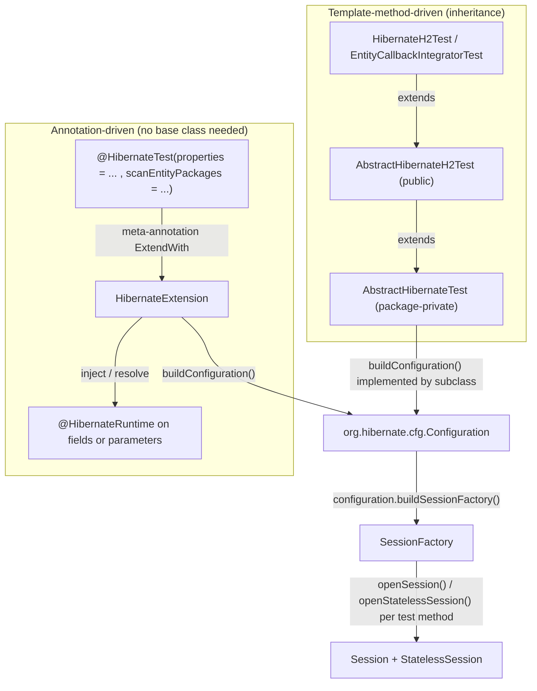
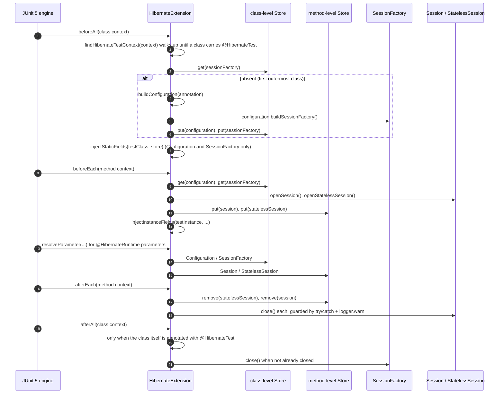
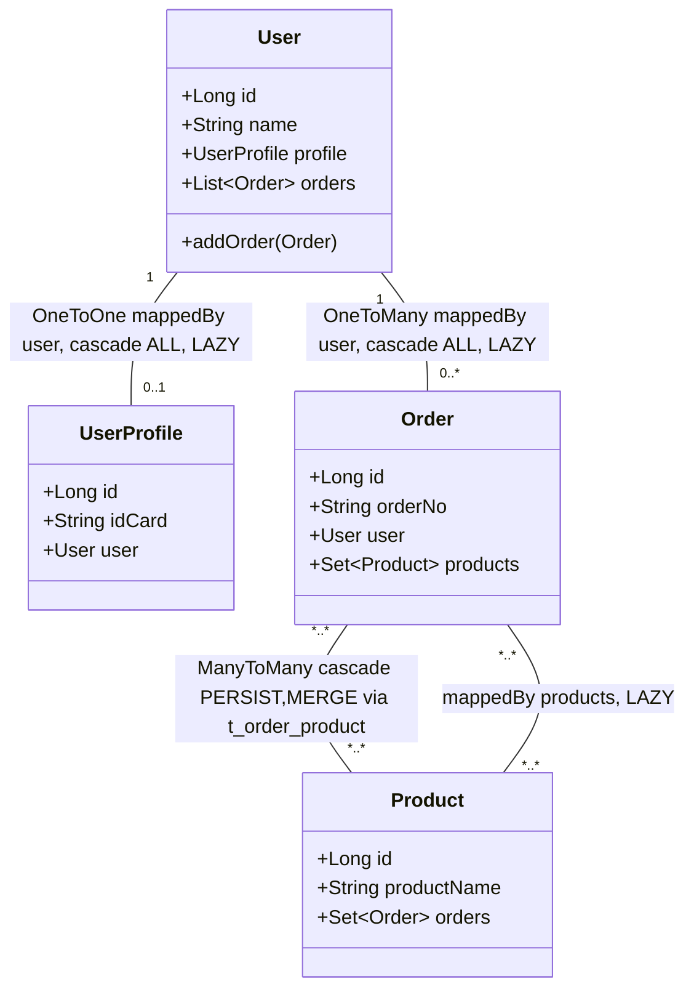

# microsphere-hibernate-test — 开发者文档（1.x）

制品：`io.github.microsphere-projects:microsphere-hibernate-test` · Packaging：`jar`
源码：`microsphere-hibernate-test/`（分支 `release-1.x`）
英文版：[../microsphere-hibernate-test.md](../microsphere-hibernate-test.md)

这是一个**对外发布的测试支持库**（不是本模块自己的测试套件）：它把一个 JUnit 5 扩展、两个注解、两个抽象测试基类和
四个示例实体打包发布，让本仓库的测试和第三方工程都能零样板地引导出一个 Hibernate 5 `SessionFactory`。

## 1. 模块事实

| **方面** | **取值** |
|---|---|
| parent | `microsphere-hibernate-parent`；`<version>${revision}</version>` |
| 编译依赖（全部 `optional`） | `hibernate-core`（`org.hibernate`）、`microsphere-java-core`、`microsphere-java-test`、`junit-jupiter`、`mockito-core`、`mockito-junit-jupiter`、`com.h2database:h2`、`logback-classic`、`microsphere-annotation-processor` |
| JDK 9+ | `java9+` profile 追加 `javax.xml.bind:jaxb-api`（Hibernate 5 在 JPMS 环境仍需要 JAXB） |
| 是否依赖 `microsphere-hibernate-core`？ | **不依赖** —— 本模块刻意保持独立；反倒是 core 以 `test` scope 依赖它 |
| 命名空间 | `javax.persistence`（Hibernate 5 / JPA 2.x 时代） |
| 自身测试 | `HibernateH2Test`、`HibernateAnnotationTest`、`entity/{User,UserProfile,Order,Product}Test` |

为什么所有依赖都是 `optional`：这个制品的设计目标是躺在**使用方自己的** Hibernate/JUnit/H2 版本旁边运行，因此既
不传递也不覆盖它们；代价是使用方必须自己声明 JUnit 5、Hibernate 与 H2。

## 2. 获得 Hibernate 测试运行时的两种方式



| **维度** | **`@HibernateTest` + `HibernateExtension`** | **`AbstractHibernateTest` / `AbstractHibernateH2Test`** |
|---|---|---|
| 组合 vs 继承 | 组合，不占用父类槽位 | 继承（模板方法） |
| 实体发现 | 按包 classpath 扫描（`SimpleClassScanner`），`@Entity` 过滤 | 显式 `addAnnotatedClass(...)` |
| `SessionFactory` 作用域 | **每个测试类一次**，`@Nested` 内部类共享 | **每个测试方法之前**重建 |
| `Session` 作用域 | 每个方法开/关 | 每个方法开/关（`setUp`/`tearDown`） |
| 注入 | 字段 + 方法参数 | `protected` 字段 |
| 使用者 | `HibernateAnnotationTest` | `HibernateH2Test`，以及 core 的 `EntityCallbackIntegratorTest` |

## 3. `HibernateExtension` 内部机制

`microsphere-hibernate-test/src/main/java/io/microsphere/hibernate/test/HibernateExtension.java:67-397` · public

```java
public class HibernateExtension implements BeforeAllCallback, BeforeEachCallback,
        AfterEachCallback, AfterAllCallback, ParameterResolver {
```

### 3.1 Store 模型

一个 `Namespace`（`Namespace.create(HibernateExtension.class)`，第 72 行）与五个键（第 74-77 行）：

| **键** | **存放位置** | **生命周期** | **写入点** |
|---|---|---|---|
| `configuration` | 带 `@HibernateTest` 的那个 context 的 store | 测试类 | `beforeAll` 第 103 行 |
| `sessionFactory` | 同上 | 测试类 | `beforeAll` 第 104 行 |
| `session` | **方法**级 context 的 store | 测试方法 | `beforeEach` 第 135 行 |
| `statelessSession` | 同上 | 测试方法 | `beforeEach` 第 136 行 |

正是这套"两级 Store"让嵌套测试类共享同一个 `SessionFactory`，同时每个测试方法拿到干净的 `Session`。

### 3.2 生命周期



### 3.3 引导配置构建（`buildConfiguration`，第 241-268 行）

1. `new Configuration()` —— Hibernate 5 的编程式引导入口（不用 `ServiceRegistryBuilder`，不读
   `hibernate.cfg.xml`，也不读 `persistence.xml`）。
2. `@HibernateTest#properties()` 里的 `key=value` 字符串逐个解析：
   `int separatorIndex = property.indexOf('=')`；`separatorIndex <= 0` 的行**只告警并跳过**（`=value`、裸 token
   都不会让测试失败），并且两段都会 `trim()` 后再 `configuration.setProperty(key, value)`。
3. 实体：对 `@HibernateTest#scanEntityPackages()` 中每个包执行
   `SimpleClassScanner.INSTANCE.scan(classLoader, packageName, true, true)`，ClassLoader 取
   `Thread.currentThread().getContextClassLoader()`；只有带 `javax.persistence.Entity` 的类会通过
   `addAnnotatedClass` 加入，并逐条打 `debug` 日志。

契约就这么多 —— 没有 `AnnotatedTypeScanner`，没有 `hibernate.hbm2ddl.auto` 默认值，也不推断方言。忘记写
`hibernate.dialect`/`hbm2ddl.auto` 的测试只会得到 Hibernate 5 自己的推断结果，所以 `HibernateAnnotationTest` 把
六个属性全部写全。

### 3.4 注入规则

| 目标 | `Configuration` | `SessionFactory` | `Session` | `StatelessSession` |
|---|---|---|---|---|
| 标注 `@HibernateRuntime` 的 `static` 字段 | 注入 | 注入 | **永不注入**（保持 `null`） | **永不注入**（保持 `null`） |
| 标注 `@HibernateRuntime` 的实例字段 | 注入 | 注入 | 注入 | 注入 |
| 标注 `@HibernateRuntime` 的测试方法参数 | 注入 | 注入 | 注入 | 注入 |

实现分别位于 `injectStaticFields`（277-296，由 `beforeAll` 调用）、`injectInstanceFields`（302-320，由
`beforeEach` 调用）以及 `resolveValueForType`（332-345）/ `resolveComponent`（351-375）。
`getAllDeclaredFields`（388-396）会沿父类链向上收集到（但不包含）`Object`，因此抽象基类里带注解的继承字段也生效。
字段用 `setAccessible(true)` 赋值，且**只在解析出非 null 值时才赋值** —— 不支持的声明类型会被静默跳过而不报错。

`supportsParameter`（205-209）要求**同时**满足"参数带 `@HibernateRuntime`"与"类型属于四种受支持类型"
（`isSupportedType`，377-382），所以本扩展不会与其他 `ParameterResolver` 抢活。

### 3.5 健壮性约定

- `beforeAll` / `afterAll` 在 `context.getTestClass()` 缺失时（方法级或 lambda 上下文）直接返回。
- `beforeEach` 在 `SessionFactory` 从未创建时（`sessionFactory == null`，第 127 行）提前退出 —— 外层类没打注解的
  嵌套类会"没有 Hibernate 支持地"跑完，而不是抛异常。
- 三处 `close()`（`statelessSession`、`session`、`sessionFactory`）都包在 `try/catch (Exception)` 里并
  `logger.warn`；`Session` 额外要求 `session.isOpen()`。注意：与 0.2.x 线不同，本分支对 `StatelessSession` 只有
  null 判定 —— Hibernate 5 下它是无条件关闭的。
- `afterAll` 只在"被注解类"那一支里移除 `configuration` 键（第 196 行），而该支也正是唯一关闭工厂的地方；这一
  配对关系保证了 `@Nested` 类不会提前关掉共享的工厂。
- 日志走 `io.microsphere.logging.Logger`（`LoggerFactory.getLogger`，第 70 行），**不是**直接用 SLF4J —— 本模块依赖
  `microsphere-java-core`/`microsphere-logging` 这层门面，所以 `logback-classic` 只在测试运行期需要。

## 4. 两个注解

### 4.1 `@HibernateTest`（`HibernateTest.java:51-71`）

```java
@Target(ElementType.TYPE)
@Retention(RetentionPolicy.RUNTIME)
@Documented
@Inherited
@ExtendWith(HibernateExtension.class)
public @interface HibernateTest {
    String[] properties() default {};
    String[] scanEntityPackages() default {};
}
```

`@ExtendWith` 使它成为一个**元注解**：测试类无需自己再写 `@ExtendWith`。`@Inherited` 配合
`findHibernateTestContext`（225-236）意味着被注解基类的**子类**同样获得运行时支持。两个成员默认都是空数组：
`properties = {}` 时 Hibernate 5 会回落到 classpath 上的 `hibernate.properties`/`hibernate.cfg.xml`；
`scanEntityPackages = {}` 时不映射任何实体 —— 两者都合法，但通常不是你想要的。

### 4.2 `@HibernateRuntime`（`HibernateRuntime.java:42-46`）

`@Target({ElementType.FIELD, ElementType.PARAMETER})`、`@Retention(RUNTIME)`、`@Documented`：一个无成员的纯标记
注解，由字段/参数的**类型**决定注入哪个组件（见 §3.4）。1.x 分支在元注解里写限定名（`ElementType.FIELD`），当前线
则静态导入了这些枚举；Javadoc 明确写出 `Session`/`StatelessSession` 不能注入 static 字段。

## 5. `AbstractHibernateTest` —— package-private 基类

`AbstractHibernateTest.java:56-115` · `abstract class`（**package-private**）

| **方法** | **行号** | **契约** |
|---|---|---|
| `setUp()` `final`、`@BeforeEach` | 66-75 | `configuration = buildConfiguration()` → `customizeConfiguration(configuration)` → `sessionFactory = configuration.buildSessionFactory()` → `session = openSession()` → `statelessSession = openStatelessSession()` → `init()` |
| `tearDown()` `final`、`@AfterEach` | 77-83 | `destroy()` → `session.close()` → `statelessSession.close()` → `sessionFactory.close()` —— **没有 try/catch**：`destroy()` 失败会漏掉 session，好在工厂本来就是每方法重建 |
| `protected abstract Configuration buildConfiguration()` | 91 | 唯一必须实现的方法 |
| `protected void customizeConfiguration(Configuration)` | 99 | 空实现钩子 |
| `protected void init()` / `destroy()` | 106 / 113 | 夹具生命周期前后的空钩子 |
| `protected` 字段 `configuration`、`sessionFactory`、`session`、`statelessSession` | 58-64 | 直接访问，无需注入 |

由于它是 package-private，`io.microsphere.hibernate.test` 包**外**无法继承它；对外发布的入口是
`AbstractHibernateH2Test`。core 模块的 `EntityCallbackIntegratorTest` 之所以能继承，是因为
`AbstractHibernateH2Test` 是 public（它自己的父类型在 test 模块编译时于同包内解析）。

## 6. `AbstractHibernateH2Test` —— 可复用的 H2 测试集

`AbstractHibernateH2Test.java:71-335` · `public abstract`

- `buildConfiguration()`（108-123）：四个 `addAnnotatedClass` 加九个硬编码属性 —— H2 驱动、
  `jdbc:h2:mem:test_db;DB_CLOSE_DELAY=-1`、`sa`/空密码、`H2Dialect`、`format_sql`、`show_sql`、
  `hbm2ddl.auto=update`。因为 `DB_CLOSE_DELAY=-1` 会让内存库存活到 JVM 结束，一个测试类写入的数据可能被另一个类
  看到；"每方法重建 `SessionFactory` + `hbm2ddl.auto=update`" 的组合依赖 H2 对 DDL 更新的容忍度，而不是干净模式。
- `init()`（76-79）通过可覆写的 `createUser()`（87-105）构建 `user` 夹具：`User` + `@OneToOne UserProfile` +
  `Order`（`@ManyToOne` 回指 `User`，`@ManyToMany` 连 `Product`）—— 恰好覆盖能触发集合事件的那些关联形态。
- `doInAction(Runnable)`（130-132）等价于 `assertDoesNotThrow`。两个嵌套类各自定义了
  `doInTransaction(Runnable)`，在行动前后开启并提交 `Transaction`（`SessionTest` 第 272 行，
  `StatelessSessionTest` 第 326 行）。
- `@Nested @DisplayName("Session Test")`（134-279）：`persist & get`、`persist & merge`、`persist & delete`、
  `persist & replicate`、`persist & flush`、`persist & evict`、`persist & lock`、`persist & refresh`、
  `persist & load`、`persist & FROM User` —— 每个有状态事件族一条，`EntityCallback` 的改动立刻可见。
- `@Nested @DisplayName("Stateless Session Test")`（281-333）：`insert & get`、`insert & delete`、
  `insert & update`、`insert & refresh` —— 有状态套件的对应物：所有操作都走 `StatelessSession`
  （`insert`/`get`/`update`/`delete`/`refresh`），不经过持久化上下文和 flush 周期。每次调用具体会产生哪些
  `PRE_*`/`POST_*` 事件由 Hibernate 决定；该套件保证的是**两种 session 形态都被驱动过**，从而把 23 个 `EventType`
  的监听器注册全部跑到位。

这些嵌套类是**内部（非 static）类**，因此可以直接看到外层的 `session` / `statelessSession` / `user`；JUnit 为每个
嵌套测试新建外层实例，这正是 `AbstractHibernateTest` 的"每方法重建"语义在此依然成立的原因。

## 7. 示例实体（`io.microsphere.hibernate.test.entity`）



| **实体** | **表** | **主键** | **映射要点** |
|---|---|---|---|
| `User` | `t_user` | `@Id @GeneratedValue(IDENTITY) Long id` | `profile`、`orders` 为 `LAZY` + `cascade ALL`；`addOrder(Order)` 维护双向关系 |
| `UserProfile` | `t_user_profile` | identity | `@OneToOne` 的**拥有方**，带 `@JoinColumn(name = "user_id")` |
| `Order` | `t_order` | identity | `@ManyToOne @JoinColumn(name = "user_id")`；`@ManyToMany` 显式 `@JoinTable(name = "t_order_product", …)` |
| `Product` | `t_product` | identity | 反向 `@ManyToMany(mappedBy = "products", fetch = LAZY)` |

四个实体都用"主键 + 一个业务字段"实现 `equals`/`hashCode`（`User` 是 `id` + `name`，`UserProfile` 是 `id` +
`idCard`，`Order` 是 `id` + `orderNo`，`Product` 是 `id` + `productName`）；`Order` 与 `Product` 的 `equals` 标了
`final`，`User` 与 `UserProfile` 没有。`AbstractHibernateH2Test` 里的断言（`assertEquals(user, user1)`）正依赖这一
点：因为主键参与比较，重新加载出来的实例只有在 `IDENTITY` 生成器把 `id` 回填到原对象之后才会相等——这也是每个这类
测试都要先在事务里 persist 的原因。`src/test/java` 下的四个 `*Test` 则是这些契约的纯 POJO 测试（默认值、
getter/setter、`addOrder` 的双向性、含 null 主键场景的 equals/hashCode），不需要数据库。

## 8. 本模块自身的测试

| **测试** | **风格** | **覆盖点** |
|---|---|---|
| `HibernateAnnotationTest` | `@HibernateTest(properties = {6 项}, scanEntityPackages = {"io.microsphere.hibernate.test.entity"})`，无基类 | static 字段注入（`Configuration`、`SessionFactory` 非空；`Session`、`StatelessSession` **assertNull**）、`@Nested FieldTest`（四种类型全部注入）、`@Nested ParameterTest`（四种类型全部作为方法参数解析成功） |
| `HibernateH2Test` | `public class ... extends AbstractHibernateH2Test`，只覆写 `customizeConfiguration` | 整套继承下来的嵌套用例；默认 H2 配置路径 |
| `entity/UserTest`、`entity/UserProfileTest`、`entity/OrderTest`、`entity/ProductTest` | 普通 JUnit 5 | POJO / 映射元数据契约 |

`HibernateAnnotationTest` 是仓库里唯一断言*注解*路径的地方，同时它也是用户文档引用的标准范例。

## 9. 扩展配方

**新增一个可注入类型**（例如 `StatelessSession` 已支持，`SessionBuilder` 未支持）：必须同时修改 `isSupportedType`、
`resolveValueForType`、`resolveComponent` 三处 —— 三者不同步会出现"声称支持、却解析为 `null`"，JUnit 随即报
`ParameterResolver` 错误。别忘了同步 `HibernateRuntime` 的 Javadoc 列表。

**往示例实体图里加实体**：在 `io.microsphere.hibernate.test.entity` 下用 `javax.persistence` 注解创建（绝不能用
`jakarta`），在 `AbstractHibernateH2Test#buildConfiguration()` 里 `addAnnotatedClass`；又因为
`HibernateAnnotationTest` 是按包扫描同一个包来发现实体的，需要确认扫描结果里只有预期的 `@Entity` 类。随后把它接入
`createUser()` 的关联关系，好让嵌套事件测试真正触发它。

**调整 Store 作用域**：`Configuration`/`SessionFactory` 放在被注解类的 Store、`Session`/`StatelessSession` 放在方法
Store，是使 `@Nested` 生效的不变式。把 session 挪到类级 Store 会跨测试泄漏并破坏"每方法一个干净工作单元"的承诺；
把工厂挪到方法级 Store 则每个测试都要重建 `SessionFactory`，H2 套件会显著变慢。

**运行**：

```bash
./mvnw -pl microsphere-hibernate-test -Phibernate-5.6 test
./mvnw -pl microsphere-hibernate-core -am test     # 验证 core -> test（test scope）耦合仍可构建
```

## 10 下一步

- [microsphere-hibernate-core.md](microsphere-hibernate-core.md) —— 这些 H2 测试到底打开了什么
- 索引：[README.md](README.md) · 用户文档：[../../user-guide/zh/microsphere-hibernate-test.md](../../user-guide/zh/microsphere-hibernate-test.md)
