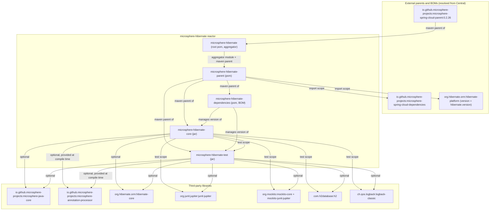
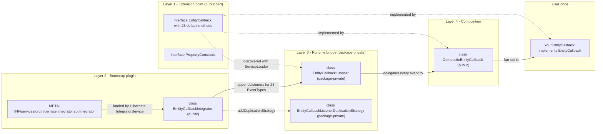
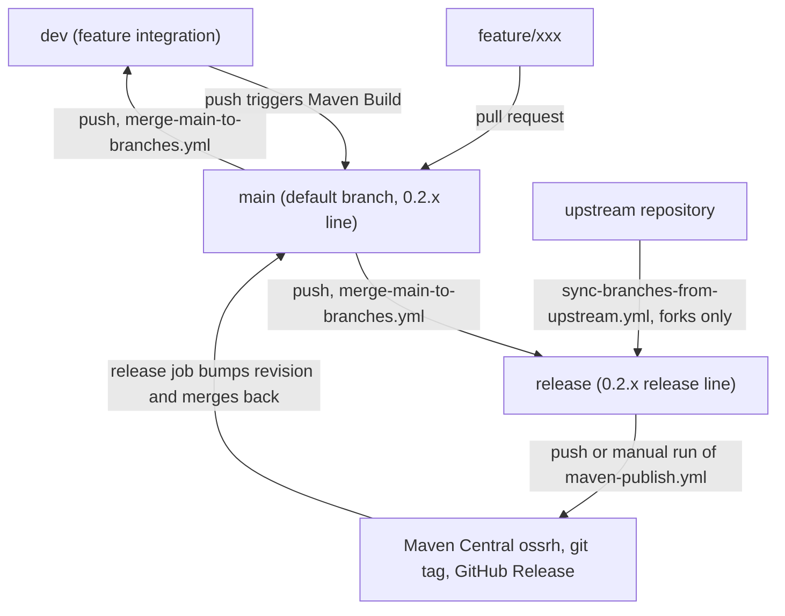

# microsphere-hibernate — Developer Guide (0.2.x / `release` branch)

> Audience: contributors and maintainers of `microsphere-hibernate`.
> This guide describes **how the code is built, how it is structured and why**, not how to use the
> library as an end user. For usage documentation see the companion User Guide (`../user-guide/`).

| Item | Value on this branch |
|------|----------------------|
| Branch | `release` (the 0.2.x line; `main` is kept merged with it) |
| Version | `${revision}` = `0.2.11-SNAPSHOT` in the root `pom.xml` (bumped automatically after each publish) |
| Java baseline | JDK 17 (`<java.version>17</java.version>`), CI also runs JDK 21 and JDK 25 |
| Hibernate ORM | `org.hibernate.orm:hibernate-core` 6.2.x – 7.3.x, selected by Maven profiles |
| Coordinates | `io.github.microsphere-projects:microsphere-hibernate-{parent,dependencies,core,test}` |
| Maven | Maven Wrapper, distribution type `only-script`, Apache Maven `3.9.16` |
| License | Apache License 2.0 (header enforced on every source file) |

---

## 1. Development environment setup

### 1.1 Prerequisites

| Tool | Requirement | Notes |
|------|-------------|-------|
| JDK | 17 or later | `pom.xml` pins `<java.version>17</java.version>`; JDK 17 is also the publish JDK |
| Maven | Not required to install | `./mvnw` (Unix) / `mvnw.cmd` (Windows) uses `wrapperVersion=3.3.4`, `distributionType=only-script` and downloads Apache Maven `3.9.16` |
| Git | Any recent version | Branch model below (section 5) |
| IDE | IntelliJ IDEA / Eclipse / VS Code | Import as a Maven **reactor** (open the root `pom.xml`); sources are not generated, no Lombok, no annotation-processing setup beyond the optional `microsphere-annotation-processor` |

Network access to Maven Central (or a mirror) is required for the first build because the parent chain
(`microsphere-spring-cloud-parent` → `microsphere-spring-cloud` → `microsphere-build`) and the imported
BOMs (`org.hibernate.orm:hibernate-platform`, `microsphere-spring-cloud-dependencies`) are resolved remotely.

### 1.2 First build

```bash
# from the repository root
git clone https://github.com/microsphere-projects/microsphere-hibernate.git
cd microsphere-hibernate
git checkout release          # the 0.2.x line

./mvnw --batch-mode clean install          # default profiles: hibernate-7.3 + spring-cloud-2025
```

Windows: use `mvnw.cmd` instead of `./mvnw` (identical goals and flags).

### 1.3 Reproducing a CI build locally

`.github/workflows/maven-build.yml` runs a matrix of **JDK × Spring Cloud profile × Hibernate profile**
with `-Drevision=0.0.1-SNAPSHOT` and the profiles `test,coverage,<spring-cloud-*>,<hibernate-*>`:

```bash
./mvnw --batch-mode --update-snapshots --file pom.xml \
  -Drevision=0.0.1-SNAPSHOT \
  test \
  --activate-profiles test,coverage,spring-cloud-2022,hibernate-6.2
```

The `test` and `coverage` profiles are **inherited from the upstream parent chain** (they contribute the
Surefire/Jacoco configuration); `coverage` is what feeds the `codecov-action` upload step.

Useful single-module commands (always pass `-am` so the required siblings are built first):

```bash
./mvnw -pl microsphere-hibernate-core -am test
./mvnw -pl microsphere-hibernate-test -am -Dtest=HibernateAnnotationTest test
```

> Reactor order is **root → parent → dependencies → test → core**. `core` is built *last* even though it is
> declared earlier in `<modules>`, because its `test`-scoped dependency on `microsphere-hibernate-test`
> forces Maven to reorder (see [module dependency graph](#2-module-dependency-overview)).

### 1.4 Available Maven profiles

| Profile id | `hibernate.version` | Active by default |
|------------|---------------------|-------------------|
| `hibernate-7.3` | `7.3.4.Final` | **yes** |
| `hibernate-7.2` | `7.2.14.Final` | no |
| `hibernate-7.1` | `7.1.25.Final` | no |
| `hibernate-7.0` | `7.0.10.Final` | no |
| `hibernate-6.6` | `6.6.50.Final` | no |
| `hibernate-6.5` | `6.5.3.Final` | no |
| `hibernate-6.4` | `6.4.10.Final` | no |
| `hibernate-6.3` | `6.3.2.Final` | no |
| `hibernate-6.2` | `6.2.52.Final` | no |

`spring-cloud-2022` … `spring-cloud-2025.1` are contributed by the inherited parent. **Activate exactly one
profile of each family** — activating two `hibernate-*` profiles makes property resolution order-dependent
and produces confusing failures. Details in [`microsphere-hibernate-parent.md`](./microsphere-hibernate-parent.md).

---

## 2. Module dependency overview



| Module | Packaging | Role | Depends on (own build) |
|--------|-----------|------|------------------------|
| `microsphere-hibernate` (root) | `pom` | Aggregator, holds `<revision>`/`<java.version>`, inherits `microsphere-spring-cloud-parent` | — |
| `microsphere-hibernate-parent` | `pom` | Version policy: imports the Hibernate platform BOM, declares the `hibernate-*` profiles | root pom |
| `microsphere-hibernate-dependencies` | `pom` | Publishable BOM: pins `microsphere-hibernate-core` / `-test` at `${revision}` | parent |
| `microsphere-hibernate-core` | `jar` | The Hibernate `Integrator` + `EntityCallback` SPI | `hibernate-core`, `microsphere-java-core` (both *optional*), plus `microsphere-hibernate-test` in `test` scope |
| `microsphere-hibernate-test` | `jar` | JUnit 5 testing framework (`@HibernateTest`, `@HibernateRuntime`, `HibernateExtension`, abstract H2 fixtures) | `hibernate-core`, `junit-jupiter`, `h2`, `microsphere-java-core`, `microsphere-java-test` (all *optional*) |

Two consequences that every contributor must know:

1. **`optional` everywhere.** Both jar modules declare all of their dependencies as `<optional>true</optional>`
   (or `test` scope). Nothing leaks transitively; downstream projects must declare `hibernate-core`,
   `microsphere-java-core` and JUnit themselves. Never "fix" this by removing `optional`.
2. **A test-scope cycle exists between `core` and `test`.** `microsphere-hibernate-core`'s tests extend
   `AbstractHibernateH2Test` from `microsphere-hibernate-test`, while `microsphere-hibernate-test`'s main
   sources do **not** reference `microsphere-hibernate-core`. Adding any compile-scope dependency from
   `test` → `core` would create a real cycle and break the reactor.

---

## 3. Architecture at a glance

The runtime design is a four-layer bridge from Hibernate ORM internals to a user-facing callback SPI:



Full source-level analysis, design-pattern walkthroughs and the bootstrap / runtime sequence diagrams live in
[`microsphere-hibernate-core.md`](./microsphere-hibernate-core.md).

---

## 4. Documentation map

| Document | English | Chinese |
|----------|---------|---------|
| Index, environment, module graph, contributing | [`README.md`](./README.md) | [`zh/README.md`](./zh/README.md) |
| `microsphere-hibernate-parent` — version management | [`microsphere-hibernate-parent.md`](./microsphere-hibernate-parent.md) | [`zh/microsphere-hibernate-parent.md`](./zh/microsphere-hibernate-parent.md) |
| `microsphere-hibernate-dependencies` — publishable BOM | [`microsphere-hibernate-dependencies.md`](./microsphere-hibernate-dependencies.md) | [`zh/microsphere-hibernate-dependencies.md`](./zh/microsphere-hibernate-dependencies.md) |
| `microsphere-hibernate-core` — architecture & source analysis | [`microsphere-hibernate-core.md`](./microsphere-hibernate-core.md) | [`zh/microsphere-hibernate-core.md`](./zh/microsphere-hibernate-core.md) |
| `microsphere-hibernate-test` — JUnit 5 framework internals | [`microsphere-hibernate-test.md`](./microsphere-hibernate-test.md) | [`zh/microsphere-hibernate-test.md`](./zh/microsphere-hibernate-test.md) |

Repository layout for `core`:

```text
microsphere-hibernate-core/src/main/java/io/microsphere/hibernate/
├── constants/PropertyConstants.java
└── entity/
    ├── EntityCallback.java                              (public SPI, 23 default methods)
    ├── CompositeEntityCallback.java                     (public Composite)
    ├── EntittyCallbackIntegrator.java                   (public Hibernate Integrator - note the typo)
    ├── EntityCallbackListener.java                      (package-private listener bridge)
    └── EntityCallbackListenerDuplicationStrategy.java   (package-private duplication strategy)
microsphere-hibernate-core/src/main/resources/META-INF/services/
└── org.hibernate.integrator.spi.Integrator             -> io.microsphere.hibernate.entity.EntittyCallbackIntegrator
```

---

## 5. Contribution workflow

### 5.1 Branch model (as enforced by CI)



| Workflow | Trigger | What it does |
|----------|---------|--------------|
| `maven-build.yml` | push to `main`/`dev`, PR targeting `main`/`dev`/`release` | Matrix build: JDK `17/21/25` × `spring-cloud-2022…2025` × `hibernate-6.2…7.3`, `-Drevision=0.0.1-SNAPSHOT test --activate-profiles test,coverage,...`, then uploads coverage to Codecov (`slug: microsphere-projects/microsphere-hibernate`) |
| `maven-publish.yml` | push to `release`, or `workflow_dispatch` with an explicit `revision` input | Validates `major.minor.patch` format, deploys to Central with `--activate-profiles publish,ci` and `-Dgpg.skip=true`, tags the version, generates release notes with GitHub Copilot (GitHub Models API), appends them to `release-notes.md`, creates the GitHub Release, increments `<revision>` to `x.y.(z+1)-SNAPSHOT`, commits `pom.xml` + `release-notes.md` and merges `release` back into `main` |
| `merge-main-to-branches.yml` | push to `main` | `git merge --no-ff origin/main` into `dev` and `release` (fails on conflict → manual intervention) |
| `sync-branches-from-upstream.yml` | push to `main`/`dev`/`dev-1.x`, cron `*/5 * * * *` | For forks only: syncs each existing branch from the upstream parent, skipping fork-ahead branches |
| `wiki-publish.yml` | push to `main` touching `*/src/main/java/**/*.java`, or manual | Runs `.github/scripts/generate-wiki-docs.py` and pushes the generated pages to the Wiki repository |
| `dependabot.yml` | daily (Maven) / weekly (Actions) | Version-update PRs, max 10 open |

### 5.2 Pull-request checklist

1. Branch from `main` (the 0.2.x line). Target `main` in the PR; CI also builds PRs against `release`.
2. `./mvnw clean test` with the default profile **and** with the oldest supported line:
   `--activate-profiles test,hibernate-6.2` (plus, for cross-version API changes, `hibernate-7.0`).
3. Keep the ASF license header, `@author <a href="mailto:mercyblitz@gmail.com">Mercy</a>` and `@since` on every
   new type; add an "Example Usage" `<pre>{@code …}</pre>` javadoc block — this is the house style and every
   existing class follows it.
4. Public javadoc references `org.hibernate.event.spi.*` interfaces; when you add an event type, update
   `EntityCallback`'s javadoc `@see` list, `CompositeEntityCallback`, `EntityCallbackListener` and the
   `appendListeners(...)` block in the integrator **together** — they are four views of one contract.
5. Tests: JUnit 5, package-private test classes, `@BeforeEach setUp()`, assertions from
   `org.junit.jupiter.api.Assertions`. Integration coverage comes from extending
   `AbstractHibernateH2Test` (see [`microsphere-hibernate-test.md`](./microsphere-hibernate-test.md)).
6. Do not commit `.flattened-pom.xml`, `target/`, or IDE metadata (already in `.gitignore`).
7. Do not change `<revision>` by hand when preparing a release — the publish workflow owns that bump.

### 5.3 Common maintenance tasks

| Task | Steps |
|------|-------|
| Support a new Hibernate minor line | Add a `hibernate-<maj>.<min>` profile with `<hibernate.version>` to `microsphere-hibernate-parent/pom.xml`, then add the id to `maven-hibernate` in `.github/workflows/maven-build.yml` |
| Add a new jar module | Create the module, set its `<parent>` to `microsphere-hibernate-parent`, list it in the root `<modules>`, add a `${revision}` entry to `microsphere-hibernate-dependencies`, keep third-party deps `optional` |
| Add a new lifecycle callback | Add a `default` method to `EntityCallback` → delegate it in `CompositeEntityCallback` → implement the matching Hibernate listener method in `EntityCallbackListener` → register the `EventType` in `EntittyCallbackIntegrator` |
| Release | Push (or manually dispatch) `maven-publish.yml` on `release` with `revision=x.y.z` |

### 5.4 Known sharp edges (documented so you do not re-discover them)

* The class name is `EntittyCallbackIntegrator` (three `t`s). The identifier is **part of the published SPI
  contract** because `META-INF/services/org.hibernate.integrator.spi.Integrator` contains its fully qualified
  name; renaming requires a coordinated release note.
* `PropertyConstants.MICROSPHERE_HIBERNATE_ENABLED_PROPERTY_NAME` (`microsphere.hibernate.enabled`) is declared
  and asserted by `PropertyConstantsTest`, but **no production code reads it on this branch** — the integrator
  is always active. Treat it as documentation of intent, not as a working switch.
* `EntityCallbackListener` and `EntityCallbackListenerDuplicationStrategy` are package-private by design: the
  public API surface of `core` is `EntityCallback`, `CompositeEntityCallback`, `EntittyCallbackIntegrator` and
  `PropertyConstants`.
* `onPreInsert` / `onPreUpdate` / `onPreDelete` hard-code `return false`, so user callbacks cannot veto an
  operation; `requiresPostCommitHandling(...)` hard-codes `false`, so "post" callbacks fire while the
  transaction is still in progress.
* Mockito is declared as a `test` dependency in `core` and as an `optional` dependency in `test`, but no test
  source currently imports it.

---

*Documents in this guide are generated from the `release` branch source snapshot; when you change behaviour,
update both the English files and their `zh/` counterparts (identical mermaid diagrams, English text inside
diagrams).*
