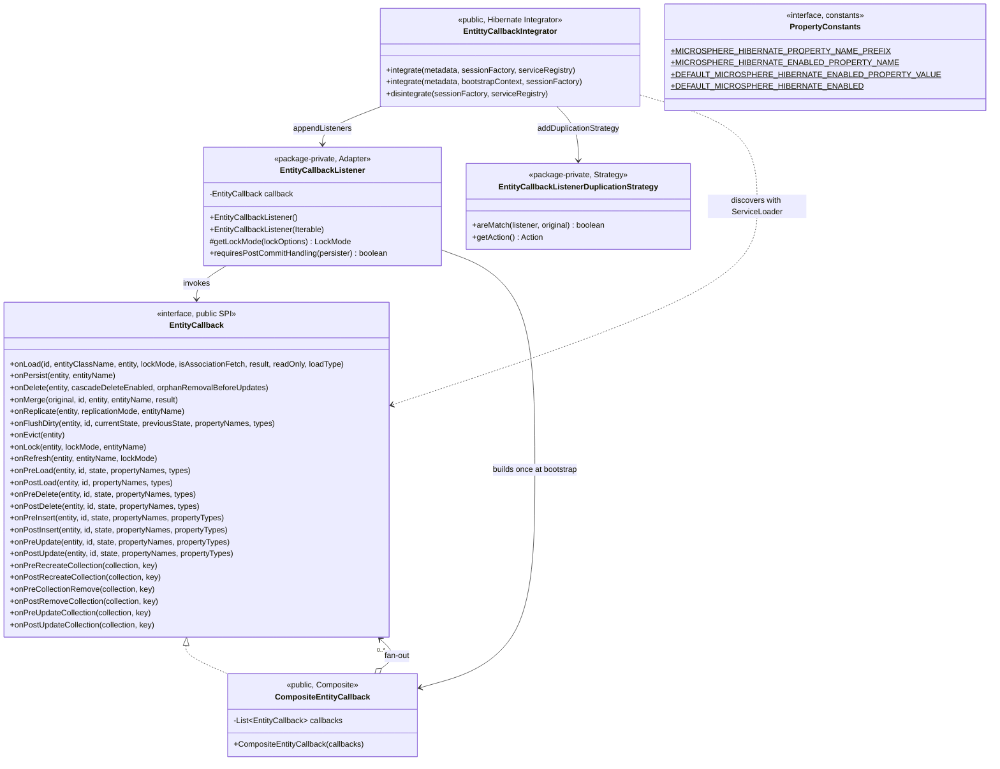
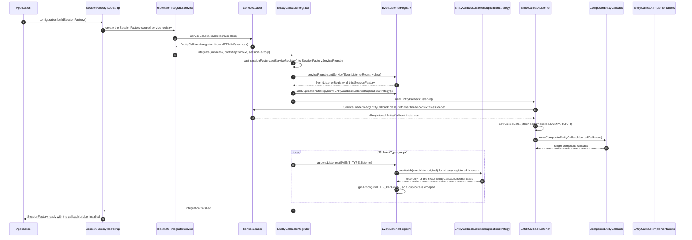
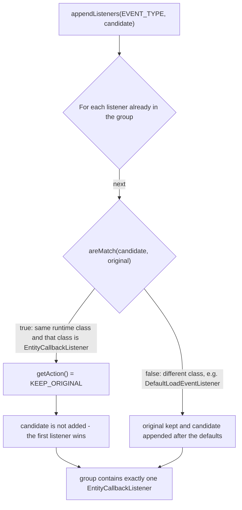
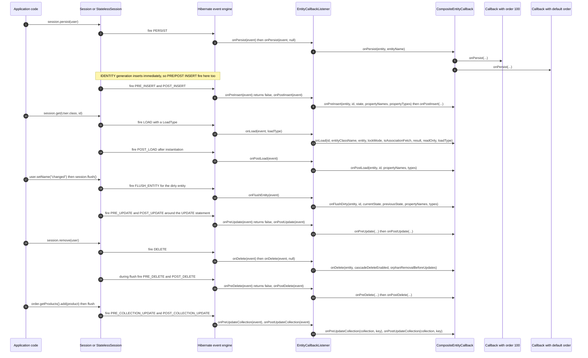

# microsphere-hibernate-core — Developer Guide

Module: `microsphere-hibernate-core` · Packaging: `jar` · Coordinates:
`io.github.microsphere-projects:microsphere-hibernate-core:${revision}`
POM: [`microsphere-hibernate-core/pom.xml`](../../../microsphere-hibernate-core/pom.xml)
Sources: `microsphere-hibernate-core/src/main/java/io/microsphere/hibernate/`

This module turns Hibernate ORM's internal event system into a **user-facing lifecycle callback SPI**. It is a
single-feature module: five classes plus one `META-INF/services` descriptor, no configuration file, no Spring
integration, no runtime state of its own.

---

## 1. Build anatomy

| Declared dependency | Scope | Why |
|---------------------|-------|-----|
| `io.github.microsphere-projects:microsphere-annotation-processor` | compile, `optional` | Processes `@ConfigurationProperty` on `PropertyConstants` to emit configuration metadata |
| `io.github.microsphere-projects:microsphere-java-core` | compile, `optional` | `ListUtils.forEach`, `ListUtils.newLinkedList`, `Prioritized.COMPARATOR`, `io.microsphere.constants.*`, `io.microsphere.annotation.ConfigurationProperty` |
| `org.hibernate.orm:hibernate-core` | compile, `optional` | The whole event/integrator API; version comes from the profile-selected `hibernate-platform` BOM |
| `org.junit.jupiter:junit-jupiter`, `org.mockito:mockito-core`, `org.mockito:mockito-junit-jupiter` | `test` | Test framework (Mockito is declared but not yet used) |
| `io.github.microsphere-projects:microsphere-hibernate-test` | `test` | Supplies `AbstractHibernateH2Test` for the integration test |
| `com.h2database:h2`, `ch.qos.logback:logback-classic` | `test` | In-memory database and the `io.microsphere.logging` backend used by `TestEntityCallback` |

Two build-relevant properties:

* **Everything compile-time is `optional`.** Consumers must add `hibernate-core` (and, if they rely on
  microsphere utilities, `microsphere-java-core`) themselves. `core` compiles fine that way; it just never leaks.
* **The reactor builds `core` last** because of the `test`-scoped dependency on `microsphere-hibernate-test`.
  The test module's main sources never reference `core`, so the cycle stays test-only.

---

## 2. Architecture: four layers, one contract



Layer responsibilities:

| Layer | Classes | Owns | Must not |
|-------|---------|------|----------|
| 1 · Extension point | `EntityCallback`, `PropertyConstants` | The vocabulary of lifecycle moments (23 `default` methods) | Depend on any other layer |
| 2 · Bootstrap plugin | `EntittyCallbackIntegrator`, `META-INF/services/org.hibernate.integrator.spi.Integrator` | When/how the bridge is wired into a `SessionFactory` | Contain business logic or event translation |
| 3 · Runtime bridge | `EntityCallbackListener`, `EntityCallbackListenerDuplicationStrategy` | Translate `*Event` objects into callback invocations; stay idempotent | Throw on its own (it does not catch anything it did not cause) |
| 4 · Composition | `CompositeEntityCallback` | Ordered fan-out to N user implementations | Assume thread-safety of user code |
| User | your `EntityCallback` implementations | Observation / side effects | Mutate Hibernate-owned arrays (documented contract) |

Note the deliberate visibility split: only layers 1, 2 and 4 are `public`; the bridge (layer 3) is
package-private, which makes the API surface small and keeps Hibernate-version churn contained inside one file.

---

## 3. Bootstrap: how the bridge gets registered

The module ships a Java SPI descriptor:

```text
microsphere-hibernate-core/src/main/resources/META-INF/services/org.hibernate.integrator.spi.Integrator
  -> io.microsphere.hibernate.entity.EntittyCallbackIntegrator
```

Hibernate's `Integrator` service (`IntegratorServiceImpl`) discovers it with `ServiceLoader` while the
`SessionFactory` is being built — no `hibernate.integrator_provider` setting, no Spring auto-configuration and
no code from the application is required to activate the callbacks.



Three consequences of this flow that matter when you change the code:

1. **One listener instance per `SessionFactory`.** `integrate` constructs a fresh `EntityCallbackListener`, so a
   test that rebuilds the `SessionFactory` repeatedly also re-runs `ServiceLoader` and re-instantiates every
   user callback. Callbacks must therefore be cheap to construct and must not assume singleton semantics.
2. **The callback set is a snapshot taken at bootstrap.** `CompositeEntityCallback` holds an immutable `List`;
   callbacks discovered later (or added to the classpath after the `SessionFactory` starts) are invisible.
3. **Idempotence is delegated to Hibernate.** `appendListeners` consults registered duplication strategies; if
   `EntityCallbackListener` is already present in a group (SPI plus a manual `registerIntegrator` call, or both
   `integrate` overloads being reached), the strategy answers `KEEP_ORIGINAL` and the second registration is
   discarded, so no event is delivered twice.



Because matching uses **exact class equality**
(`Objects.equals(listenerClass, original.getClass()) && EntityCallbackListener.class.equals(listenerClass)`), a
hypothetical subclass of `EntityCallbackListener` would not be recognised as a duplicate. That is the intended
escape hatch for "I want a second, specialised listener" experiments — and the reason the check cannot be
loosened to `isAssignableFrom` without a design discussion.

---

## 4. Source analysis

### 4.1 `EntityCallback` — the extension point

`microsphere-hibernate-core/src/main/java/io/microsphere/hibernate/entity/EntityCallback.java`

* `public interface EntityCallback` with **23 `default` methods**, all `void`, all with empty bodies. Implementors
  override only what they care about; this is the "adapter class" pattern expressed with Java 8 default methods.
* Signature groups (the naming is the contract):
  * Top-level session operations: `onLoad`, `onPersist`, `onDelete`, `onMerge`, `onReplicate`, `onFlushDirty`,
    `onEvict`, `onLock`, `onRefresh`.
  * Pre/post pairs for entity state changes: `onPreLoad`/`onPostLoad`, `onPreDelete`/`onPostDelete`,
    `onPreInsert`/`onPostInsert`, `onPreUpdate`/`onPostUpdate`.
  * Pre/post pairs for collections: `onPreRecreateCollection`/`onPostRecreateCollection`,
    `onPreCollectionRemove`/`onPostRemoveCollection`, `onPreUpdateCollection`/`onPostUpdateCollection`.
* The interface **is documented as a `ServiceLoader` contract** ("The implementation class will be loaded by
  Java Services Loader") and its javadoc `@see` list enumerates all 23 Hibernate `*EventListener` interfaces.
* Hibernate types leak into the API on purpose: `LockMode`, `ReplicationMode`, `LoadEventListener.LoadType`,
  `org.hibernate.type.Type`. This is why `hibernate-core` cannot be made `provided`-only or shaded: upgrading a
  Hibernate major can break *user* code, not just this module. Treat any signature change here as a breaking
  change requiring a minor-version bump on this line.
* Documented mutation rules repeated across javadocs: *"It is not recommended that the interceptor modify the
  `state` / `currentState` / `previousState`."* Those arrays are Hibernate's own dirty-checking buffers;
  mutating them changes SQL without changing the entity, or vice versa.
* Asymmetry to keep in mind when editing: `onPostLoad` has **no** state array (Hibernate does not expose one at
  that point), `onPostDelete` reports `getDeletedState()` like `onPreDelete`, and the collection callbacks use
  the inconsistent-looking names `onPreCollectionRemove` / `onPostRemoveCollection` (both map to the
  `PRE_COLLECTION_REMOVE` / `POST_COLLECTION_REMOVE` event types). The names are public API — change them only
  with a migration note.

### 4.2 `CompositeEntityCallback` — the fan-out

```java
public class CompositeEntityCallback implements EntityCallback {
    private final List<EntityCallback> callbacks;
    public CompositeEntityCallback(List<EntityCallback> callbacks) { this.callbacks = callbacks; }
    @Override public void onPersist(Object entity, String entityName) {
        forEach(this.callbacks, callback -> callback.onPersist(entity, entityName));
    }
    // ... 22 more methods, one per callback
}
```

* Every method is a one-liner: `forEach(this.callbacks, callback -> callback.onXxx(...))`, using
  `io.microsphere.collection.ListUtils.forEach`, which is **null-safe** — a `null` list silently means "no
  callbacks". The constructor does **not** copy or filter the list, so:
  * passing `null` is tolerated at call time but the field would still be `null`; the class does not defend
    against it, and no `Objects.requireNonNull` exists;
  * a `null` element inside the list produces an NPE on the first event (`callback.onXxx(...)`);
  * an externally mutable list (`Arrays.asList` / your own `ArrayList`) can be changed after bootstrap and will
    be observed by the running system. Prefer `List.copyOf(...)` when you build one by hand.
* Invocation order = list order. Since `EntityCallbackListener` sorts with `Prioritized.COMPARATOR` before
  constructing the composite, "order" means *priority first, then discovery order* (`List.sort` is a stable
  TimSort, so callbacks that do not implement `io.microsphere.lang.Prioritized` keep the `ServiceLoader`
  sequence).
* Exception behaviour: none. A `RuntimeException` thrown by callback *i* aborts the loop, so callbacks *i+1…n*
  never see the event and the Hibernate operation fails. There is no per-callback isolation and no logging
  wrapper in this class.
* The class is public and usable without Hibernate at all — it is a plain composite, and that is exactly how it
  is unit-testable (see the javadoc example in the file itself).

### 4.3 `EntityCallbackListener` — the adapter

`EntityCallbackListener.java`, class declaration at line 128. Package-private; implements **23 Hibernate
listener interfaces** in the same order as the callback methods:
`LoadEventListener, PersistEventListener, MergeEventListener, DeleteEventListener, ReplicateEventListener,
FlushEntityEventListener, EvictEventListener, LockEventListener, RefreshEventListener, PreLoadEventListener,
PostLoadEventListener, PreDeleteEventListener, PostDeleteEventListener, PreUpdateEventListener,
PostUpdateEventListener, PreInsertEventListener, PostInsertEventListener, PreCollectionRecreateEventListener,
PostCollectionRecreateEventListener, PreCollectionRemoveEventListener, PostCollectionRemoveEventListener,
PreCollectionUpdateEventListener, PostCollectionUpdateEventListener`.

State: a single `private final EntityCallback callback;` — always a `CompositeEntityCallback`, so the rest of
the class never has to loop.

Constructors:

```java
EntityCallbackListener() { this(load(EntityCallback.class)); }                 // ServiceLoader, TCCL
EntityCallbackListener(Iterable<EntityCallback> callbacks) {                   // test-friendly
    List<EntityCallback> entityCallbacks = newLinkedList(callbacks);           // mutable copy
    entityCallbacks.sort(COMPARATOR);                                          // Prioritized order
    this.callback = new CompositeEntityCallback(entityCallbacks);
}
```

* `load(...)` is the static import of `java.util.ServiceLoader.load`, i.e. `ServiceLoader.load(EntityCallback.class)`
  → the **thread context class loader** decides what is discovered. Under Spring Boot repackaged jars or an
  unusual `URLClassLoader` setup this is the first thing to suspect when callbacks do not fire.
* `EntityCallback` itself does not extend `Prioritized`, yet the list is sorted with `Prioritized.COMPARATOR`.
  That comparator is a `Comparator<Object>` (otherwise `List<EntityCallback>.sort` would not compile), so it
  accepts plain implementations and only *additional* `Prioritized` implementations get re-ordered. Practical
  rule: implement `Prioritized` if your callback must run before/after others.

Event-to-callback mapping (as implemented, including the exact Hibernate accessors used):

| `EventType` registered | Listener method(s) | Values read from the event | Callback |
|------------------------|--------------------|----------------------------|----------|
| `LOAD` | `onLoad(LoadEvent, LoadType)` | `getEntityId()`, `getEntityClassName()`, `getInstanceToLoad()`, `getLockMode(event.getLockOptions())`, `isAssociationFetch()`, `getResult()`, `getReadOnly()`, the `loadType` argument | `onLoad` |
| `PERSIST` | `onPersist(PersistEvent)` → `onPersist(event, null)`; `onPersist(PersistEvent, PersistContext)` | `getObject()`, `getEntityName()` | `onPersist` |
| `MERGE` | `onMerge(MergeEvent)` → `onMerge(event, null)`; `onMerge(MergeEvent, MergeContext)` | `getOriginal()`, `getRequestedId()`, `getEntity()`, `getEntityName()`, `getResult()` | `onMerge` |
| `DELETE` | `onDelete(DeleteEvent)` → `onDelete(event, null)`; `onDelete(DeleteEvent, DeleteContext)` | `getObject()`, `isCascadeDeleteEnabled()`, `isOrphanRemovalBeforeUpdates()` | `onDelete` |
| `REPLICATE` | `onReplicate(ReplicateEvent)` | `getObject()`, `getReplicationMode()`, `getEntityName()` | `onReplicate` |
| `FLUSH_ENTITY` | `onFlushEntity(FlushEntityEvent)` | `getEntityEntry()` → `getId()`, `getLoadedState()`, `getPersister()`; `getPropertyValues()`; `persister.getPropertyNames()`, `getPropertyTypes()` | `onFlushDirty` |
| `EVICT` | `onEvict(EvictEvent)` | `getObject()` | `onEvict` |
| `LOCK` | `onLock(LockEvent)` | `getObject()`, `getLockMode(event.getLockOptions())`, `getEntityName()` | `onLock` |
| `REFRESH` | `onRefresh(RefreshEvent)` → `onRefresh(event, null)`; `onRefresh(RefreshEvent, RefreshContext)` | `getObject()`, `getEntityName()`, `getLockMode(event.getLockOptions())` | `onRefresh` |
| `PRE_LOAD` | `onPreLoad(PreLoadEvent)` | `getEntity()`, `getId()`, `getState()`, `persister.getPropertyNames()/getPropertyTypes()` | `onPreLoad` |
| `POST_LOAD` | `onPostLoad(PostLoadEvent)` | `getEntity()`, `getId()`, property names and types | `onPostLoad` |
| `PRE_DELETE` | `onPreDelete(PreDeleteEvent)` → returns `false` | `getEntity()`, `getId()`, `getDeletedState()`, names/types | `onPreDelete` |
| `POST_DELETE` | `onPostDelete(PostDeleteEvent)` | same as pre-delete | `onPostDelete` |
| `PRE_INSERT` | `onPreInsert(PreInsertEvent)` → returns `false` | `getEntity()`, `getId()`, `getState()`, names/types | `onPreInsert` |
| `POST_INSERT` | `onPostInsert(PostInsertEvent)` | same as pre-insert | `onPostInsert` |
| `PRE_UPDATE` | `onPreUpdate(PreUpdateEvent)` → returns `false` | `getEntity()`, `getId()`, `getState()`, names/types | `onPreUpdate` |
| `POST_UPDATE` | `onPostUpdate(PostUpdateEvent)` | same as pre-update | `onPostUpdate` |
| `PRE_COLLECTION_RECREATE` | `onPreRecreateCollection(PreCollectionRecreateEvent)` | `event.getCollection()` (a `PersistentCollection<?>`) and `collection.getKey()` | `onPreRecreateCollection` |
| `POST_COLLECTION_RECREATE` | `onPostRecreateCollection(...)` | same | `onPostRecreateCollection` |
| `PRE_COLLECTION_REMOVE` | `onPreRemoveCollection(...)` | same | `onPreCollectionRemove` |
| `POST_COLLECTION_REMOVE` | `onPostRemoveCollection(...)` | same | `onPostRemoveCollection` |
| `PRE_COLLECTION_UPDATE` | `onPreUpdateCollection(...)` | same | `onPreUpdateCollection` |
| `POST_COLLECTION_UPDATE` | `onPostUpdateCollection(...)` | same | `onPostUpdateCollection` |

Behavioural semantics encoded in this file:

* **Single delivery per overload.** The one-argument overloads (`onDelete(event)`, `onPersist(event)`,
  `onMerge(event)`, `onRefresh(event)`) delegate to the two-argument "cascade chain" overloads with a `null`
  context and the *two-argument* method is the one that calls the callback. Hibernate's interfaces declare the
  one-argument form as the entry point and the context-carrying form as the cascade-aware form; overriding both
  means whichever the ORM chooses, the callback fires exactly once. The `null` contexts never reach user code
  because `EntityCallback` has no context parameter — a deliberate simplification.
* **No veto channel.** `onPreDelete`, `onPreInsert`, `onPreUpdate` must answer Hibernate's "veto this
  operation?" question. The implementation hard-codes `return false`, i.e. *never veto*. User callbacks return
  `void`, so they cannot veto either. To add vetoing you would need a new callback signature **and** a decision
  on how `CompositeEntityCallback` aggregates N answers — that is a design change, not a bug fix.
* **No post-commit deferral.** `requiresPostCommitHandling(EntityPersister persister)` returns `false`
  unconditionally, so `Post*` callbacks are delivered inside the flush/transaction boundary (they can still use
  the `Session`, and an exception still rolls the work back). Returning `true` would move notification to after
  transaction completion for the matched persisters.
* **`protected LockMode getLockMode(LockOptions)`** exists as an override seam (and does no null check on
  `lockOptions`). Because the class is package-private, only same-package subclasses can use the seam today —
  effectively dead extensibility. Keep it if you plan to open the class up; delete it if you do not.
* **Defensive coding is intentionally absent.** `event.getEntityEntry()`, `event.getPersister()`,
  `event.getCollection()` and `event.getLockOptions()` are dereferenced without null checks; any `null` becomes
  an NPE that propagates out of the event pipeline. The contract is "Hibernate always supplies these", which is
  also what the CI matrix across 6.2 → 7.3 protects.

### 4.4 `EntityCallbackListenerDuplicationStrategy` — the guard

Class at line 45, package-private, implements `org.hibernate.event.service.spi.DuplicationStrategy`:

```java
public boolean areMatch(Object listener, Object original) {
    Class<?> listenerClass = listener.getClass();
    return Objects.equals(listenerClass, original.getClass())
            && EntityCallbackListener.class.equals(listenerClass);
}
public Action getAction() { return KEEP_ORIGINAL; }   // static-imported from DuplicationStrategy.Action
```

* Two independent conditions: identical runtime classes **and** that class must be exactly
  `EntityCallbackListener`. `null` arguments are not tolerated (NPE on `listener.getClass()`), which is fine
  because Hibernate never queries with nulls.
* `KEEP_ORIGINAL` means the *first* listener registered wins. Combined with §3 this is what makes double
  registration harmless, and it also means: **if you register your own subclass in the same group, both
  listeners stay active** — a deliberate, testable difference (see
  `EntityCallbackListenerDuplicationStrategyTest`, which uses `DefaultLoadEventListener` as the negative case).

### 4.5 `EntittyCallbackIntegrator` — the plugin entry point

```java
public class EntittyCallbackIntegrator implements Integrator {
    public void integrate(Metadata metadata, SessionFactoryImplementor sessionFactory,
                          SessionFactoryServiceRegistry serviceRegistry) { /* 23 appendListeners calls */ }

    @Override
    public void integrate(Metadata metadata, BootstrapContext bootstrapContext,
                          SessionFactoryImplementor sessionFactory) {
        integrate(metadata, sessionFactory, (SessionFactoryServiceRegistry) sessionFactory.getServiceRegistry());
    }

    @Override
    public void disintegrate(SessionFactoryImplementor sessionFactory, SessionFactoryServiceRegistry serviceRegistry) { }
}
```

* The 3-argument overload is the **legacy** `Integrator` signature (Hibernate 5.x style, still present and
  deprecated in the 6.x line); the `BootstrapContext` overload is the Hibernate 6.0+ signature. Implementing both
  and having the new one delegate to the old one is what lets a single class work from `6.2` through `7.3`. The
  legacy method intentionally carries **no `@Override`** annotation so that its `@Deprecated` status upstream
  does not turn the build into a warning/error — do not "clean that up".
* The cast `(SessionFactoryServiceRegistry) sessionFactory.getServiceRegistry()` is a real coupling point: it
  assumes the `SessionFactory`'s registry implements `SessionFactoryServiceRegistry`. True throughout the tested
  matrix; a future refactor that hands out a different registry type fails here with a `ClassCastException`.
* Registration order is the file order: `LOAD`, `PERSIST`, `MERGE`, `DELETE`, `REPLICATE`, `FLUSH_ENTITY`,
  `EVICT`, `LOCK`, `REFRESH`, then the pre/post pairs (`PRE_LOAD`/`POST_LOAD`, `POST_DELETE`/`PRE_DELETE`,
  `PRE_UPDATE`/`POST_UPDATE`, `PRE_INSERT`/`POST_INSERT`) and the six collection types. `appendListeners` places
  the listener **after** the built-in defaults in each group, which is what allows `event.getResult()` to be
  populated for `LOAD` — do not switch to `prependListeners` unless the `onLoad` contract is re-evaluated.
* Not registered, and therefore not callable: `FLUSH`, `AUTO_FLUSH`, `SAVE_UPDATE`/`PERSIST_ON_FLUSH`,
  `REFRESH`-adjacent `ResolveNaturalId`, and the `PreInsert`/`PostInsert` variants fired by `SaveOrUpdate`. If a
  feature request asks for them, follow the "add a callback" recipe in §7.
* `metadata` and `bootstrapContext` are ignored: the bridge is entity-agnostic (it does not need to know the
  mapped entities), which is why the module works with any mapping style and any `hibernate.hbm2ddl.auto` value.
* `disintegrate` is a documented no-op: listeners live in the `SessionFactory`-scoped registry, so closing the
  factory drops them. If you ever store state outside the registry (static maps, thread locals), this is the
  place to clean it up — and the place current tests do not cover.

### 4.6 `PropertyConstants` — declared configuration surface

```java
public interface PropertyConstants {
    String MICROSPHERE_HIBERNATE_PROPERTY_NAME_PREFIX = MICROSPHERE_PROPERTY_NAME_PREFIX + "hibernate" + DOT; // "microsphere.hibernate."
    String DEFAULT_MICROSPHERE_HIBERNATE_ENABLED_PROPERTY_VALUE = "true";
    boolean DEFAULT_MICROSPHERE_HIBERNATE_ENABLED = parseBoolean(DEFAULT_MICROSPHERE_HIBERNATE_ENABLED_PROPERTY_VALUE);

    @ConfigurationProperty(type = boolean.class,
            defaultValue = DEFAULT_MICROSPHERE_HIBERNATE_ENABLED_PROPERTY_VALUE,
            source = SYSTEM_PROPERTIES_SOURCE)
    String MICROSPHERE_HIBERNATE_ENABLED_PROPERTY_NAME = MICROSPHERE_HIBERNATE_PROPERTY_NAME_PREFIX + ENABLED_PROPERTY_NAME;
    // "microsphere.hibernate.enabled"
}
```

* Constants-in-an-interface style, composed from `microsphere-java-core` primitives
  (`MICROSPHERE_PROPERTY_NAME_PREFIX`, `ENABLED_PROPERTY_NAME`, `SymbolConstants.DOT`) so all microsphere
  projects share one naming scheme.
* `@ConfigurationProperty` is consumed by `microsphere-annotation-processor` to publish configuration metadata
  (IDE completion). This is why the annotation processor is a compile dependency at all.
* **Reality check for developers:** on the `release` (0.2.x) line nothing reads
  `microsphere.hibernate.enabled`. `EntittyCallbackIntegrator.integrate(...)` registers unconditionally. The
  property is a declaration of intent — verified by `PropertyConstantsTest` asserting the four values — not a
  functioning switch. If you implement gating, the natural place is the top of the 3-argument `integrate`
  method, reading the *system property* (that is the documented source), and the change needs a test in
  `EntityCallbackIntegratorTest`.

---

## 5. Runtime: how one operation reaches user code



Reading the diagram as rules:

* A **single `Session#persist` on an `IDENTITY`-generated entity is observable as `onPersist` + `onPreInsert` +
  `onPostInsert`** (plus `PRE_LOAD`/`POST_LOAD` when cascading reaches already-managed entities). With a
  sequence/table generator the insert is deferred to flush, so `onPersist` fires early and the insert callbacks
  arrive at commit time. Never write a callback that assumes "one SQL statement = one callback".
* **`StatelessSession` skips the top-level groups.** `insert`/`update`/`delete` on a `StatelessSession` produce
  only `PRE_*`/`POST_*` notifications (that is why the javadoc of those `EntityCallback` methods points at
  `StatelessSession`), while `Session` produces both the top-level and the pre/post ones.
* **Callbacks are synchronous and in-line.** They run on the calling thread inside the event pipeline, share the
  transaction, and an exception aborts the operation (see §4.2/§4.3).
* Cascading `Cascade` operations re-enter the same groups for each affected entity, so a `persist` of a graph
  (`User` → `UserProfile` → `Order` → `Product`, as in the test fixtures) yields one callback set per node.

---

## 6. Design patterns in this module

| Pattern | Where exactly | Why it is used here | Cost |
|---------|---------------|---------------------|------|
| **Composite** | `CompositeEntityCallback implements EntityCallback` holding `List<EntityCallback>` and re-implementing all 23 methods as `forEach(...)` | The listener needs *one* collaborator; N user implementations are collapsed behind the same interface | 23 near-identical delegating methods to maintain; adding a callback means touching the composite |
| **Observer / Event** | `EntityCallbackListener` implementing 23 `*EventListener` interfaces; `EntityCallback` as the consumer role; `EventType` groups as the subject | Decouples Hibernate internals from user code without subclassing Hibernate | Delivery order depends on `append` vs `prepend` and on other integrators |
| **Adapter** | `EntityCallbackListener`: `LoadEvent` → `onLoad(8 args)`, `FlushEntityEvent` → `onFlushDirty(6 args)` | Translates an object-per-event model into a flat argument list users can consume | Coupled to per-event getter names; a renamed accessor breaks compilation across a Hibernate major |
| **Strategy** | `EntityCallbackListenerDuplicationStrategy` (`areMatch` + `getAction`) plugged into `EventListenerRegistry#addDuplicationStrategy` | Makes listener registration idempotent without checking group contents manually | Exact-class matching, so subclasses bypass it |
| **SPI / plug-in (Service Loader)** | `META-INF/services/org.hibernate.integrator.spi.Integrator` for the integrator; `ServiceLoader.load(EntityCallback.class)` for user callbacks; test module provides `META-INF/services/io.microsphere.hibernate.entity.EntityCallback` | Zero-configuration activation; user code contributes behaviour by dropping a descriptor file | Discovery depends on the thread context class loader; no ordering or conditional metadata |
| **Priority/Ordering (comparator strategy)** | `entityCallbacks.sort(Prioritized.COMPARATOR)` in the `EntityCallbackListener(Iterable)` constructor | Lets callbacks declare relative order without inventing a project-specific annotation | `EntityCallback` does not extend `Prioritized`, so ordering is invisible unless implemented |
| **Template Method (default methods)** | All 23 `default` methods of `EntityCallback`; `TestEntityCallback` even calls `EntityCallback.super.onXxx(...)` explicitly | Implementors override a subset instead of an adapter class | Binary compatibility is guaranteed, but signature changes stay breaking for the `super` calls |
| **Facade (thin)** | `CompositeEntityCallback` + `EntityCallback` present one simple vocabulary instead of the `org.hibernate.event.spi` zoo | Users never import Hibernate event types except `LockMode`, `ReplicationMode`, `LoadType`, `Type` | Those four leaks keep the facade from being version-neutral |

---

## 7. Extension cookbook

### 7.1 Ship a callback in your own library

```java
package com.acme.audit;

public class AuditEntityCallback implements EntityCallback {
    @Override public void onPostInsert(Object entity, Object id, Object[] state,
                                       String[] propertyNames, Type[] propertyTypes) {
        // write an audit record; do NOT mutate `state`
    }
}
```

`src/main/resources/META-INF/services/io.microsphere.hibernate.entity.EntityCallback`:

```text
com.acme.audit.AuditEntityCallback
```

Requirements the loader imposes: a public class with a public no-arg constructor, discoverable by the TCCL of
the thread that builds the `SessionFactory`.

### 7.2 Order callbacks explicitly

```java
public class SecurityEntityCallback implements EntityCallback, Prioritized {
    @Override public int order() { return HIGHEST_PRECEDENCE; }   // runs first
}
```

`Prioritized.COMPARATOR` sorts ascending, so lower values run earlier; implementations without `Prioritized`
behave as the default order and keep their `ServiceLoader` sequence (stable sort).

### 7.3 Use the composite without Hibernate

```java
List<EntityCallback> callbacks = List.of(new LoggingEntityCallback(), new AuditEntityCallback());
EntityCallback composite = new CompositeEntityCallback(callbacks);
composite.onPersist(entity, "com.acme.User");     // no SessionFactory involved
```

This is the recommended unit-testing seam: `CompositeEntityCallback` is public and dependency-free, whereas
`EntityCallbackListener` is package-private and must be tested from inside `io.microsphere.hibernate.entity`
(which is exactly what `EntityCallbackListenerTest` and `EntityCallbackListenerDuplicationStrategyTest` do).

### 7.4 Add a new lifecycle moment (the four-touch rule)

1. `EntityCallback`: add a `default` method + javadoc referencing the Hibernate `*EventListener` and the
   `Session`/`StatelessSession` entry point.
2. `CompositeEntityCallback`: add the delegating override (`forEach(callbacks, c -> c.onXxx(...))`).
3. `EntityCallbackListener`: implement the matching listener method (add the interface if it is a new family)
   and extract only the values the callback needs.
4. `EntittyCallbackIntegrator`: `eventListenerRegistry.appendListeners(NEW_EVENT_TYPE, listener);`

Then add/extend tests in `microsphere-hibernate-core/src/test/...` and re-run the whole matrix
(`hibernate-6.2` … `hibernate-7.3`) — see [`microsphere-hibernate-test.md`](./microsphere-hibernate-test.md)
for the integration harness.

---

## 8. Coupling points to Hibernate 6.2 → 7.3

| Coupling | File | Risk when the ORM changes |
|----------|------|---------------------------|
| Package `org.hibernate.event.spi.*` for every event and listener type, plus `org.hibernate.collection.spi.PersistentCollection` and `org.hibernate.engine.spi.EntityEntry` | `EntityCallback`, `EntityCallbackListener` | The binding is by type, not by text: any rename or signature change in these SPI packages shows up as a compile error under that profile. This module targets the 6.x/7.x shape only — the project's 0.1.x line carries the Hibernate 5.x variant of the same classes |
| `Integrator` with *both* `integrate` signatures | `EntittyCallbackIntegrator` | The legacy 3-argument method is deprecated upstream; removal in a future major requires deleting it and keeping only the `BootstrapContext` form |
| `(SessionFactoryServiceRegistry) sessionFactory.getServiceRegistry()` | `EntittyCallbackIntegrator` | `ClassCastException` if the registry type changes |
| `EventListenerRegistry#appendListeners` / `addDuplicationStrategy`, `DuplicationStrategy.Action.KEEP_ORIGINAL` | integrator, strategy | API stable across the matrix, but group ordering semantics ("after the defaults") are behavioural, not contractual |
| Event accessors: `MergeEvent#getRequestedId`, `LoadEvent#getReadOnly/getResult`, `DeleteEvent#isOrphanRemovalBeforeUpdates`, `FlushEntityEvent#getEntityEntry`, `PreDeleteEvent#getDeletedState`, `PersistentCollection#getKey` | `EntityCallbackListener` | Renamed/removed accessors surface as compile errors per profile — the reason CI compiles against nine Hibernate lines |
| `org.hibernate.type.Type`, `LockMode`, `ReplicationMode`, `LoadEventListener.LoadType` in the public callback signatures | `EntityCallback` | Leaks into user code: a Hibernate major that relocates them is a breaking change for this module's consumers |
| `hbm2ddl.auto`, `hibernate.dialect`, H2 driver used by the harness | tests only | Test-level, not production-level |

### 8.1 What the 0.2.x code gains over the 0.1.x (Hibernate 5.x) implementation

Comparing the same five classes across the two lines makes the coupling concrete and is the fastest way to
understand which ORM APIs this module actually depends on:

| Surface | 0.1.x (Hibernate 5.0 – 5.6) | 0.2.x (Hibernate 6.2 – 7.3) | Coupling this proves |
|---------|------------------------------|------------------------------|----------------------|
| `Integrator` entry point | only `integrate(Metadata, SessionFactoryImplementor, SessionFactoryServiceRegistry)` | adds `integrate(Metadata, BootstrapContext, SessionFactoryImplementor)` and delegates to the legacy form | the `BootstrapContext` overload only exists from Hibernate 6.0 onwards |
| Cascade-aware listener overloads | `onPersist(PersistEvent, Map)`, `onMerge(MergeEvent, Map)`, `onDelete(DeleteEvent, Set)`, `onRefresh(RefreshEvent, Map)` (raw types) | `onPersist(PersistEvent, PersistContext)`, `onMerge(MergeEvent, MergeContext)`, `onDelete(DeleteEvent, DeleteContext)`, `onRefresh(RefreshEvent, RefreshContext)` | the four `*Context` types are a Hibernate 6.x addition; the raw collections no longer compile there |
| `onLoad` callback arity | 7 arguments (no read-only flag) | 8 arguments, using `event.getReadOnly()` | `LoadEvent#getReadOnly()` is only available on the 6.x/7.x line |
| Collection events | raw `PersistentCollection collection = event.getCollection();` | `PersistentCollection<?> collection = event.getCollection();` | `PersistentCollection` became generic in Hibernate 6 |
| Registry of listeners | same `EventListenerRegistry` + `DuplicationStrategy` | same, with the `Integrator` call path changed | these two SPI types are the stable part of the design |

Practical rule: when back-porting or forward-porting a change here, diff against the other branch's
`EntityCallbackListener` before writing code — the four rows above are usually where the two lines diverge.

---

## 9. Testing strategy inside this module

| Test | Location | What it proves |
|------|----------|----------------|
| `PropertyConstantsTest` | `src/test/java/io/microsphere/hibernate/constants/` | The four constant values, including the composed `"microsphere.hibernate.enabled"` name |
| `EntityCallbackListenerTest` | `src/test/java/io/microsphere/hibernate/entity/` | `new EntityCallbackListener()` (ServiceLoader path) constructs without error; `requiresPostCommitHandling(null)` is `false` (the argument is ignored by the implementation) |
| `EntityCallbackListenerDuplicationStrategyTest` | same package | Self-match is `true`; pairing with `DefaultLoadEventListener` or two `DefaultLoadEventListener`s is `false`; `getAction()` is the same instance as `KEEP_ORIGINAL` |
| `EntityCallbackIntegratorTest` | same package | **Integration proof.** It declares no test method: it extends `AbstractHibernateH2Test` from `microsphere-hibernate-test`, so every inherited `@Nested` Session and `StatelessSession` test runs while `EntittyCallbackIntegrator` is active on the classpath and `TestEntityCallback` is registered via the test SPI descriptor. If bootstrap wiring or event wiring were broken, the ORM would fail or the callbacks would blow up |
| `TestEntityCallback` | `src/test/java/.../entity/` | Reference implementation of all 23 methods, logging at `TRACE` through `io.microsphere.logging` and explicitly chaining to `EntityCallback.super.onXxx(...)` |
| `src/test/resources/META-INF/services/io.microsphere.hibernate.entity.EntityCallback` | test resources | Contains `io.microsphere.hibernate.entity.TestEntityCallback` — this is what makes the ServiceLoader path non-empty during tests |

Guidance for new tests:

* Prefer real bootstrap (`extends AbstractHibernateH2Test`) over mocking `LoadEvent`/`PersistEvent` objects: the
  event classes have package-private constructors and change shape across the matrix, so mocks are the most
  brittle thing you can write here.
* Callback assertions need a callback that is **registered before the `SessionFactory` is built** (test SPI
  file), and they must tolerate re-instantiation per `SessionFactory` (§3, consequence 1). Collect events in a
  `CopyOnWriteArrayList` exposed through a static holder, or register your callback as a Spring/JUnit fixture by
  constructing `CompositeEntityCallback` directly.
* The harness shares one in-memory H2 database (`jdbc:h2:mem:test_db;DB_CLOSE_DELAY=-1`) with
  `hbm2ddl.auto=update`, and Surefire reuses the JVM across test classes: state survives between test classes in
  a module. Write assertions that do not depend on an empty table.
* Build verification for this module:

```bash
./mvnw -pl microsphere-hibernate-core -am test
./mvnw -pl microsphere-hibernate-core -am --activate-profiles test,coverage,hibernate-6.2 test
./mvnw -pl microsphere-hibernate-core -am --activate-profiles test,coverage,hibernate-7.3 test
```

---

## 10. Known limitations (candidate backlog)

| # | Observation | Impact | Suggested direction |
|---|-------------|--------|---------------------|
| 1 | Class name typo `EntittyCallbackIntegrator` | Cosmetic, but it is a published SPI identifier | Rename + keep a compatibility SPI entry, or accept and document |
| 2 | `microsphere.hibernate.enabled` is never consulted | No way to disable the bridge at runtime | Read the system property in `integrate(...)`; default stays `true` |
| 3 | No isolation between callbacks | One throwing callback hides the others and fails the ORM operation | Opt-in try/catch + logging wrapper, or document "fail-fast" as the contract |
| 4 | `CompositeEntityCallback` neither copies nor null-checks its list | Externally mutable lists change behaviour at runtime; a `null` element NPEs on first event | `List.copyOf` in the constructor, skip `null` elements |
| 5 | `disintegrate` is empty and untested | Fine today; silently leaks if state is ever added outside the registry | Add a regression test that rebuilds a `SessionFactory` twice |
| 6 | `getLockMode` seam is unreachable from outside the package | Dead extensibility | Make the listener public, or inline the accessor |
| 7 | `requiresPostCommitHandling` always `false` | Post-events cannot observe committed state | Expose it through a callback method returning `true` per persister |
| 8 | No `FLUSH`/`AUTO_FLUSH`/`SAVE_UPDATE` coverage | Some lifecycle moments are invisible | Add callbacks per §7.4 if requested |
| 9 | Mockito declared, never used | Dead weight in the test classpath | Use it for event-translation unit tests, or remove the dependency |

---

## 11. Reviewer checklist for this module

- [ ] ASF header, `@author`, `@since`, javadoc "Example Usage" block present on new types.
- [ ] New callback added in all four places (§7.4) and reflected in the mapping table of §4.3.
- [ ] `EventType` registration uses `appendListeners`; no accidental `prependListeners`.
- [ ] Public API changes checked against the "leaks Hibernate types" concern in §8.
- [ ] No mutation of `state`/`currentState`/`previousState` arrays anywhere.
- [ ] Null-handling stance explicitly considered (see §4.3 "defensive coding is intentionally absent").
- [ ] `hibernate-6.2` **and** `hibernate-7.3` builds green, ideally the whole matrix.
- [ ] Test SPI descriptor still registers at least one callback so the ServiceLoader path stays covered.
- [ ] Documentation updated in both `docs/current/developer-guide/` and `docs/current/developer-guide/zh/`.

---

Previous: [`microsphere-hibernate-dependencies.md`](./microsphere-hibernate-dependencies.md) ·
Next: [`microsphere-hibernate-test.md`](./microsphere-hibernate-test.md) ·
[Index](./README.md)
