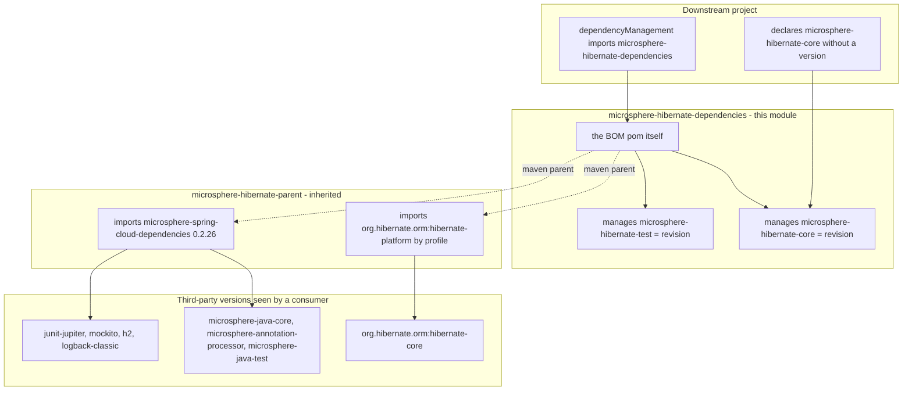
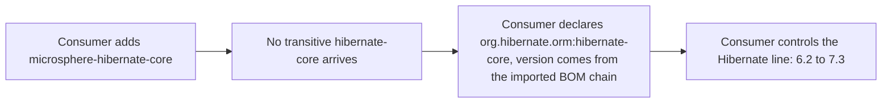

# microsphere-hibernate-dependencies — Developer Guide

Module: `microsphere-hibernate-dependencies` · Packaging: `pom` · Coordinates:
`io.github.microsphere-projects:microsphere-hibernate-dependencies:${revision}`
File: [`microsphere-hibernate-dependencies/pom.xml`](../../../microsphere-hibernate-dependencies/pom.xml)

This is the **publishable BOM** (Bill of Materials) of the project. It is the artifact end users import into
their own `<dependencyManagement>`; it is *not* where third-party versions are decided. Its content is exactly
two managed coordinates — the two jar modules of this repository — both pinned to `${revision}`.

```xml
<dependencyManagement>
    <dependencies>
        <dependency>
            <groupId>io.github.microsphere-projects</groupId>
            <artifactId>microsphere-hibernate-core</artifactId>
            <version>${revision}</version>
        </dependency>
        <dependency>
            <groupId>io.github.microsphere-projects</groupId>
            <artifactId>microsphere-hibernate-test</artifactId>
            <version>${revision}</version>
        </dependency>
    </dependencies>
</dependencyManagement>
```

---

## 1. Where version decisions actually happen



The important asymmetry:

| Question | Answered by |
|----------|-------------|
| "Which version of `microsphere-hibernate-core` do I get?" | **this module** (`${revision}`) |
| "Which version of `hibernate-core` does that require?" | `microsphere-hibernate-parent` → `hibernate-platform` (profile-selected) |
| "Which version of `microsphere-java-core` / JUnit / H2?" | `microsphere-spring-cloud-dependencies:0.2.26` imported by the parent |

Because a BOM import (`<scope>import</scope>`) also drags in the *inherited* `dependencyManagement` of the
imported pom's parent chain, consumers of this BOM transitively get the microsphere/Spring/Hibernate platform
management — but only as long as the **published** pom keeps its `<parent>` reference intact (the Flatten
Maven Plugin's `flattenMode` decides how much is inlined; verify against the pom that actually lands on
Central before documenting a change).

---

## 2. Why both project artifacts are `optional`-dependency publishers

`microsphere-hibernate-core` and `microsphere-hibernate-test` declare *all* of their non-test dependencies as
`<optional>true</optional>`. Combined with this BOM the effect is deliberate:



Consequences for maintainers:

* Adding a new runtime dependency to a jar module means (a) declaring it `optional` there and (b) making sure a
  version is managed by the parent chain or by this BOM — otherwise downstream builds break with a missing
  version, not with a conflict.
* Never replace `optional` with a normal scope "to make it easier"; that decision is shared with every other
  microsphere project and would silently change what consumers inherit.

---

## 3. Structure and conventions of this module

| Aspect | Current state | Rationale / caution |
|--------|---------------|---------------------|
| Parent | `microsphere-hibernate-parent` via `../microsphere-hibernate-parent/pom.xml` | Inherits the Hibernate profile machinery so `${revision}` and managed versions stay consistent |
| Aggregation | none | It is a leaf pom: consumers import it, the reactor builds it |
| `<properties>` | none | All properties come from the root pom / parent chain |
| Managed scope | only this project's own modules | Third-party management belongs in the parent, keeping the BOM stable across Hibernate upgrades |
| Profiles | none | Hibernate/Spring profiles are inherited from the parent and are the ones to activate when building |
| Deployed as | `pom` artifact `microsphere-hibernate-dependencies-x.y.z.pom` | The "Getting Started" section of the root README shows the import snippet |

### 3.1 Adding a new module to the BOM

When a fifth jar module (for example a future `microsphere-hibernate-spring-boot-starter`) is created:

1. Create the module directory with `<parent>` = `microsphere-hibernate-parent` and `<version>${revision}</version>`.
2. Add it to the root `<modules>` list.
3. Add its coordinate here with `<version>${revision}</version>` — the same style as the existing two entries.
4. Keep its own dependencies `optional`, and rely on the parent chain for third-party versions.
5. Update the module tables in `docs/current/developer-guide/` **and** the matching `zh/` files.

Ordering convention: keep entries sorted top-down by dependency depth (core first, then anything that depends
on core) so the BOM reads like the reactor.

---

## 4. Verifying the BOM locally

```bash
# 1. Publish the whole reactor (parent + BOM + jars) to the local repository
./mvnw -Drevision=0.0.0-LOCAL clean install

# 2. Inspect what the BOM resolves for a managed coordinate
./mvnw -q -o help:effective-pom -pl microsphere-hibernate-dependencies | grep -A2 microsphere-hibernate-core

# 3. In a scratch project that imports the BOM, confirm no transitive Hibernate leak
./mvnw -q dependency:tree -Dincludes=org.hibernate.orm
```

What you should observe: `microsphere-hibernate-core` appears with the concrete version (never the literal
`${revision}`), and `org.hibernate.orm:hibernate-core` is **absent** from the tree unless the scratch project
declared it.

---

## 5. Release considerations

* The BOM is versioned in lock-step with the jars (`${revision}`), which is why the publish workflow deploys the
  whole reactor in one run — never deploy this module alone at a different version.
* Users pin `${microsphere-hibernate.version}`; the 0.2.x line (`release` branch) and the 1.x line
  (`release-1.x` branch) publish disjoint version ranges (`0.2.x` vs `0.1.x`) from the same artifact id, so
  version selection *is* branch selection. Do not introduce a shared version across the two lines.
* Because it is `pom`-packaged, there is no jar, no javadoc jar and no sources jar for this artifact — a
  "missing javadoc" complaint in Central validation usually points at a packaging mistake, not at this pom.

---

Previous: [`microsphere-hibernate-parent.md`](./microsphere-hibernate-parent.md) ·
Next: [`microsphere-hibernate-core.md`](./microsphere-hibernate-core.md) ·
[Index](./README.md)
