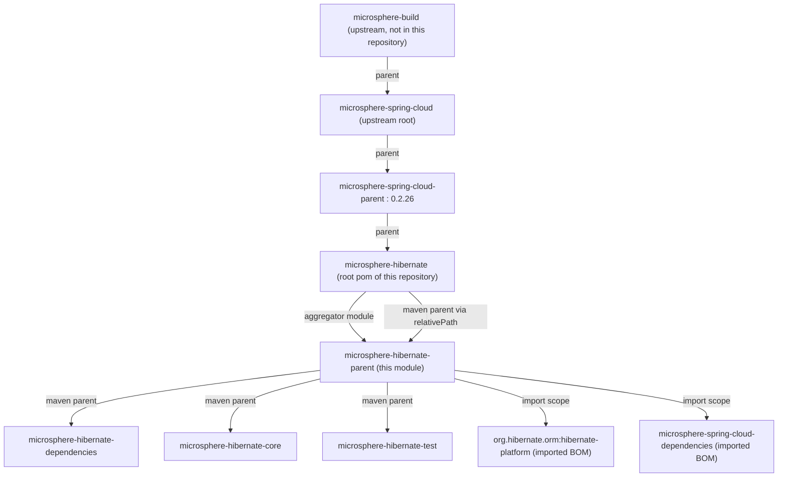
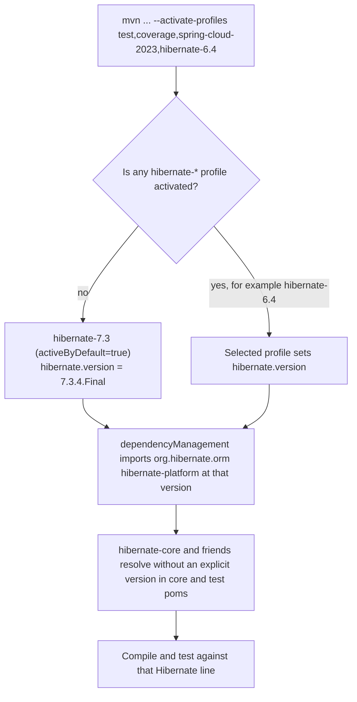
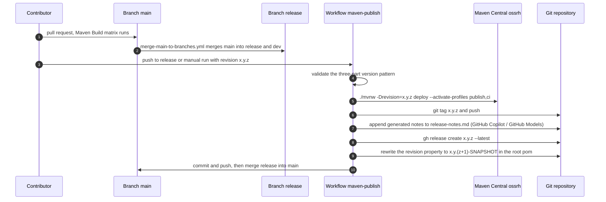

# microsphere-hibernate-parent — Developer Guide

Module: `microsphere-hibernate-parent` · Packaging: `pom` · Coordinates:
`io.github.microsphere-projects:microsphere-hibernate-parent:${revision}`
File: [`microsphere-hibernate-parent/pom.xml`](../../../microsphere-hibernate-parent/pom.xml)

This module holds **the whole version policy of the project**: which Hibernate ORM line is compiled against,
which BOMs supply dependency versions, and how the `${revision}` CI-friendly version is threaded through the
reactor. It declares **no build plugins, no dependencies and no modules** — it is a pure inheritance parent.

---

## 1. Position in the POM hierarchy



Two structural facts that surprise newcomers and that must be preserved:

1. **The root pom is simultaneously the aggregator and the Maven parent of `microsphere-hibernate-parent`.**
   The root declares `<module>microsphere-hibernate-parent</module>` *and* is referenced by
   `<parent>microsphere-hibernate</parent>` inside that module. Maven resolves it through
   `<relativePath>../pom.xml</relativePath>`, so the reactor stays acyclic, but the parent pom is a
   **module** — it is therefore built (and deployed) as an artifact consumers can inherit from.
2. **`microsphere-hibernate-parent` does not aggregate anything.** Children (dependencies / core / test) point
   at it explicitly with `<relativePath>../microsphere-hibernate-parent/pom.xml</relativePath>`; aggregation is
   owned exclusively by the root pom.

---

## 2. Anatomy of the POM

```xml
<parent>
    <groupId>io.github.microsphere-projects</groupId>
    <artifactId>microsphere-hibernate</artifactId>   <!-- the root aggregator -->
    <version>${revision}</version>
    <relativePath>../pom.xml</relativePath>
</parent>

<artifactId>microsphere-hibernate-parent</artifactId>
<version>${revision}</version>
<packaging>pom</packaging>

<properties>
    <microsphere-spring-cloud.version>0.2.26</microsphere-spring-cloud.version>
</properties>

<dependencyManagement>
    <dependencies>
        <dependency>  <!-- Hibernate line selected by profile -->
            <groupId>org.hibernate.orm</groupId>
            <artifactId>hibernate-platform</artifactId>
            <version>${hibernate.version}</version>
            <type>pom</type><scope>import</scope>
        </dependency>
        <dependency>  <!-- everything else microsphere-related -->
            <groupId>io.github.microsphere-projects</groupId>
            <artifactId>microsphere-spring-cloud-dependencies</artifactId>
            <version>${microsphere-spring-cloud.version}</version>
            <type>pom</type><scope>import</scope>
        </dependency>
    </dependencies>
</dependencyManagement>
```

### 2.1 Import precedence

`dependencyManagement` in *this* pom is evaluated before anything inherited from
`microsphere-spring-cloud-parent`, and among `<scope>import</scope>` entries **the first declaration wins** for
duplicated coordinates. That is why `hibernate-platform` is listed first: Hibernate-managed artifacts
(`hibernate-core`, `hibernate-maven-plugin`, the JPAsmetamodel helpers, …) resolve to the profile-selected
Hibernate line rather than to whatever version a Spring Boot BOM happens to mention.
Re-ordering these two entries is a functional change and must be justified in review.

### 2.2 What this module deliberately does *not* contain

| Absent element | Where it lives instead |
|----------------|------------------------|
| `<modules>` | root `pom.xml` |
| `<dependencies>` (non-managed) | leaf jar modules (`core`, `test`) |
| `<build>`, plugins, compiler config | upstream parent chain (`microsphere-build`) |
| `<distributionManagement>` / GPG / staging | upstream parent chain, activated by the `publish` / `ci` profiles |
| JUnit / Surefire / Jacoco tuning | upstream `test` and `coverage` profiles |

Consequence: a build failure about the compiler release, jar manifest, sources jar or Central deployment is
**not** fixed here — first reproduce it with `-X` to see which upstream plugin configuration is in play.

---

## 3. Version management

### 3.1 `${revision}` (CI-friendly versions)

Every module — root, parent, dependencies, core, test — declares `<version>${revision}</version>`, and
`revision` is defined exactly once, in the root pom:

```xml
<properties>
    <revision>0.2.11-SNAPSHOT</revision>
    <java.version>17</java.version>
</properties>
```

Rules that follow from this design:

* `${revision}` also appears in the `<parent><version>` of every child. This is legal because the property is
  defined in the pom that is being read as the parent (the root), so Maven can interpolate it.
* The value is **overridable on the command line**, which is what CI relies on:
  `./mvnw -Drevision=0.0.1-SNAPSHOT test` (build workflow) and
  `./mvnw -Drevision=${{ inputs.revision }} deploy` (publish workflow). Never hard-code a concrete version in
  a module pom.
* A pom published with a literal `${revision}` is unusable by consumers. The upstream parent chain configures
  the **Flatten Maven Plugin** for this repository's releases — `.gitignore` contains
  `# flatten ignore` / `.flattened-pom.xml`, and the publish workflow runs with `-Dsurefire.useSystemClassLoader=false`
  plus `--activate-profiles publish,ci`. If publishing behaviour must change, inspect the upstream `flattenMode`
  before touching this pom.

### 3.2 The Hibernate version profiles



| Profile | `hibernate.version` | Hibernate major | Notes for contributors |
|---------|---------------------|-----------------|------------------------|
| `hibernate-7.3` | `7.3.4.Final` | 7 | default; the reference configuration |
| `hibernate-7.2` | `7.2.14.Final` | 7 | |
| `hibernate-7.1` | `7.1.25.Final` | 7 | |
| `hibernate-7.0` | `7.0.10.Final` | 7 | first Jakarta-2.x / `org.hibernate.event.spi` 7 line |
| `hibernate-6.6` | `6.6.50.Final` | 6 | |
| `hibernate-6.5` | `6.5.3.Final` | 6 | |
| `hibernate-6.4` | `6.4.10.Final` | 6 | |
| `hibernate-6.3` | `6.3.2.Final` | 6 | |
| `hibernate-6.2` | `6.2.52.Final` | 6 | oldest supported line; run it before merging API-touching changes |

Profile semantics worth remembering:

* `activeByDefault` on `hibernate-7.3` is switched off as soon as **another profile of this same pom** is
  activated. Activating only `spring-cloud-2022` (defined upstream) leaves `hibernate-7.3` active, which is why
  CI always passes one profile from each family.
* Activating two `hibernate-*` profiles makes the effective `hibernate.version` depend on profile ordering in
  the effective POM. Do not do it, and do not rely on the observed outcome.
* Adding a line means **two edits in the same PR**: the profile here and the `maven-hibernate` matrix entry in
  `.github/workflows/maven-build.yml`. Removing a line requires deleting both, otherwise CI fails with
  "profile does not exist".

### 3.3 Spring Cloud / JDK alignment

`<java.version>17</java.version>` (root pom) plus the four/five `spring-cloud-*` profiles inherited from
`microsphere-spring-cloud-parent` define the 0.2.x compatibility contract:

| Dimension | Range enforced by this parent |
|-----------|-------------------------------|
| JDK | 17 minimum (CI: 17, 21, 25) |
| Spring Cloud | 2022.0.x … 2025.0.x (`spring-cloud-2022` … `spring-cloud-2025`) |
| Hibernate ORM | 6.2.x … 7.3.x |
| microsphere-java-core & co. | managed by `microsphere-spring-cloud-dependencies:0.2.26` |

---

## 4. Release lifecycle (what happens to the version)



Notes derived from the workflow source:

* Signing is skipped (`-Dgpg.skip=true`) and the deployment credential/signing material is injected through the
  `MAVEN_USERNAME` / `MAVEN_PASSWORD` / `SIGN_KEY*` environment variables consumed by the upstream `publish`
  profile — nothing about credentials lives in this pom.
* The version bump uses `sed` on the **root** `pom.xml` only, because `revision` is defined once. If a future
  module hard-codes a version, the automation will silently miss it.
* Tags on this line are plain `x.y.z` (for example `0.2.10`), the 1.x line uses its own tags (`0.1.10`).

---

## 5. Practical guidance

### 5.1 How to verify which Hibernate version you actually built with

```bash
./mvnw -q -o help:evaluate -Dexpression=hibernate.version -DforceStdout -P hibernate-6.2
./mvnw -pl microsphere-hibernate-core dependency:tree -Dincludes=org.hibernate.orm
```

`core` and `test` declare `org.hibernate.orm:hibernate-core` **without a version**; the resolved version proves
the profile wiring works.

### 5.2 Adding or removing a managed third-party library

1. Do **not** add versions to `core/pom.xml` / `test/pom.xml`.
2. If the library belongs to the Hibernate or Spring universe, it is already managed by an imported BOM — just
   declare the coordinate without a version.
3. If it is new, prefer adding a `<dependencyManagement>` entry here (project-wide policy) rather than in the
   publishable BOM (`microsphere-hibernate-dependencies`, which is about *this project's own* artifacts, see
   [`microsphere-hibernate-dependencies.md`](./microsphere-hibernate-dependencies.md)).

### 5.3 Reviewer checklist for this module

- [ ] Exactly one `hibernate.version` per profile, no `-SNAPSHOT` Hibernate versions.
- [ ] `hibernate-platform` remains the **first** import in `dependencyManagement`.
- [ ] New profiles are mirrored in `.github/workflows/maven-build.yml`.
- [ ] `microsphere-spring-cloud.version` bumps are accompanied by a full CI matrix run.
- [ ] No plugin, dependency or module configuration sneaks into this pom.
- [ ] `<revision>` untouched unless the publish workflow made the change.

### 5.4 Failure patterns

| Symptom | Likely cause | Fix |
|---------|--------------|-----|
| `Could not find artifact …:microsphere-hibernate-parent:${revision}` | `-Drevision` not passed while resolving from a repository, or a stale flattened pom in `~/.m2` | Build from the reactor root (`-pl <module> -am`) or install with flatten enabled |
| `Non-resolvable parent POM … microsphere-spring-cloud-parent:0.2.26` | Offline mode / missing mirror | Restore network access or seed the local repository |
| Compile error about `org.hibernate.event.spi` types | Inherited Hibernate line differs from what the code expects | Check the active profile and `dependency:tree` |
| Tests pass locally, fail in CI on one JDK | Matrix cell not reproduced locally | Re-run with `-Drevision=0.0.1-SNAPSHOT --activate-profiles test,coverage,spring-cloud-<x>,hibernate-<y>` |

---

Next: [`microsphere-hibernate-dependencies.md`](./microsphere-hibernate-dependencies.md) ·
[`microsphere-hibernate-core.md`](./microsphere-hibernate-core.md) ·
[`README.md`](./README.md)
