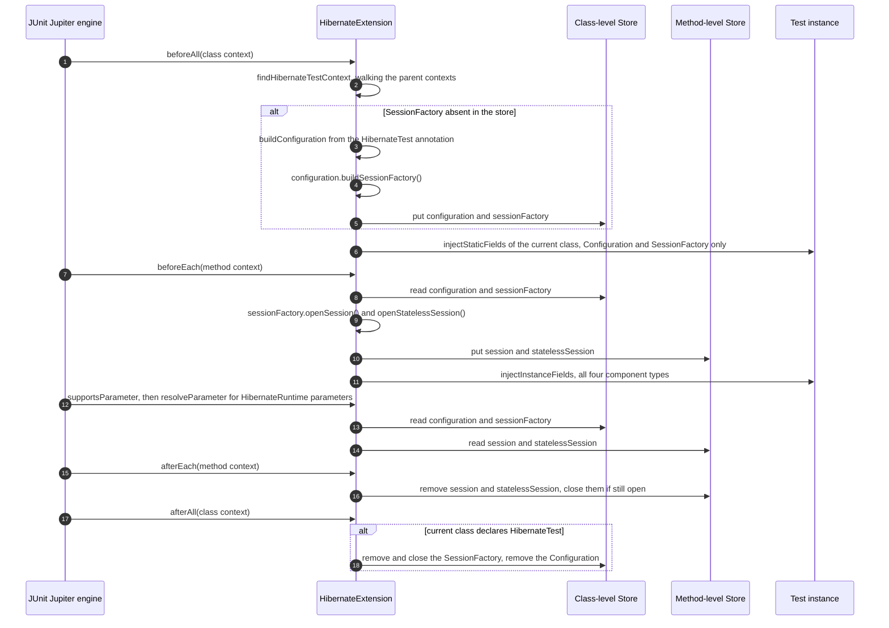
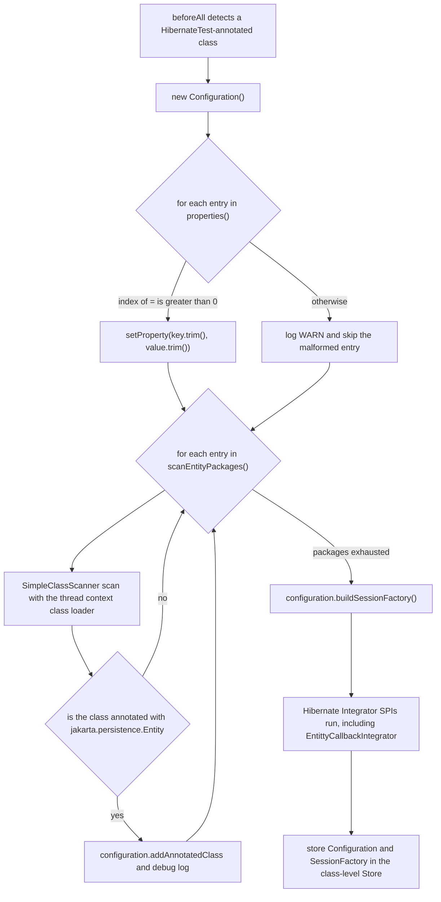
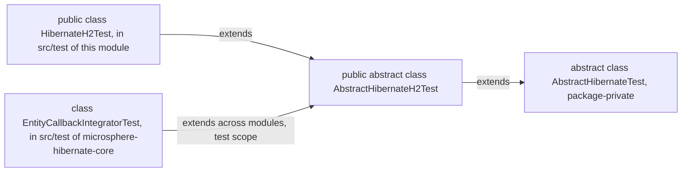
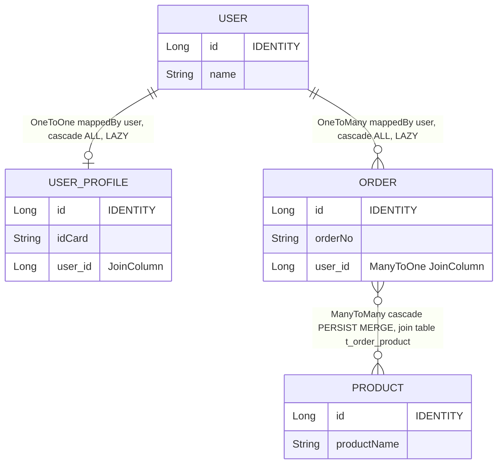

# microsphere-hibernate-test — Developer Guide

Module: `microsphere-hibernate-test` · Packaging: `jar` · Coordinates:
`io.github.microsphere-projects:microsphere-hibernate-test:${revision}`
POM: [`microsphere-hibernate-test/pom.xml`](../../../microsphere-hibernate-test/pom.xml)
Sources: `microsphere-hibernate-test/src/main/java/io/microsphere/hibernate/test/`

This module is the **test framework** of the project: a JUnit 5 extension that bootstraps a real Hibernate
`SessionFactory` (plus `Session` / `StatelessSession`) for a test class, an annotation-driven configuration model
for it, and a set of abstract fixtures with a ready-made entity graph on H2. `microsphere-hibernate-core` uses
it in `test` scope for its only integration test, so it is simultaneously *test tooling* and *part of the
project's verification strategy*.

---

## 1. Build anatomy

Every dependency is `<optional>true</optional>` (compile scope), including the testing libraries:

| Dependency | Scope | Note |
|------------|-------|------|
| `io.github.microsphere-projects:microsphere-annotation-processor` | optional | Metadata generation, as in `core` |
| `io.github.microsphere-projects:microsphere-java-core` | optional | `SimpleClassScanner`, `io.microsphere.logging` |
| `io.github.microsphere-projects:microsphere-java-test` | optional | Shared microsphere test helpers |
| `org.hibernate.orm:hibernate-core` | optional | `Configuration`, `SessionFactory`, `Session`, `StatelessSession` |
| `com.h2database:h2` | optional | The harness ships an H2-based fixture, so the driver is part of the published API surface |
| `org.junit.jupiter:junit-jupiter` | optional | `Extension`, `@Nested`, assertions |
| `org.mockito:mockito-core`, `mockito-junit-jupiter` | optional | Available to consumers; not used by this module's own tests |
| `ch.qos.logback:logback-classic` | optional | Logging backend for `io.microsphere.logging` |

Consequences:

* Because JUnit is *optional* rather than `test`-scoped, this module publishes **main** sources that depend on
  JUnit (`HibernateExtension` implements JUnit interfaces). That is intentional — it is a testing library — but
  it means consumers must declare JUnit themselves and the module's own `src/test` runs with the same classpath.
* No `META-INF/services/org.junit.jupiter.api.extension.Extension` descriptor exists in this module: the
  extension is activated **only** through `@ExtendWith` meta-annotated on `@HibernateTest`, never through JUnit
  extension auto-detection. Do not add an auto-detection descriptor — it would silently bootstrap Hibernate in
  unrelated tests.

Layout:

```text
io/microsphere/hibernate/test/
├── HibernateTest.java                 (public annotation, @Target(TYPE), @Inherited, @ExtendWith)
├── HibernateRuntime.java              (public annotation, @Target({FIELD, PARAMETER}))
├── HibernateExtension.java            (public JUnit 5 extension)
├── AbstractHibernateTest.java         (package-private template-method base class)
├── AbstractHibernateH2Test.java       (public H2 base class with entity fixtures and @Nested tests)
└── entity/                            (User, UserProfile, Order, Product)
```

---

## 2. `HibernateExtension`: the JUnit 5 contract

```java
public class HibernateExtension implements BeforeAllCallback, BeforeEachCallback,
        AfterEachCallback, AfterAllCallback, ParameterResolver
```

Five callbacks, one namespace, four store keys:

```java
private static final Namespace NAMESPACE = Namespace.create(HibernateExtension.class);
private static final String CONFIGURATION_KEY   = "configuration";
private static final String SESSION_FACTORY_KEY = "sessionFactory";
private static final String SESSION_KEY         = "session";
private static final String STATELESS_SESSION_KEY = "statelessSession";
```

| Key | Stored in | Lifetime | Injected into static fields |
|-----|-----------|----------|-----------------------------|
| `configuration` | store of the `@HibernateTest`-annotated class context | one test class (shared with nested classes) | yes |
| `sessionFactory` | same class-level store | one test class | yes |
| `session` | store of the **method** context | one test method | **no** (stays `null`) |
| `statelessSession` | same method-level store | one test method | **no** (stays `null`) |

The class-level store is obtained from `findHibernateTestContext(context)`, which walks the
`ExtensionContext` parent chain until it finds a context whose test class carries `@HibernateTest`. This is
what makes `@Nested` classes share the outer `SessionFactory` instead of building one per nesting level.

### 2.1 Lifecycle



Design details worth preserving:

* **Idempotent `beforeAll`.** The `if (store.get(SESSION_FACTORY_KEY) == null)` guard plus the parent-walk means
  outer and inner classes both call `beforeAll` without building two factories.
* **`afterAll` ownership rule.** Only the context whose class literally declares `@HibernateTest` closes the
  factory (`testClassOpt.get().isAnnotationPresent(HibernateTest.class)`), otherwise a `@Nested` class finishing
  first would tear the factory down for its siblings.
* **Close is best-effort.** `afterEach`/`afterAll` wrap `close()` in `try/catch` and log a warning
  (`"Failed to close Session"`, `"Failed to close StatelessSession"`, `"Failed to close SessionFactory"`)
  instead of failing the test. Resource-leak noise therefore shows up in the logs, not in the report.
* **Early exits everywhere.** Missing test class, missing `@HibernateTest` ancestor or a `null` `SessionFactory`
  cause silent returns, so applying the extension to a non-Hibernate class is harmless.
* **Injection is field-type driven, not name driven.** `resolveValueForType` maps exactly
  `Configuration` → configuration, `SessionFactory` → sessionFactory, `Session` → session,
  `StatelessSession` → statelessSession; anything else returns `null` and the field is simply left untouched.
  `isSupportedType` applies the same whitelist to parameters, and unsupported annotated parameters therefore
  fall through to other resolvers.
* `getAllDeclaredFields` walks the class hierarchy up to but excluding `Object`, so `@HibernateRuntime` fields
  inherited from a base class are injected too; `field.setAccessible(true)` means `private` is fine, but
  `final` fields would throw `IllegalAccessException` — do not mark injected fields `final`.

### 2.2 Annotation model

`@HibernateTest` (`RetentionPolicy.RUNTIME`, `ElementType.TYPE`, `@Inherited`, `@Documented`,
meta-annotated `@ExtendWith(HibernateExtension.class)`):

| Attribute | Format | Behaviour in `buildConfiguration` |
|-----------|--------|-----------------------------------|
| `properties()` | `String[]` of `key=value` | Split on the **first** `'='`; `key` and `value` are trimmed; entries with an index `<= 0` (missing `'='`, empty key, or a leading `'='`) are logged as `WARN` and skipped. Values may themselves contain `'='`. |
| `scanEntityPackages()` | `String[]` of package names | Each package is scanned with `SimpleClassScanner.INSTANCE.scan(classLoader, packageName, true, true)` using `Thread.currentThread().getContextClassLoader()`; only classes annotated `@jakarta.persistence.Entity` are registered via `configuration.addAnnotatedClass(...)` (debug-logged). |

Because the annotation is `@Inherited`, a subclass of an annotated test class inherits `@HibernateTest` and with
it the extension registration; the properties are read from `hibernateTestContext.getRequiredTestClass()`, i.e.
from the annotated ancestor, not from the subclass.

There is **no default configuration**: an empty `@HibernateTest` yields a `Configuration` with no properties and
no entities, and `buildSessionFactory()` fails during bootstrap. Always supply connection properties (see
`HibernateAnnotationTest`) or extend `AbstractHibernateH2Test` instead.



Step `K` is the reason this module matters to `core`: every annotation-driven test also exercises the
`EntityCallback` bootstrap path.

---

## 3. Abstract fixtures: the template-method family



`AbstractHibernateTest` (package-private) — a Template Method base with a `final` lifecycle:

```java
@BeforeEach final void setUp()  { configuration = buildConfiguration();
                                 customizeConfiguration(configuration);
                                 sessionFactory = configuration.buildSessionFactory();
                                 session = sessionFactory.openSession();
                                 statelessSession = sessionFactory.openStatelessSession();
                                 init(); }
@AfterEach  final void tearDown(){ destroy(); session.close(); statelessSession.close(); sessionFactory.close(); }
```

| Hook | Kind | Purpose |
|------|------|---------|
| `buildConfiguration()` | `abstract`, must implement | Supply properties and annotated classes |
| `customizeConfiguration(Configuration)` | overridable no-op | Last-mile tweaks without rebuilding |
| `init()` / `destroy()` | overridable no-op | Fixture data creation / cleanup around each test method |

Notable semantics:

* Fields `configuration`, `sessionFactory`, `session`, `statelessSession` are `protected`, and
  `setUp`/`tearDown` are `final` — the lifecycle cannot be broken by subclasses, only customised.
* The factory is rebuilt **per test method** (not per class), unlike `HibernateExtension`. That buys isolation
  (fresh Hibernate caches, no `@Cacheable` leftovers) at a measurable time cost; prefer `@HibernateTest` when a
  per-class factory is acceptable.
* Visibility is the coupling to remember: `AbstractHibernateTest` is package-private, so tests outside
  `io.microsphere.hibernate.test` can only extend `AbstractHibernateH2Test`. That is precisely what
  `EntityCallbackIntegratorTest` (package `io.microsphere.hibernate.entity`, another module) does.

`AbstractHibernateH2Test` adds:

* `buildConfiguration()` → four annotated classes plus an H2 in-memory configuration:
  `org.h2.Driver`, `jdbc:h2:mem:test_db;DB_CLOSE_DELAY=-1`, `sa` / empty password, `org.hibernate.dialect.H2Dialect`,
  `hibernate.format_sql=true`, `hibernate.show_sql=true`, `hibernate.hbm2ddl.auto=update`.
* `protected User user` created by the overridable `createUser()` factory method (User + UserProfile + Order +
  Product graph) inside `init()`.
* `doInAction(Runnable)` — asserts "does not throw" without a transaction.
* Two `@Nested` suites, `SessionTest` and `StatelessSessionTest`, whose own `doInTransaction` helpers wrap the
  action in `assertDoesNotThrow` + `beginTransaction`/`commit`. They cover `persist`, `get`, `find`, `merge`,
  `remove`, `replicate(LATEST_VERSION)`, `flush`, `detach`, `evict`, `lock(READ)`, `refresh`, HQL
  `FROM User`, and on the stateless side `insert`, `get`, `update`, `delete`, `refresh`, `fetch`.

Those nested tests are the de-facto contract test of the whole project: they run once in the `test` module and
again inside `core` (with the `EntityCallback` bridge active) via `EntityCallbackIntegratorTest`.

---

## 4. Entity fixtures



| Entity | Table | Relationships | Why it exists in the harness |
|--------|-------|---------------|------------------------------|
| `User` | `t_user` | `@OneToOne(mappedBy="user", cascade=ALL, fetch=LAZY) UserProfile`, `@OneToMany(mappedBy="user", cascade=ALL, fetch=LAZY) List<Order>`, plus `addOrder(Order)` maintaining both sides | Cascade + collection events (`onPersist` cascades, `PRE/POST_COLLECTION_*`) |
| `UserProfile` | `t_user_profile` | owning side `@OneToOne User` with `@JoinColumn(name="user_id")` | `OneToOne` cascade and `orphanRemoval`-style removals in `testPersistAndRemove` |
| `Order` | `t_order` | `@ManyToOne User`, `@ManyToMany(cascade={PERSIST,MERGE}) Set<Product>` with `t_order_product` join table | Collection recreate/update/remove events |
| `Product` | `t_product` | `@ManyToMany(mappedBy="products", fetch=LAZY) Set<Order>` | The inverse side, exercised through `StatelessSession` |

All four use `@Id @GeneratedValue(strategy = IDENTITY)` and implement `equals`/`hashCode` on
`(id, businessField)` with Java 17 pattern matching (`if (!(o instanceof User user1)) return false;`).
The `IDENTITY` strategy is deliberate: `session.persist()` inserts immediately, so `PRE_INSERT`/`POST_INSERT`
callbacks fire during `persist` rather than at flush — the assertion points in `core`'s integration test rely on
that. Be careful when changing it: with `SEQUENCE`/`TABLE` generation the callbacks move to commit time and the
`testInsertAndGet`-style assertions in `StatelessSessionTest` change meaning.

The entity unit tests (`UserTest`, `OrderTest`, `ProductTest`, `UserProfileTest` in `src/test`) are plain POJO
tests — constructor defaults, getters/setters, `addOrder` bidirectionality and the `equals`/`hashCode` contract.
They exist to keep the fixtures trustworthy without bootstrapping Hibernate.

---

## 5. Self-tests of this module

| Test | Mechanism | Assertion focus |
|------|-----------|-----------------|
| `HibernateH2Test` (`public`, extends the H2 base) | Template-method family; overrides `customizeConfiguration` calling `super` | Proves `AbstractHibernateH2Test` boots and all inherited nested suites pass |
| `HibernateAnnotationTest` (`@HibernateTest` with 6 properties and `scanEntityPackages`) | Annotation/extension family | Three `@Nested` classes: instance fields get all four components; static fields get `Configuration`/`SessionFactory` while `Session`/`StatelessSession` **must remain null**; constructor parameters annotated `@HibernateRuntime` resolve for all four types |
| `entity/*Test` | POJO only | Fixture correctness |

`HibernateAnnotationTest` is also the documentation of the scanner: `io.microsphere.hibernate.test.entity` is
discovered at runtime and its four `@Entity` classes are registered without any `addAnnotatedClass` call. If you
move the entities to another package, this test breaks first — update both.

---

## 6. Guidelines for extending this module

1. **Keep the harness honest.** Any new Hibernate capability you add to `core` should get an assertion path here
   (a nested suite in `AbstractHibernateH2Test`, or a focused test in `core` that extends it).
2. **Never let `test` reference `core` at compile scope.** It would create a real Maven cycle (see the
   [index](./README.md)); `core` depends on `test` in `test` scope only, which is why `core` is built last.
3. **Adding a second database flavour**: subclass `AbstractHibernateTest` (same package, so package-private
   access works), return a different `Configuration`, and keep `buildConfiguration()` free of side effects so
   subclasses can override `customizeConfiguration`. For an annotation-driven equivalent, add attributes to
   `@HibernateTest` (defaults preserved) rather than inventing new annotations.
4. **Isolation caution**: `jdbc:h2:mem:test_db;DB_CLOSE_DELAY=-1` plus `hbm2ddl.auto=update` and a reused Surefire
   JVM means tables and rows persist across test classes in the same module. Use `@DirtiesContext`-like
   discipline (delete your own rows in `destroy()`), or a distinct `DB_CLOSE_DELAY`/database name per fixture if
   you add a new base class.
5. **Transaction discipline in the nested suites**: `doInAction` deliberately runs without a transaction (that is
   how `detach`, `evict`, `lock` are exercised). Do not "fix" those to `doInTransaction` — they test that these
   operations do not throw outside a transaction boundary.
6. **Style**: this module is where the project's conventions are most visible (ASF header, `@author`, `@since`,
   javadoc with sections). `HibernateExtension` currently deviates in two spots — the inline
   `java.util.List`/`java.util.ArrayList`/`java.util.Arrays` usage inside `getAllDeclaredFields` and the
   fully-qualified `getLockMode` javadoc style elsewhere — prefer real imports in new code.
7. **Do not switch JUnit scope from `optional` to `compile`** without deciding that every consumer now inherits
   JUnit transitively; that is a publishing-policy change shared with the 1.x line.

---

## 7. Reviewer checklist

- [ ] New extension callbacks keep the "early return when no `@HibernateTest` is found" behaviour.
- [ ] Class-level vs method-level store keys used consistently (`session` must never land in the class store).
- [ ] `afterAll` still closes the factory only from the annotated class.
- [ ] Injection whitelist updated in *all three* places: `resolveValueForType`, `resolveComponent`, `isSupportedType`.
- [ ] Malformed `key=value` handling still warns and skips instead of throwing.
- [ ] Entity package scanning still uses the thread context class loader and still filters on `@Entity`.
- [ ] `AbstractHibernateTest` remains package-private and its `setUp`/`tearDown` remain `final` unless a
      documented reason exists.
- [ ] Fixture changes are mirrored in the `core` integration test and in both `docs/current/developer-guide` and
      `docs/current/developer-guide/zh`.

---

Previous: [`microsphere-hibernate-core.md`](./microsphere-hibernate-core.md) ·
[Index](./README.md)
