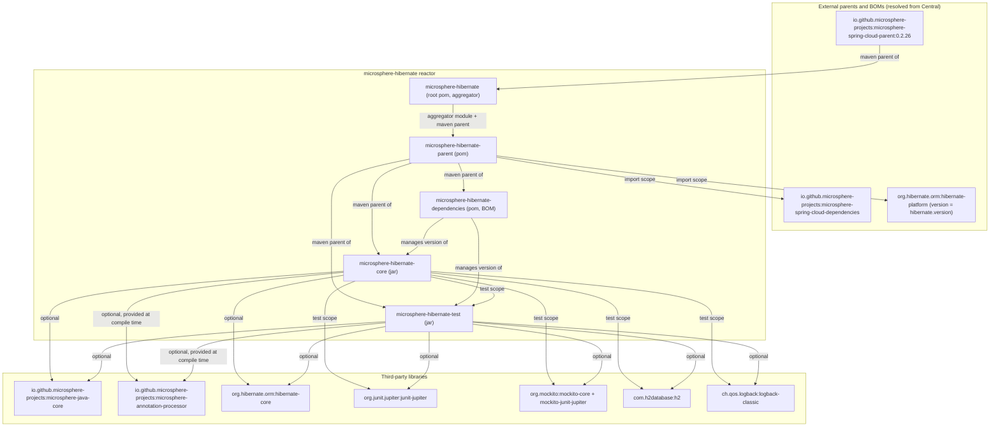
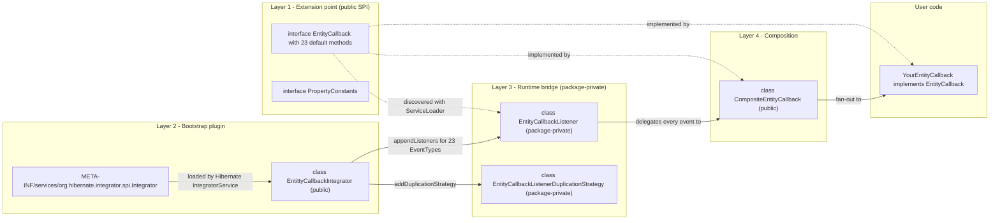
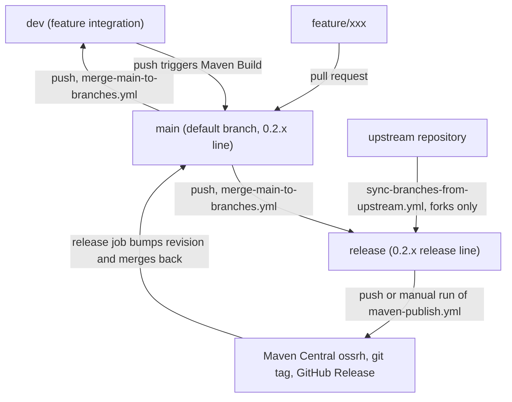

# microsphere-hibernate — 开发者文档（0.2.x / `release` 分支）

> 读者对象：`microsphere-hibernate` 的贡献者与维护者。
> 本文档说明**项目如何构建、代码如何分层、为什么这样设计**，而不是把库作为最终用户如何使用。
> 使用方式请见配套的《用户文档》（`../user-guide/`）。

| 项目 | 该分支的取值 |
|------|--------------|
| 分支 | `release`（0.2.x 版本线；`main` 会持续合并到它） |
| 版本 | 根 `pom.xml` 中 `${revision}` = `0.2.11-SNAPSHOT`（每次发布后自动递增） |
| Java 基线 | JDK 17（`<java.version>17</java.version>`），CI 还会跑 JDK 21、JDK 25 |
| Hibernate ORM | `org.hibernate.orm:hibernate-core` 6.2.x – 7.3.x，由 Maven profile 选择 |
| 坐标 | `io.github.microsphere-projects:microsphere-hibernate-{parent,dependencies,core,test}` |
| Maven | Maven Wrapper，`distributionType=only-script`，Apache Maven `3.9.16` |
| 许可证 | Apache License 2.0（每个源文件都必须带许可证头） |

---

## 1. 开发环境搭建

### 1.1 前置条件

| 工具 | 要求 | 说明 |
|------|------|------|
| JDK | 17 及以上 | `pom.xml` 固定 `<java.version>17</java.version>`；发布时也使用 JDK 17 |
| Maven | 无需安装 | `./mvnw`（Unix）/ `mvnw.cmd`（Windows）使用 `wrapperVersion=3.3.4`、`distributionType=only-script`，会下载 Apache Maven `3.9.16` |
| Git | 任意较新版本 | 分支模型见第 5 节 |
| IDE | IntelliJ IDEA / Eclipse / VS Code | 以 Maven **reactor** 方式导入（打开根 `pom.xml`）；无代码生成、无 Lombok，除可选的 `microsphere-annotation-processor` 外没有注解处理器配置 |

首次构建需要能访问 Maven Central（或镜像），因为父级链（`microsphere-spring-cloud-parent` →
`microsphere-spring-cloud` → `microsphere-build`）以及被 import 的 BOM
（`org.hibernate.orm:hibernate-platform`、`microsphere-spring-cloud-dependencies`）都要远程解析。

### 1.2 首次构建

```bash
# 在仓库根目录执行
git clone https://github.com/microsphere-projects/microsphere-hibernate.git
cd microsphere-hibernate
git checkout release          # 0.2.x 版本线

./mvnw --batch-mode clean install          # 默认 profile：hibernate-7.3 + spring-cloud-2025
```

Windows 下把 `./mvnw` 换成 `mvnw.cmd`，goal 与参数完全一致。

### 1.3 在本地复现 CI 构建

`.github/workflows/maven-build.yml` 跑的是 **JDK × Spring Cloud profile × Hibernate profile** 矩阵，
使用 `-Drevision=0.0.1-SNAPSHOT` 并激活 profile `test,coverage,<spring-cloud-*>,<hibernate-*>`：

```bash
./mvnw --batch-mode --update-snapshots --file pom.xml \
  -Drevision=0.0.1-SNAPSHOT \
  test \
  --activate-profiles test,coverage,spring-cloud-2022,hibernate-6.2
```

`test` 与 `coverage` profile **继承自上游父级链**（它们提供 Surefire/Jacoco 配置）；`coverage` 产出的数据用于
`codecov-action` 上传。

常用的单模块命令（始终带 `-am`，把依赖的兄弟模块一起构建）：

```bash
./mvnw -pl microsphere-hibernate-core -am test
./mvnw -pl microsphere-hibernate-test -am -Dtest=HibernateAnnotationTest test
```

> reactor 顺序为 **root → parent → dependencies → test → core**。`core` 虽然写在 `<modules>` 前面，
> 但因为其对 `microsphere-hibernate-test` 有 `test` scope 依赖，Maven 会把它排到最后
> （见 [模块依赖总图](#2-模块依赖总图)）。

### 1.4 可用的 Maven profile

| Profile id | `hibernate.version` | 是否默认激活 |
|------------|---------------------|--------------|
| `hibernate-7.3` | `7.3.4.Final` | **是** |
| `hibernate-7.2` | `7.2.14.Final` | 否 |
| `hibernate-7.1` | `7.1.25.Final` | 否 |
| `hibernate-7.0` | `7.0.10.Final` | 否 |
| `hibernate-6.6` | `6.6.50.Final` | 否 |
| `hibernate-6.5` | `6.5.3.Final` | 否 |
| `hibernate-6.4` | `6.4.10.Final` | 否 |
| `hibernate-6.3` | `6.3.2.Final` | 否 |
| `hibernate-6.2` | `6.2.52.Final` | 否 |

`spring-cloud-2022` … `spring-cloud-2025.1` 由继承的父级提供。**每个族只能激活一个 profile** —— 同时激活两个
`hibernate-*` 会让属性取值依赖 profile 顺序，从而产生难以定位的失败。详见
[`microsphere-hibernate-parent.md`](./microsphere-hibernate-parent.md)。

---

## 2. 模块依赖总图



| 模块 | packaging | 职责 | 自身构建依赖 |
|------|-----------|------|--------------|
| `microsphere-hibernate`（根） | `pom` | 聚合器，持有 `<revision>`/`<java.version>`，继承 `microsphere-spring-cloud-parent` | — |
| `microsphere-hibernate-parent` | `pom` | 版本策略：import Hibernate platform BOM，声明 `hibernate-*` profile | 根 pom |
| `microsphere-hibernate-dependencies` | `pom` | 可发布的 BOM：把 `microsphere-hibernate-core` / `-test` 锁定在 `${revision}` | parent |
| `microsphere-hibernate-core` | `jar` | Hibernate `Integrator` + `EntityCallback` SPI | `hibernate-core`、`microsphere-java-core`（均为 *optional*），以及 `test` scope 的 `microsphere-hibernate-test` |
| `microsphere-hibernate-test` | `jar` | JUnit 5 测试框架（`@HibernateTest`、`@HibernateRuntime`、`HibernateExtension`、H2 抽象夹具） | `hibernate-core`、`junit-jupiter`、`h2`、`microsphere-java-core`、`microsphere-java-test`（全部 *optional*） |

每位贡献者都必须知道的两条结论：

1. **全部 `optional`。** 两个 jar 模块的所有非 test 依赖都声明为 `<optional>true</optional>`（或 `test` scope）。
   依赖不会传递，下游项目必须自己声明 `hibernate-core`、`microsphere-java-core` 与 JUnit。
   不要以“更方便”为由去掉 `optional`。
2. **`core` 与 `test` 之间存在测试期的循环。** `microsphere-hibernate-core` 的测试继承
   `microsphere-hibernate-test` 中的 `AbstractHibernateH2Test`，而 `microsphere-hibernate-test` 的 main 源码
   **不**引用 `microsphere-hibernate-core`。一旦 `test` 模块出现指向 `core` 的 compile scope 依赖，就会变成
   真正的循环并使 reactor 失败。

---

## 3. 架构速览

运行期设计是把 Hibernate ORM 内部事件机制桥接为用户可见回调 SPI 的四层结构：



完整的源码级分析、设计模式讲解以及引导期/运行期时序图见
[`microsphere-hibernate-core.md`](./microsphere-hibernate-core.md)。

---

## 4. 文档地图

| 文档 | 中文 | 英文 |
|------|------|------|
| 索引、环境、模块图、贡献流程 | [`README.md`](./README.md) | [`../README.md`](../README.md) |
| `microsphere-hibernate-parent` — 版本管理 | [`microsphere-hibernate-parent.md`](./microsphere-hibernate-parent.md) | [`../microsphere-hibernate-parent.md`](../microsphere-hibernate-parent.md) |
| `microsphere-hibernate-dependencies` — 可发布 BOM | [`microsphere-hibernate-dependencies.md`](./microsphere-hibernate-dependencies.md) | [`../microsphere-hibernate-dependencies.md`](../microsphere-hibernate-dependencies.md) |
| `microsphere-hibernate-core` — 架构与源码分析 | [`microsphere-hibernate-core.md`](./microsphere-hibernate-core.md) | [`../microsphere-hibernate-core.md`](../microsphere-hibernate-core.md) |
| `microsphere-hibernate-test` — JUnit 5 框架内部机制 | [`microsphere-hibernate-test.md`](./microsphere-hibernate-test.md) | [`../microsphere-hibernate-test.md`](../microsphere-hibernate-test.md) |

`core` 的目录结构：

```text
microsphere-hibernate-core/src/main/java/io/microsphere/hibernate/
├── constants/PropertyConstants.java
└── entity/
    ├── EntityCallback.java                              (public SPI, 23 default methods)
    ├── CompositeEntityCallback.java                     (public Composite)
    ├── EntittyCallbackIntegrator.java                   (public Hibernate Integrator - note the typo)
    ├── EntityCallbackListener.java                      (package-private listener bridge)
    └── EntityCallbackListenerDuplicationStrategy.java   (package-private duplication strategy)
microsphere-hibernate-core/src/main/resources/META-INF/services/
└── org.hibernate.integrator.spi.Integrator             -> io.microsphere.hibernate.entity.EntittyCallbackIntegrator
```

---

## 5. 贡献流程

### 5.1 分支模型（由 CI 强制）



| Workflow | 触发条件 | 做的事情 |
|----------|----------|----------|
| `maven-build.yml` | push 到 `main`/`dev`；PR 目标为 `main`/`dev`/`release` | 矩阵构建：JDK `17/21/25` × `spring-cloud-2022…2025` × `hibernate-6.2…7.3`，`-Drevision=0.0.1-SNAPSHOT test --activate-profiles test,coverage,...`，随后上传覆盖率到 Codecov（`slug: microsphere-projects/microsphere-hibernate`） |
| `maven-publish.yml` | push 到 `release`，或带 `revision` 输入的手工 `workflow_dispatch` | 校验 `major.minor.patch` 格式；以 `--activate-profiles publish,ci` 与 `-Dgpg.skip=true` 部署到 Central；打 tag；用 GitHub Copilot（GitHub Models API）生成发布说明并追加到 `release-notes.md`；创建 GitHub Release；把 `<revision>` 递增为 `x.y.(z+1)-SNAPSHOT`；提交 `pom.xml` + `release-notes.md`；最后把 `release` 合并回 `main` |
| `merge-main-to-branches.yml` | push 到 `main` | 对 `dev`、`release` 执行 `git merge --no-ff origin/main`（冲突即失败，需要人工介入） |
| `sync-branches-from-upstream.yml` | push 到 `main`/`dev`/`dev-1.x`，cron `*/5 * * * *` | 仅 fork 仓库：从上游同名分支同步，若本地分支更超前则跳过以免覆盖 |
| `wiki-publish.yml` | push 到 `main` 且涉及 `*/src/main/java/**/*.java`，或手工触发 | 运行 `.github/scripts/generate-wiki-docs.py`，把生成的页面推送到 Wiki 仓库 |
| `dependabot.yml` | Maven 每日、Actions 每周 | 版本升级 PR，最多同时开 10 个 |

### 5.2 Pull Request 检查清单

1. 基于 `main`（0.2.x 线）开分支；PR 目标填 `main`，CI 同样会构建以 `release` 为目标的 PR。
2. 本地至少跑两次：默认 profile，以及最老的支持线
   `--activate-profiles test,hibernate-6.2`（若改动涉及跨版本 API，再加 `hibernate-7.0`）。
3. 保留 ASF 许可证头，新类型必须带 `@author <a href="mailto:mercyblitz@gmail.com">Mercy</a>` 与 `@since`；
   并补一段 “Example Usage” 的 `<pre>{@code …}</pre>` javadoc —— 这是本项目的统一风格，现存每个类都遵循。
4. 公共 javadoc 引用了 `org.hibernate.event.spi.*` 接口；新增事件类型时，必须**同时**更新
   `EntityCallback` 的 `@see` 列表、`CompositeEntityCallback`、`EntityCallbackListener` 以及 integrator 中的
   `appendListeners(...)` 代码块 —— 它们是同一份契约的四个视图。
5. 测试：JUnit 5、package-private 测试类、`@BeforeEach setUp()`、断言用
   `org.junit.jupiter.api.Assertions`。集成覆盖通过继承 `AbstractHibernateH2Test` 获得
   （见 [`microsphere-hibernate-test.md`](./microsphere-hibernate-test.md)）。
6. 不要提交 `.flattened-pom.xml`、`target/`、IDE 元数据（`.gitignore` 已覆盖）。
7. 准备发版时不要手工改 `<revision>`，该递增由发布 workflow 负责。

### 5.3 常见维护任务

| 任务 | 步骤 |
|------|------|
| 支持新的 Hibernate 小版本 | 在 `microsphere-hibernate-parent/pom.xml` 增加 `hibernate-<maj>.<min>` profile 并设置 `<hibernate.version>`，然后在 `.github/workflows/maven-build.yml` 的 `maven-hibernate` 矩阵里加上该 id |
| 新增 jar 模块 | 建模块目录、`<parent>` 指向 `microsphere-hibernate-parent`、加入根 `<modules>`、在 `microsphere-hibernate-dependencies` 增加 `${revision}` 条目、第三方依赖保持 `optional` |
| 新增生命周期回调 | 在 `EntityCallback` 加 `default` 方法 → 在 `CompositeEntityCallback` 委托 → 在 `EntityCallbackListener` 实现对应 listener 方法 → 在 `EntittyCallbackIntegrator` 注册 `EventType` |
| 发布 | 在 `release` 分支触发（或手工分发）`maven-publish.yml`，`revision=x.y.z` |

### 5.4 已知的“坑”（写在这里以免你重新踩一遍）

* 类名是 `EntittyCallbackIntegrator`（三个 `t`）。该标识**属于已发布的 SPI 契约**，因为
  `META-INF/services/org.hibernate.integrator.spi.Integrator` 里写着它的全限定名；改名必须配套发布说明。
* `PropertyConstants.MICROSPHERE_HIBERNATE_ENABLED_PROPERTY_NAME`（`microsphere.hibernate.enabled`）已声明并被
  `PropertyConstantsTest` 断言，但**在 0.2.x 分支上没有任何生产代码读取它** —— integrator 始终注册。
  把它当作“意图文档”，而不是可用开关。
* `EntityCallbackListener` 与 `EntityCallbackListenerDuplicationStrategy` 是刻意的 package-private：
  `core` 的公共 API 面只有 `EntityCallback`、`CompositeEntityCallback`、`EntittyCallbackIntegrator` 和
  `PropertyConstants`。
* `onPreInsert` / `onPreUpdate` / `onPreDelete` 硬编码 `return false`，因此用户回调无法否决操作；
  `requiresPostCommitHandling(...)` 硬编码 `false`，因此 “post” 回调在事务仍未结束时就已触发。
* `core` 声明了 `test` scope 的 Mockito、`test` 模块声明了 `optional` 的 Mockito，但当前没有测试代码 import 它。

---

*本文档基于 `release` 分支源码快照撰写；改动行为时请同时更新英文文件与 `zh/` 下的对应文件
（mermaid 图保持一致，图内文字使用英文）。*
