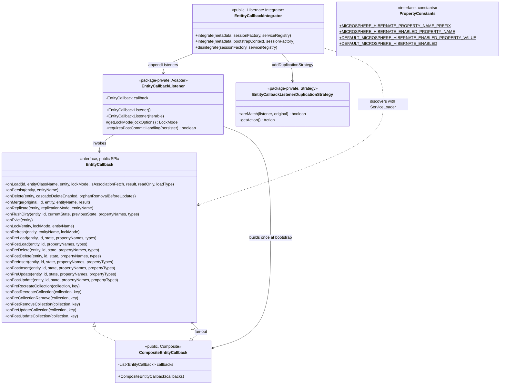
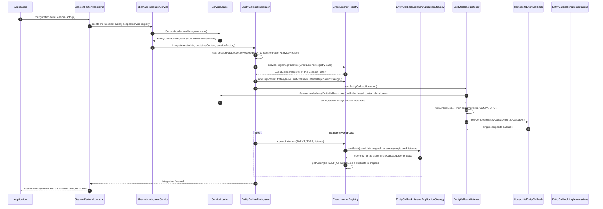
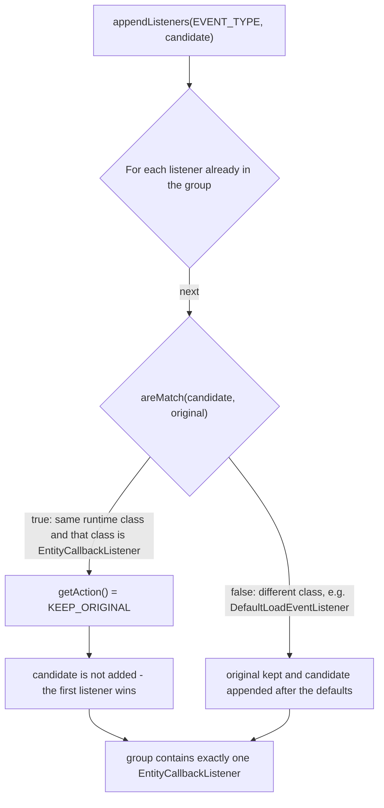
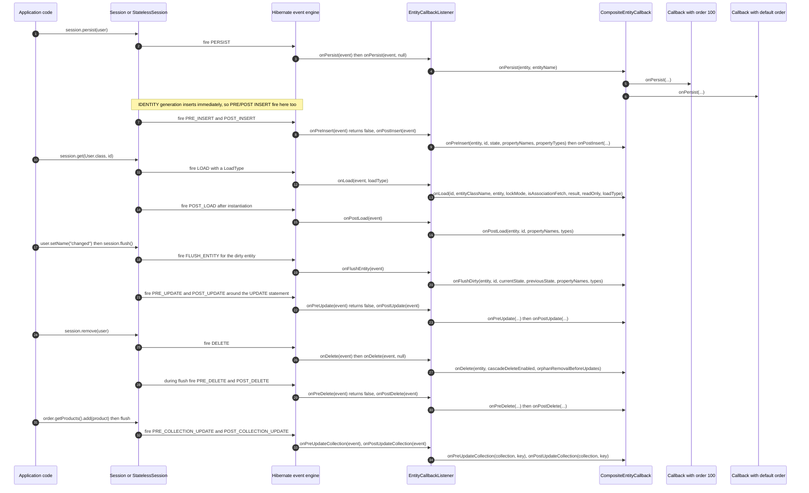

# microsphere-hibernate-core — 开发者文档

模块：`microsphere-hibernate-core` · packaging：`jar` · 坐标：
`io.github.microsphere-projects:microsphere-hibernate-core:${revision}`
POM：[`microsphere-hibernate-core/pom.xml`](../../../../microsphere-hibernate-core/pom.xml)
源码：`microsphere-hibernate-core/src/main/java/io/microsphere/hibernate/`

本模块把 Hibernate ORM 的内部事件机制转换成**面向用户的生命周期回调 SPI**。它是一个单一功能模块：
五个类加一个 `META-INF/services` 描述文件，没有配置文件，没有 Spring 集成，也没有自己的运行期状态。

---

## 1. 构建构成

| 声明的依赖 | scope | 用途 |
|------------|-------|------|
| `io.github.microsphere-projects:microsphere-annotation-processor` | compile，`optional` | 处理 `PropertyConstants` 上的 `@ConfigurationProperty`，产出配置元数据 |
| `io.github.microsphere-projects:microsphere-java-core` | compile，`optional` | `ListUtils.forEach`、`ListUtils.newLinkedList`、`Prioritized.COMPARATOR`、`io.microsphere.constants.*`、`io.microsphere.annotation.ConfigurationProperty` |
| `org.hibernate.orm:hibernate-core` | compile，`optional` | 整套 event/integrator API；版本来自按 profile 选定的 `hibernate-platform` BOM |
| `org.junit.jupiter:junit-jupiter`、`org.mockito:mockito-core`、`org.mockito:mockito-junit-jupiter` | `test` | 测试框架（Mockito 已声明但尚未使用） |
| `io.github.microsphere-projects:microsphere-hibernate-test` | `test` | 为集成测试提供 `AbstractHibernateH2Test` |
| `com.h2database:h2`、`ch.qos.logback:logback-classic` | `test` | 内存数据库，以及 `TestEntityCallback` 使用的 `io.microsphere.logging` 后端 |

两个与构建相关的事实：

* **编译期依赖全部是 `optional`。** 消费者必须自己添加 `hibernate-core`（如果还用到 microsphere 工具类，
  还要加 `microsphere-java-core`）。`core` 这样编译完全正常，只是不外泄。
* **reactor 最后构建 `core`**，因为它在 `test` scope 依赖 `microsphere-hibernate-test`。
  `test` 模块的 main 源码不引用 `core`，因此这个环只存在于测试期。

---

## 2. 架构：四层结构，一份契约



各层职责：

| 层 | 类 | 拥有什么 | 不允许做什么 |
|----|-----|----------|--------------|
| 1 · 扩展点 | `EntityCallback`、`PropertyConstants` | 定义生命周期时刻的词汇表（23 个 `default` 方法） | 依赖其它任何层 |
| 2 · 引导插件 | `EntittyCallbackIntegrator`、`META-INF/services/org.hibernate.integrator.spi.Integrator` | 决定桥接在何时、如何接入 `SessionFactory` | 承载业务逻辑或事件翻译逻辑 |
| 3 · 运行期桥接 | `EntityCallbackListener`、`EntityCallbackListenerDuplicationStrategy` | 把 `*Event` 对象翻译成回调调用；保持幂等 | 抛出自己未造成的异常（它不做任何 catch） |
| 4 · 组合 | `CompositeEntityCallback` | 按序 fan-out 到 N 个用户实现 | 假设用户代码是线程安全的 |
| 用户 | 你的 `EntityCallback` 实现 | 观察 / 副作用 | 修改 Hibernate 持有的数组（契约已声明） |

注意这里刻意的可见性划分：只有第 1、2、4 层是 `public`，桥接层（第 3 层）是 package-private ——
这让公共 API 面极小，并把 Hibernate 版本波动收敛在单个文件内。

---

## 3. 引导期：桥接如何被注册

模块随包发布了一个 Java SPI 描述文件：

```text
microsphere-hibernate-core/src/main/resources/META-INF/services/org.hibernate.integrator.spi.Integrator
  -> io.microsphere.hibernate.entity.EntittyCallbackIntegrator
```

Hibernate 的 `Integrator` 服务（`IntegratorServiceImpl`）在构建 `SessionFactory` 时用 `ServiceLoader` 发现它 ——
不需要 `hibernate.integrator_provider` 设置，不需要 Spring 自动配置，也不需要应用写任何代码即可激活回调。



这条流程有三个后果，改代码时必须记住：

1. **每个 `SessionFactory` 一个 listener 实例。** `integrate` 会 `new` 一个新的 `EntityCallbackListener`，
   因此反复重建 `SessionFactory` 的测试也会反复执行 `ServiceLoader` 并重新实例化每个用户回调。
   回调构造必须廉价，且不能假定自己是单例。
2. **回调集合是引导期的快照。** `CompositeEntityCallback` 持有的是一个 `List`；之后才发现的回调
   （或在 `SessionFactory` 启动后才放进 classpath 的实现）不会被看到。
3. **幂等性交给 Hibernate。** `appendListeners` 会咨询已注册的重复策略；若同一组里已存在
   `EntityCallbackListener`（SPI 加手工 `registerIntegrator`，或两个 `integrate` 重载都被触达），
   策略返回 `KEEP_ORIGINAL`，第二次注册被丢弃，因此事件不会被投递两次。



由于匹配使用的是**精确类相等**
（`Objects.equals(listenerClass, original.getClass()) && EntityCallbackListener.class.equals(listenerClass)`），
假想的 `EntityCallbackListener` 子类不会被判为重复。这正是“我要再注册一个专用 listener”实验的预留出口 ——
也解释了为什么不能未经设计讨论就把判定放宽成 `isAssignableFrom`。

---

## 4. 源码逐类分析

### 4.1 `EntityCallback` —— 扩展点

`microsphere-hibernate-core/src/main/java/io/microsphere/hibernate/entity/EntityCallback.java`

* `public interface EntityCallback`，含 **23 个 `default` 方法**，全部 `void`，全部空实现。实现者只覆盖自己关心的
  方法；这是用 Java 8 default 方法表达的 “adapter class” 模式。
* 签名分组（命名即契约）：
  * 顶层 Session 操作：`onLoad`、`onPersist`、`onDelete`、`onMerge`、`onReplicate`、`onFlushDirty`、
    `onEvict`、`onLock`、`onRefresh`。
  * 实体状态变更的 pre/post 对：`onPreLoad`/`onPostLoad`、`onPreDelete`/`onPostDelete`、
    `onPreInsert`/`onPostInsert`、`onPreUpdate`/`onPostUpdate`。
  * 集合的 pre/post 对：`onPreRecreateCollection`/`onPostRecreateCollection`、
    `onPreCollectionRemove`/`onPostRemoveCollection`、`onPreUpdateCollection`/`onPostUpdateCollection`。
* 接口 javadoc **明确把它写成 `ServiceLoader` 契约**（“The implementation class will be loaded by
  Java Services Loader”），并在 `@see` 列表里枚举了全部 23 个 Hibernate `*EventListener` 接口。
* Hibernate 类型是有意泄漏进 API 的：`LockMode`、`ReplicationMode`、`LoadEventListener.LoadType`、
  `org.hibernate.type.Type`。这就是为什么 `hibernate-core` 不能改成 `provided` 或做 shade：
  升级 Hibernate 大版本会破坏*用户*代码，而不只是本模块。此处任何签名变更都应视为破坏性变更，
  需要在该版本线上提升次版本号。
* javadoc 中反复出现的可变性约束：*"It is not recommended that the interceptor modify the
  `state` / `currentState` / `previousState`."* 这些数组是 Hibernate 自己的脏检查缓冲；改它们会让 SQL 与
  实体状态不一致。
* 编辑时要记住的命名不对称：`onPostLoad` **没有** state 数组（Hibernate 在该时机不暴露），
  `onPostDelete` 与 `onPreDelete` 一样上报 `getDeletedState()`，集合回调使用了看起来不一致的命名
  `onPreCollectionRemove` / `onPostRemoveCollection`（两者分别对应 `PRE_COLLECTION_REMOVE` /
  `POST_COLLECTION_REMOVE` 事件类型）。这些名字是公共 API —— 修改必须附迁移说明。

### 4.2 `CompositeEntityCallback` —— fan-out

```java
public class CompositeEntityCallback implements EntityCallback {
    private final List<EntityCallback> callbacks;
    public CompositeEntityCallback(List<EntityCallback> callbacks) { this.callbacks = callbacks; }
    @Override public void onPersist(Object entity, String entityName) {
        forEach(this.callbacks, callback -> callback.onPersist(entity, entityName));
    }
    // ... 还有 22 个方法，每个回调一个
}
```

* 每个方法都是同一形状的一行：`forEach(this.callbacks, callback -> callback.onXxx(...))`，使用
  `io.microsphere.collection.ListUtils.forEach`，它是**空值安全**的 —— `null` 列表等于“没有回调”。
  构造函数**既不复制也不过滤**列表，因此：
  * 传 `null` 在调用时被容忍，但字段仍是 `null`；该类不做防御，也没有 `Objects.requireNonNull`；
  * 列表中出现 `null` 元素，第一个事件就会 NPE（`callback.onXxx(...)`）；
  * 传入外部可变的 list（`Arrays.asList` / 你的 `ArrayList`）会在引导之后仍可被改变，并且会被运行中的系统观察到。
    手工构造时优先 `List.copyOf(...)`。
* 调用顺序 = 列表顺序。由于 `EntityCallbackListener` 在构造 composite 之前已用 `Prioritized.COMPARATOR`
  排序，“顺序”含义是**优先级优先，其次发现顺序**（`List.sort` 是稳定的 TimSort，未实现
  `io.microsphere.lang.Prioritized` 的回调保持 `ServiceLoader` 的次序）。
* 异常行为：无任何处理。第 *i* 个回调抛出 `RuntimeException` 会中断循环，*i+1…n* 看不到该事件，
  且 Hibernate 操作失败。本类没有回调间隔离，也没有日志包装。
* 该类是 public 且完全不依赖 Hibernate 即可使用 —— 它就是纯 Composite，也因此是可单测的
  （文件自身 javadoc 里的示例即为此用途）。

### 4.3 `EntityCallbackListener` —— 适配器

`EntityCallbackListener.java`，类声明在第 128 行。package-private；实现 **23 个 Hibernate listener 接口**，
顺序与回调方法一一对应：
`LoadEventListener, PersistEventListener, MergeEventListener, DeleteEventListener, ReplicateEventListener,
FlushEntityEventListener, EvictEventListener, LockEventListener, RefreshEventListener, PreLoadEventListener,
PostLoadEventListener, PreDeleteEventListener, PostDeleteEventListener, PreUpdateEventListener,
PostUpdateEventListener, PreInsertEventListener, PostInsertEventListener, PreCollectionRecreateEventListener,
PostCollectionRecreateEventListener, PreCollectionRemoveEventListener, PostCollectionRemoveEventListener,
PreCollectionUpdateEventListener, PostCollectionUpdateEventListener`。

状态：只有一个字段 `private final EntityCallback callback;` —— 永远是 `CompositeEntityCallback`，
因此类内其余部分不需要任何循环。

构造函数：

```java
EntityCallbackListener() { this(load(EntityCallback.class)); }                 // ServiceLoader, TCCL
EntityCallbackListener(Iterable<EntityCallback> callbacks) {                   // test-friendly
    List<EntityCallback> entityCallbacks = newLinkedList(callbacks);           // 可变副本
    entityCallbacks.sort(COMPARATOR);                                          // Prioritized 顺序
    this.callback = new CompositeEntityCallback(entityCallbacks);
}
```

* `load(...)` 是 `java.util.ServiceLoader.load` 的静态导入，即 `ServiceLoader.load(EntityCallback.class)`
  → 由**线程上下文类加载器**决定能发现什么。在 Spring Boot 重打包 jar 或非常规 `URLClassLoader` 环境下，
  回调不触发时应首先怀疑这一点。
* `EntityCallback` 本身并不 extends `Prioritized`，但列表却用 `Prioritized.COMPARATOR` 排序。
  该比较器必须是 `Comparator<Object>`（否则 `List<EntityCallback>.sort` 无法编译），所以它接受普通实现，
  只有**额外**实现了 `Prioritized` 的回调会被重新排序。实践规则：需要控制先后就实现 `Prioritized`。

事件到回调的映射（严格按实现，包含实际使用的 Hibernate accessor）：

| 注册的 `EventType` | Listener 方法 | 从事件读取的值 | 回调 |
|--------------------|---------------|----------------|------|
| `LOAD` | `onLoad(LoadEvent, LoadType)` | `getEntityId()`、`getEntityClassName()`、`getInstanceToLoad()`、`getLockMode(event.getLockOptions())`、`isAssociationFetch()`、`getResult()`、`getReadOnly()`、入参 `loadType` | `onLoad` |
| `PERSIST` | `onPersist(PersistEvent)` → `onPersist(event, null)`；`onPersist(PersistEvent, PersistContext)` | `getObject()`、`getEntityName()` | `onPersist` |
| `MERGE` | `onMerge(MergeEvent)` → `onMerge(event, null)`；`onMerge(MergeEvent, MergeContext)` | `getOriginal()`、`getRequestedId()`、`getEntity()`、`getEntityName()`、`getResult()` | `onMerge` |
| `DELETE` | `onDelete(DeleteEvent)` → `onDelete(event, null)`；`onDelete(DeleteEvent, DeleteContext)` | `getObject()`、`isCascadeDeleteEnabled()`、`isOrphanRemovalBeforeUpdates()` | `onDelete` |
| `REPLICATE` | `onReplicate(ReplicateEvent)` | `getObject()`、`getReplicationMode()`、`getEntityName()` | `onReplicate` |
| `FLUSH_ENTITY` | `onFlushEntity(FlushEntityEvent)` | `getEntityEntry()` → `getId()`、`getLoadedState()`、`getPersister()`；`getPropertyValues()`；`persister.getPropertyNames()`、`getPropertyTypes()` | `onFlushDirty` |
| `EVICT` | `onEvict(EvictEvent)` | `getObject()` | `onEvict` |
| `LOCK` | `onLock(LockEvent)` | `getObject()`、`getLockMode(event.getLockOptions())`、`getEntityName()` | `onLock` |
| `REFRESH` | `onRefresh(RefreshEvent)` → `onRefresh(event, null)`；`onRefresh(RefreshEvent, RefreshContext)` | `getObject()`、`getEntityName()`、`getLockMode(event.getLockOptions())` | `onRefresh` |
| `PRE_LOAD` | `onPreLoad(PreLoadEvent)` | `getEntity()`、`getId()`、`getState()`、`persister.getPropertyNames()/getPropertyTypes()` | `onPreLoad` |
| `POST_LOAD` | `onPostLoad(PostLoadEvent)` | `getEntity()`、`getId()`、属性名与类型 | `onPostLoad` |
| `PRE_DELETE` | `onPreDelete(PreDeleteEvent)` → 返回 `false` | `getEntity()`、`getId()`、`getDeletedState()`、属性名/类型 | `onPreDelete` |
| `POST_DELETE` | `onPostDelete(PostDeleteEvent)` | 与 pre-delete 相同 | `onPostDelete` |
| `PRE_INSERT` | `onPreInsert(PreInsertEvent)` → 返回 `false` | `getEntity()`、`getId()`、`getState()`、属性名/类型 | `onPreInsert` |
| `POST_INSERT` | `onPostInsert(PostInsertEvent)` | 与 pre-insert 相同 | `onPostInsert` |
| `PRE_UPDATE` | `onPreUpdate(PreUpdateEvent)` → 返回 `false` | `getEntity()`、`getId()`、`getState()`、属性名/类型 | `onPreUpdate` |
| `POST_UPDATE` | `onPostUpdate(PostUpdateEvent)` | 与 pre-update 相同 | `onPostUpdate` |
| `PRE_COLLECTION_RECREATE` | `onPreRecreateCollection(PreCollectionRecreateEvent)` | `event.getCollection()`（`PersistentCollection<?>`）与 `collection.getKey()` | `onPreRecreateCollection` |
| `POST_COLLECTION_RECREATE` | `onPostRecreateCollection(...)` | 同上 | `onPostRecreateCollection` |
| `PRE_COLLECTION_REMOVE` | `onPreRemoveCollection(...)` | 同上 | `onPreCollectionRemove` |
| `POST_COLLECTION_REMOVE` | `onPostRemoveCollection(...)` | 同上 | `onPostRemoveCollection` |
| `PRE_COLLECTION_UPDATE` | `onPreUpdateCollection(...)` | 同上 | `onPreUpdateCollection` |
| `POST_COLLECTION_UPDATE` | `onPostUpdateCollection(...)` | 同上 | `onPostUpdateCollection` |

这个文件里编码下来的行为语义：

* **每个重载只投递一次。** 单参重载（`onDelete(event)`、`onPersist(event)`、`onMerge(event)`、
  `onRefresh(event)`）委托给双参“级联链”重载并传 `null` context，而**双参**方法才是真正调用回调的那个。
  Hibernate 接口把单参形式定义为入口、把带 context 的形式定义为级联感知形式；两者都覆盖，意味着无论 ORM 走哪个，
  回调都恰好触发一次。`null` context 不会传到用户代码，因为 `EntityCallback` 没有 context 参数 —— 这是刻意的简化。
* **没有否决通道。** `onPreDelete`、`onPreInsert`、`onPreUpdate` 必须回答 Hibernate 的“是否否决本次操作”。
  实现硬编码 `return false`，即*从不否决*；用户回调返回 `void`，同样无法否决。若要支持否决，需要新增回调签名
  **并且**决定 `CompositeEntityCallback` 如何聚合 N 个答案 —— 那是设计变更，不是 bug 修复。
* **不做 post-commit 延迟。** `requiresPostCommitHandling(EntityPersister persister)` 无条件返回 `false`，
  因此 `Post*` 回调在 flush/事务边界*之内*投递（仍可使用 `Session`，异常仍会回滚工作）。
  返回 `true` 会把匹配 persister 的通知推迟到事务完成之后。
* **`protected LockMode getLockMode(LockOptions)`** 作为可覆盖的钩子存在（且不对 `lockOptions` 做空检查）。
  由于类是 package-private，只有同包子类能用这个钩子 —— 实际上是失效的扩展点。
  计划开放该类就保留它，否则就删除。
* **刻意不做防御性编程。** `event.getEntityEntry()`、`event.getPersister()`、`event.getCollection()`、
  `event.getLockOptions()` 都被直接解引用；出现 `null` 就会 NPE 并冲出事件管道。契约是“Hibernate 一定会提供”，
  而 6.2 → 7.3 的 CI 矩阵正是对这一假设的保护。

### 4.4 `EntityCallbackListenerDuplicationStrategy` —— 守卫

类在第 45 行，package-private，实现 `org.hibernate.event.service.spi.DuplicationStrategy`：

```java
public boolean areMatch(Object listener, Object original) {
    Class<?> listenerClass = listener.getClass();
    return Objects.equals(listenerClass, original.getClass())
            && EntityCallbackListener.class.equals(listenerClass);
}
public Action getAction() { return KEEP_ORIGINAL; }   // 来自 DuplicationStrategy.Action 的静态导入
```

* 两个独立条件：运行时类相同，**且**该类必须正好是 `EntityCallbackListener`。
  不接受 `null` 参数（`listener.getClass()` 会 NPE），这没关系，因为 Hibernate 不会用 null 查询。
* `KEEP_ORIGINAL` 表示*先*注册的 listener 胜出。结合第 3 节，这正是重复注册无害的原因；同时也意味着
  **若你在同一组里注册了自己的子类，两个 listener 都会保留** —— 这是可测试的差异
  （`EntityCallbackListenerDuplicationStrategyTest` 用 `DefaultLoadEventListener` 作为反例）。

### 4.5 `EntittyCallbackIntegrator` —— 插件入口

```java
public class EntittyCallbackIntegrator implements Integrator {
    public void integrate(Metadata metadata, SessionFactoryImplementor sessionFactory,
                          SessionFactoryServiceRegistry serviceRegistry) { /* 23 次 appendListeners */ }

    @Override
    public void integrate(Metadata metadata, BootstrapContext bootstrapContext,
                          SessionFactoryImplementor sessionFactory) {
        integrate(metadata, sessionFactory, (SessionFactoryServiceRegistry) sessionFactory.getServiceRegistry());
    }

    @Override
    public void disintegrate(SessionFactoryImplementor sessionFactory, SessionFactoryServiceRegistry serviceRegistry) { }
}
```

* 三参数重载是 **legacy** 的 `Integrator` 签名（Hibernate 5.x 风格，在 6.x 线中仍存在但已被标废弃）；
  带 `BootstrapContext` 的重载才是 Hibernate 6.0+ 签名。两者都实现、并让新签名委托旧签名，
  是同一个类能从 `6.2` 一直工作到 `7.3` 的原因。旧方法**刻意不带 `@Override`** 注解，
  以免上游的 `@Deprecated` 状态把构建变成告警/错误 —— 不要“顺手清理掉”。
* 强制转换 `(SessionFactoryServiceRegistry) sessionFactory.getServiceRegistry()` 是真实的耦合点：
  它假定 `SessionFactory` 的服务注册表实现 `SessionFactoryServiceRegistry`。在整个受测矩阵中成立；
  若将来换成别的注册表类型，这里会以 `ClassCastException` 失败。
* 注册顺序即文件顺序：`LOAD`、`PERSIST`、`MERGE`、`DELETE`、`REPLICATE`、`FLUSH_ENTITY`、`EVICT`、`LOCK`、
  `REFRESH`，随后是 pre/post 对（`PRE_LOAD`/`POST_LOAD`、`POST_DELETE`/`PRE_DELETE`、
  `PRE_UPDATE`/`POST_UPDATE`、`PRE_INSERT`/`POST_INSERT`）与六个集合类型。
  `appendListeners` 会把 listener 放在内置默认实现**之后**，这正是 `LOAD` 时 `event.getResult()` 能取到值的原因 ——
  除非准备重新评估 `onLoad` 契约，否则不要改用 `prependListeners`。
* 未注册因此不可达的：`FLUSH`、`AUTO_FLUSH`、`SAVE_UPDATE`/`PERSIST_ON_FLUSH`、`ResolveNaturalId` 一族，
  以及由 `SaveOrUpdate` 触发的 `PreInsert`/`PostInsert` 变体。若要满足相关需求，按第 7.4 节 recipe 走。
* `metadata` 与 `bootstrapContext` 被忽略：桥接与实体无关（不需要知道映射了哪些实体），
  这也是本模块能兼容任意映射风格和任意 `hibernate.hbm2ddl.auto` 取值的原因。
* `disintegrate` 是文档化的空实现：listener 活在 `SessionFactory` 作用域的注册表里，关闭工厂即回收。
  一旦将来你在注册表之外保存状态（静态 Map、ThreadLocal），这里就是清理点 —— 也是当前测试没有覆盖的地方。

### 4.6 `PropertyConstants` —— 声明出来的配置面

```java
public interface PropertyConstants {
    String MICROSPHERE_HIBERNATE_PROPERTY_NAME_PREFIX = MICROSPHERE_PROPERTY_NAME_PREFIX + "hibernate" + DOT; // "microsphere.hibernate."
    String DEFAULT_MICROSPHERE_HIBERNATE_ENABLED_PROPERTY_VALUE = "true";
    boolean DEFAULT_MICROSPHERE_HIBERNATE_ENABLED = parseBoolean(DEFAULT_MICROSPHERE_HIBERNATE_ENABLED_PROPERTY_VALUE);

    @ConfigurationProperty(type = boolean.class,
            defaultValue = DEFAULT_MICROSPHERE_HIBERNATE_ENABLED_PROPERTY_VALUE,
            source = SYSTEM_PROPERTIES_SOURCE)
    String MICROSPHERE_HIBERNATE_ENABLED_PROPERTY_NAME = MICROSPHERE_HIBERNATE_PROPERTY_NAME_PREFIX + ENABLED_PROPERTY_NAME;
    // "microsphere.hibernate.enabled"
}
```

* “常量放在 interface 里”的风格，全部由 `microsphere-java-core` 的原语拼出
  （`MICROSPHERE_PROPERTY_NAME_PREFIX`、`ENABLED_PROPERTY_NAME`、`SymbolConstants.DOT`），
  以保证所有 microsphere 项目共享同一命名体系。
* `@ConfigurationProperty` 由 `microsphere-annotation-processor` 消费并产出配置元数据（IDE 补全）。
  这就是注解处理器成为编译依赖的唯一原因。
* **给开发者的现实提醒：**在 `release`（0.2.x）线上，没有任何代码读取 `microsphere.hibernate.enabled`。
  `EntittyCallbackIntegrator.integrate(...)` 无条件注册。该属性是“意图声明”，由 `PropertyConstantsTest`
  断言四个值，而不是可用开关。若要实现开关，最自然的位置是三参数 `integrate` 方法开头，读取*系统属性*
  （这正是 javadoc 声明的 source），并需要在 `EntityCallbackIntegratorTest` 里补测试。

---

## 5. 运行期：一次操作如何抵达用户代码



把图读成规则：

* **对 `IDENTITY` 主键实体，一次 `Session#persist` 会被观察到 `onPersist` + `onPreInsert` + `onPostInsert`**
  （级联触达已管理实体时还会有 `PRE_LOAD`/`POST_LOAD`）。若使用 sequence/table 生成器，insert 被推迟到 flush，
  于是 `onPersist` 提前触发、insert 相关回调在提交时才到。永远不要写“一条 SQL = 一个回调”的假设。
* **`StatelessSession` 跳过顶层事件组。** `insert`/`update`/`delete` 只产生 `PRE_*`/`POST_*`
  （这正是那些 `EntityCallback` 方法 javadoc 指向 `StatelessSession` 的原因），而 `Session` 会同时产生顶层与
  pre/post 两类回调。
* **回调是同步、内联的。** 它们在同一线程的事件管道内执行，共享事务，抛出异常会中断操作（见 4.2 / 4.3）。
* 级联 `Cascade` 会为图中每个实体重新进入同一批事件组，因此 persist 一个对象图
  （测试夹具里的 `User` → `UserProfile` → `Order` → `Product`）会产生“每个节点一套回调”。

---

## 6. 本模块中的设计模式

| 模式 | 精确落点 | 在此处使用的原因 | 代价 |
|------|----------|------------------|------|
| **Composite（组合）** | `CompositeEntityCallback implements EntityCallback`，持有 `List<EntityCallback>`，23 个方法全部以 `forEach(...)` 重实现 | listener 只需要*一个*协作者；N 个用户实现被折叠进同一接口 | 23 个近似重复的委托方法要维护；新增回调必须同步改 composite |
| **Observer / Event（观察者）** | `EntityCallbackListener` 实现 23 个 `*EventListener` 接口；`EntityCallback` 扮演订阅者；`EventType` 分组扮演被观察者 | 无需继承 Hibernate 内部类即可解耦 | 投递顺序取决于 `append` 与 `prepend`，也受其它 integrator 影响 |
| **Adapter（适配器）** | `EntityCallbackListener`：`LoadEvent` → `onLoad(8 参数)`，`FlushEntityEvent` → `onFlushDirty(6 参数)` | 把“每事件一个对象”的模型翻译成用户易用的扁平参数列表 | 与每个 event 的 getter 名强耦合；改名会在 Hibernate 大版本上直接编译失败 |
| **Strategy（策略）** | `EntityCallbackListenerDuplicationStrategy`（`areMatch` + `getAction`）通过 `EventListenerRegistry#addDuplicationStrategy` 插入 | 让 listener 注册幂等，而无需手工检查分组内容 | 精确类匹配使子类绕过策略 |
| **SPI / 插件（Service Loader）** | `META-INF/services/org.hibernate.integrator.spi.Integrator` 注册 integrator；`ServiceLoader.load(EntityCallback.class)` 发现用户回调；测试模块用 `META-INF/services/io.microsphere.hibernate.entity.EntityCallback` | 零配置激活；用户代码只需放一个描述文件即可贡献行为 | 发现依赖线程上下文类加载器；没有排序或条件化元数据 |
| **优先级排序（比较器策略）** | `EntityCallbackListener(Iterable)` 构造函数里的 `entityCallbacks.sort(Prioritized.COMPARATOR)` | 让回调能声明相对次序，而无需自造注解 | `EntityCallback` 不继承 `Prioritized`，因此不实现它时排序不可见 |
| **Template Method（default 方法）** | `EntityCallback` 的 23 个 `default` 方法；`TestEntityCallback` 还显式调用 `EntityCallback.super.onXxx(...)` | 实现者只覆盖子集，不需要 adapter 基类 | 二进制兼容有保障，但签名变更会让 `super` 调用点变成破坏性变更 |
| **Facade（薄门面）** | `CompositeEntityCallback` + `EntityCallback` 用一套简单词汇替代 `org.hibernate.event.spi` 动物园 | 用户除了 `LockMode`、`ReplicationMode`、`LoadType`、`Type` 之外不必导入 Hibernate 事件类型 | 这四个泄漏使门面无法做到版本中立 |

---

## 7. 扩展 cookbook

### 7.1 在自己的库里发布一个回调

```java
package com.acme.audit;

public class AuditEntityCallback implements EntityCallback {
    @Override public void onPostInsert(Object entity, Object id, Object[] state,
                                       String[] propertyNames, Type[] propertyTypes) {
        // 写审计记录；不要修改 `state`
    }
}
```

`src/main/resources/META-INF/services/io.microsphere.hibernate.entity.EntityCallback`：

```text
com.acme.audit.AuditEntityCallback
```

加载器施加的要求：public 类、public 无参构造、并且能被构建 `SessionFactory` 所在线程的 TCCL 发现。

### 7.2 显式控制回调顺序

```java
public class SecurityEntityCallback implements EntityCallback, Prioritized {
    @Override public int order() { return HIGHEST_PRECEDENCE; }   // 最先执行
}
```

`Prioritized.COMPARATOR` 为升序，值越小越先执行；未实现 `Prioritized` 的回调按默认序处理，
并保持 `ServiceLoader` 次序（稳定排序）。

### 7.3 不启动 Hibernate 也能用 composite

```java
List<EntityCallback> callbacks = List.of(new LoggingEntityCallback(), new AuditEntityCallback());
EntityCallback composite = new CompositeEntityCallback(callbacks);
composite.onPersist(entity, "com.acme.User");     // 完全不涉及 SessionFactory
```

这是推荐的单测切口：`CompositeEntityCallback` 是 public 且无额外依赖；而 `EntityCallbackListener` 是
package-private，只能在 `io.microsphere.hibernate.entity` 包内测（`EntityCallbackListenerTest` 与
`EntityCallbackListenerDuplicationStrategyTest` 正是这样做的）。

### 7.4 新增一个生命周期时刻（四处联动规则）

1. `EntityCallback`：新增 `default` 方法 + javadoc，引用对应的 Hibernate `*EventListener` 与
   `Session`/`StatelessSession` 入口。
2. `CompositeEntityCallback`：新增委托覆写（`forEach(callbacks, c -> c.onXxx(...))`）。
3. `EntityCallbackListener`：实现对应 listener 方法（若是新家族还要加接口），只抽取回调需要的值。
4. `EntittyCallbackIntegrator`：`eventListenerRegistry.appendListeners(NEW_EVENT_TYPE, listener);`

然后在 `microsphere-hibernate-core/src/test/...` 增补测试，并重跑整个矩阵
（`hibernate-6.2` … `hibernate-7.3`）—— 集成环境见
[`microsphere-hibernate-test.md`](./microsphere-hibernate-test.md)。

---

## 8. 与 Hibernate 6.2 → 7.3 的耦合点

| 耦合点 | 文件 | ORM 变化时的风险 |
|--------|------|------------------|
| 所有事件与 listener 类型都在 `org.hibernate.event.spi.*`，另有 `org.hibernate.collection.spi.PersistentCollection`、`org.hibernate.engine.spi.EntityEntry` | `EntityCallback`、`EntityCallbackListener` | 绑定发生在类型层面而非文本层面：这些 SPI 包内的任何改名或签名变更，都会在对应 profile 下直接编译失败。本模块只面向 6.x/7.x 的形态 —— 项目的 0.1.x 线承载同一批类的 Hibernate 5.x 版本 |
| `Integrator` 的两个 `integrate` 签名 | `EntittyCallbackIntegrator` | 三参数方法上游已标废弃；若未来被移除，需删掉它并只保留 `BootstrapContext` 形式 |
| `(SessionFactoryServiceRegistry) sessionFactory.getServiceRegistry()` | `EntittyCallbackIntegrator` | 注册表类型变化会抛 `ClassCastException` |
| `EventListenerRegistry#appendListeners` / `addDuplicationStrategy`、`DuplicationStrategy.Action.KEEP_ORIGINAL` | integrator、strategy | API 在矩阵内稳定，但“放在默认实现之后”属于行为约定而非契约 |
| 事件 accessor：`MergeEvent#getRequestedId`、`LoadEvent#getReadOnly/getResult`、`DeleteEvent#isOrphanRemovalBeforeUpdates`、`FlushEntityEvent#getEntityEntry`、`PreDeleteEvent#getDeletedState`、`PersistentCollection#getKey` | `EntityCallbackListener` | 改名或删除会以“按 profile 编译失败”的形式暴露 —— 这正是 CI 跑九条 Hibernate 线的原因 |
| `org.hibernate.type.Type`、`LockMode`、`ReplicationMode`、`LoadEventListener.LoadType` 出现在公共回调签名中 | `EntityCallback` | 泄漏进用户代码：Hibernate 大版本一旦挪动它们，对本模块的*消费者*即为破坏性变更 |
| 测试夹具使用的 `hbm2ddl.auto`、`hibernate.dialect`、H2 驱动 | 仅测试 | 属于测试层，不影响生产 |

### 8.1 0.2.x 相对 0.1.x（Hibernate 5.x）实现的区别

对比同一批类在两条版本线上的写法，是让耦合点变得可验证的最快方式：

| 界面 | 0.1.x（Hibernate 5.0 – 5.6） | 0.2.x（Hibernate 6.2 – 7.3） | 说明的耦合 |
|------|------------------------------|------------------------------|------------|
| `Integrator` 入口 | 只有 `integrate(Metadata, SessionFactoryImplementor, SessionFactoryServiceRegistry)` | 新增 `integrate(Metadata, BootstrapContext, SessionFactoryImplementor)` 并委托给旧签名 | `BootstrapContext` 重载自 Hibernate 6.0 起才存在 |
| 级联感知的 listener 重载 | `onPersist(PersistEvent, Map)`、`onMerge(MergeEvent, Map)`、`onDelete(DeleteEvent, Set)`、`onRefresh(RefreshEvent, Map)`（裸类型） | `onPersist(PersistEvent, PersistContext)`、`onMerge(MergeEvent, MergeContext)`、`onDelete(DeleteEvent, DeleteContext)`、`onRefresh(RefreshEvent, RefreshContext)` | 四个 `*Context` 类型是 Hibernate 6.x 的新增；裸集合写法在新线上不再能编译 |
| `onLoad` 回调参数个数 | 7 个（没有只读标记） | 8 个，使用 `event.getReadOnly()` | `LoadEvent#getReadOnly()` 只在 6.x/7.x 可用 |
| 集合事件 | 裸类型 `PersistentCollection collection = event.getCollection();` | `PersistentCollection<?> collection = event.getCollection();` | `PersistentCollection` 在 Hibernate 6 中变成泛型 |
| listener 注册表 | 同为 `EventListenerRegistry` + `DuplicationStrategy` | 相同，但 `Integrator` 调用路径改变 | 这两个 SPI 类型是该设计中最稳定的部分 |

实践规则：做回合或前向移植时，先与另一条分支的 `EntityCallbackListener` 做一次 diff —— 上表四行通常就是分叉点。

---

## 9. 本模块的测试策略

| 测试 | 位置 | 证明了什么 |
|------|------|------------|
| `PropertyConstantsTest` | `src/test/java/io/microsphere/hibernate/constants/` | 四个常量值，包括拼接出的 `"microsphere.hibernate.enabled"` |
| `EntityCallbackListenerTest` | `src/test/java/io/microsphere/hibernate/entity/` | `new EntityCallbackListener()`（ServiceLoader 路径）可无异常构造；`requiresPostCommitHandling(null)` 为 `false`（实现忽略该参数） |
| `EntityCallbackListenerDuplicationStrategyTest` | 同包 | 自身匹配为 `true`；与 `DefaultLoadEventListener` 配对、或两个 `DefaultLoadEventListener` 互为 `false`；`getAction()` 与 `KEEP_ORIGINAL` 同一实例 |
| `EntityCallbackIntegratorTest` | 同包 | **集成证明。** 它自身没有测试方法：继承自 `microsphere-hibernate-test` 的 `AbstractHibernateH2Test`，于是所有继承来的 `@Nested` Session 与 StatelessSession 测试都会在 `EntittyCallbackIntegrator` 生效、且 `TestEntityCallback` 已通过测试 SPI 注册的条件下运行。引导或事件装配若坏了，ORM 会失败或回调会抛异常 |
| `TestEntityCallback` | `src/test/java/.../entity/` | 23 个方法的参考实现，通过 `io.microsphere.logging` 以 `TRACE` 记录，并显式链式调用 `EntityCallback.super.onXxx(...)` |
| `src/test/resources/META-INF/services/io.microsphere.hibernate.entity.EntityCallback` | 测试资源 | 内容 `io.microsphere.hibernate.entity.TestEntityCallback` —— 它使测试期间的 ServiceLoader 路径不为空 |

新测试的建议：

* 优先用真实引导（`extends AbstractHibernateH2Test`），不要去 mock `LoadEvent`/`PersistEvent`：
  这些事件类的构造函数多为包内可见，且在矩阵版本间形态会变，是本模块最脆弱的测试写法。
* 断言回调需要回调在 `SessionFactory` 构建**之前**就已注册（测试 SPI 文件），并且要容忍“每个
  SessionFactory 重新实例化”（第 3 节后果 1）。可以把事件收集到 `CopyOnWriteArrayList` 并由静态持有者暴露，
  或者直接构造 `CompositeEntityCallback` 作为夹具。
* 该夹具共享一个内存库（`jdbc:h2:mem:test_db;DB_CLOSE_DELAY=-1`）且 `hbm2ddl.auto=update`，Surefire 在同一
  JVM 内跨测试类复用：表与数据在一个模块的测试类之间是存活的。请编写不依赖“空表”的断言。
* 本模块的验证命令：

```bash
./mvnw -pl microsphere-hibernate-core -am test
./mvnw -pl microsphere-hibernate-core -am --activate-profiles test,coverage,hibernate-6.2 test
./mvnw -pl microsphere-hibernate-core -am --activate-profiles test,coverage,hibernate-7.3 test
```

---

## 10. 已知局限（候选待办）

| # | 观察 | 影响 | 建议方向 |
|---|------|------|----------|
| 1 | 类名拼写 `EntittyCallbackIntegrator` | 属外观问题，但它是已发布的 SPI 标识 | 改名并保留兼容 SPI 条目，或接受现状并文档化 |
| 2 | 从不读取 `microsphere.hibernate.enabled` | 运行期无法关闭桥接 | 在 `integrate(...)` 里读系统属性，默认仍为 `true` |
| 3 | 回调之间没有隔离 | 一个抛异常的回调会隐藏其它回调并使 ORM 操作失败 | 提供可选的 try/catch + 日志包装，或把“快速失败”写成契约 |
| 4 | `CompositeEntityCallback` 不复制也不判空列表 | 外部可变列表会改变运行期行为；`null` 元素在首个事件即 NPE | 构造函数里 `List.copyOf`，并跳过 `null` 元素 |
| 5 | `disintegrate` 为空且无测试 | 当前无害；一旦在注册表外保存状态就会静默泄漏 | 增加“重建两次 SessionFactory”的回归测试 |
| 6 | `getLockMode` 钩子包外不可达 | 失效的扩展点 | 公开该类，或直接把访问器内联 |
| 7 | `requiresPostCommitHandling` 恒为 `false` | post 事件无法观察已提交状态 | 通过回调方法按 persister 返回 `true` |
| 8 | 没有覆盖 `FLUSH`/`AUTO_FLUSH`/`SAVE_UPDATE` | 部分生命周期时刻不可见 | 有需求时按 7.4 追加回调 |
| 9 | Mockito 已声明但从未使用 | 测试 classpath 冗余 | 用它写事件翻译单测，或移除依赖 |

---

## 11. 本模块的评审清单

- [ ] 新类型带 ASF 许可证头、`@author`、`@since`，以及含 “Example Usage” 的 javadoc。
- [ ] 新增回调已同步到四处（7.4），并更新 4.3 的映射表。
- [ ] `EventType` 注册使用 `appendListeners`；没有误用 `prependListeners`。
- [ ] 公共 API 变更已对照第 8 节“Hibernate 类型泄漏”风险检查。
- [ ] 任何位置都不修改 `state`/`currentState`/`previousState` 数组。
- [ ] 空值处理立场被显式讨论过（见 4.3 “刻意不做防御性编程”）。
- [ ] `hibernate-6.2` **与** `hibernate-7.3` 构建通过，最好跑完整矩阵。
- [ ] 测试 SPI 描述文件至少仍注册一个回调，保证 ServiceLoader 路径有覆盖。
- [ ] `docs/current/developer-guide/` 与 `docs/current/developer-guide/zh/` 文档同步更新。

---

上一篇：[`microsphere-hibernate-dependencies.md`](./microsphere-hibernate-dependencies.md) ·
下一篇：[`microsphere-hibernate-test.md`](./microsphere-hibernate-test.md) ·
[索引](./README.md)
