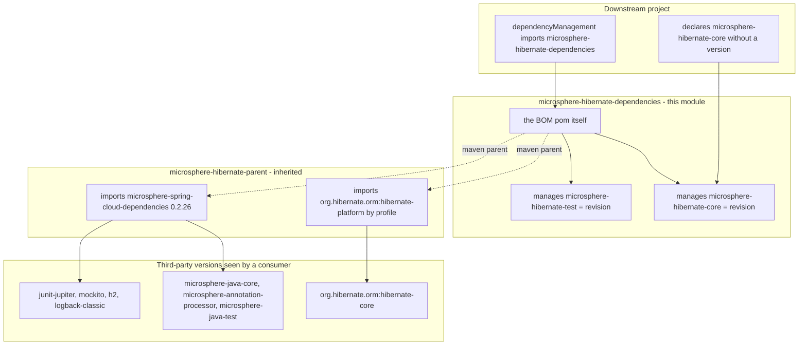
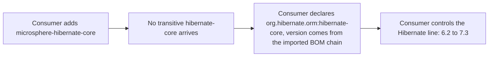

# microsphere-hibernate-dependencies — 开发者文档

模块：`microsphere-hibernate-dependencies` · packaging：`pom` · 坐标：
`io.github.microsphere-projects:microsphere-hibernate-dependencies:${revision}`
文件：[`microsphere-hibernate-dependencies/pom.xml`](../../../../microsphere-hibernate-dependencies/pom.xml)

这是本项目的**可发布 BOM**（Bill of Materials，物料清单）：终端用户把它 import 进自己的
`<dependencyManagement>`。它**不是**决定第三方版本的地方。其内容恰好只有两个被管理的坐标 ——
本仓库的两个 jar 模块 —— 都锁定在 `${revision}`。

```xml
<dependencyManagement>
    <dependencies>
        <dependency>
            <groupId>io.github.microsphere-projects</groupId>
            <artifactId>microsphere-hibernate-core</artifactId>
            <version>${revision}</version>
        </dependency>
        <dependency>
            <groupId>io.github.microsphere-projects</groupId>
            <artifactId>microsphere-hibernate-test</artifactId>
            <version>${revision}</version>
        </dependency>
    </dependencies>
</dependencyManagement>
```

---

## 1. 版本决策究竟发生在哪里



关键的非对称性：

| 问题 | 由谁回答 |
|------|----------|
| “我拿到的 `microsphere-hibernate-core` 是哪个版本？” | **本模块**（`${revision}`） |
| “它需要哪个 `hibernate-core` 版本？” | `microsphere-hibernate-parent` → `hibernate-platform`（由 profile 选择） |
| “`microsphere-java-core` / JUnit / H2 是哪个版本？” | parent import 的 `microsphere-spring-cloud-dependencies:0.2.26` |

由于 BOM import（`<scope>import</scope>`）会连带引入被 import pom 的**继承链**上的
`dependencyManagement`，本 BOM 的消费者也就间接获得了 microsphere / Spring / Hibernate 平台版本管理 ——
前提是**已发布**的 pom 保留其 `<parent>` 引用（Flatten Maven Plugin 的 `flattenMode` 决定内联多少；
在真正改发布行为前，请以 Central 上落地的那份 pom 为准）。

---

## 2. 为什么本项目的所有 artifact 都把依赖标成 `optional`

`microsphere-hibernate-core` 与 `microsphere-hibernate-test` 把**所有**非 test 依赖声明为
`<optional>true</optional>`。与本 BOM 组合后的效果是刻意的：



对维护者的含义：

* 给 jar 模块新增运行期依赖意味着：(a) 在该模块里以 `optional` 声明；(b) 确认版本由父级链或本 BOM 管理 ——
  否则下游得到的是 “missing version” 而不是冲突提示。
* 不要为了“省事”把 `optional` 改成普通 scope；该决策与其它所有 microsphere 项目一致，会静默改变下游继承内容。

---

## 3. 本模块的结构与约定

| 方面 | 当前状态 | 理由 / 注意事项 |
|------|----------|-----------------|
| parent | 通过 `../microsphere-hibernate-parent/pom.xml` 指向 `microsphere-hibernate-parent` | 继承 Hibernate profile 机制，使 `${revision}` 与 managed 版本保持一致 |
| 聚合 | 无 | 它是叶子 pom：消费者 import，reactor 构建 |
| `<properties>` | 无 | 所有属性来自根 pom / 父级链 |
| 管理范围 | 只含本项目自有模块 | 第三方版本管理放在 parent，使 BOM 在不同 Hibernate 版本线之间保持稳定 |
| profiles | 无 | Hibernate/Spring profile 由父级继承，构建时激活的是它们 |
| 发布形态 | pom artifact `microsphere-hibernate-dependencies-x.y.z.pom` | 根 README 的 “Getting Started” 展示的就是 import 片段 |

### 3.1 向 BOM 增加新模块

当出现第五个 jar 模块（例如未来的 `microsphere-hibernate-spring-boot-starter`）时：

1. 创建模块目录，`<parent>` 设为 `microsphere-hibernate-parent`，`<version>${revision}</version>`。
2. 加入根 pom 的 `<modules>`。
3. 在本文件按现有两条同样风格加入 `${revision}` 条目。
4. 其自身依赖继续保持 `optional`，第三方版本交给父级链。
5. 更新 `docs/current/developer-guide/` 下的模块文档，**以及** `zh/` 对应文件。

排序约定：按依赖深度自上而下排列（先 `core`，再依赖 `core` 的东西），让 BOM 读起来像 reactor 顺序。

---

## 4. 本地验证 BOM

```bash
# 1. 把整个 reactor（parent + BOM + jar）发布到本地仓库
./mvnw -Drevision=0.0.0-LOCAL clean install

# 2. 查看 BOM 对被管理坐标解析出的内容
./mvnw -q -o help:effective-pom -pl microsphere-hibernate-dependencies | grep -A2 microsphere-hibernate-core

# 3. 在一个 import 了该 BOM 的临时工程里，确认没有传递的 Hibernate 泄漏
./mvnw -q dependency:tree -Dincludes=org.hibernate.orm
```

应当观察到：`microsphere-hibernate-core` 出现的是具体版本（绝不会是字面量 `${revision}`），
且 `org.hibernate.orm:hibernate-core` **不在**依赖树中，除非临时工程自己声明了它。

---

## 5. 发布相关注意事项

* BOM 与 jar 以 `${revision}` 同版本锁步演进，这也是发布 workflow 必须一次性部署整个 reactor 的原因 ——
  永远不要以不同版本单独发布本模块。
* 用户通过 `${microsphere-hibernate.version}` 锁版本；0.2.x 线（`release` 分支）与 1.x 线
  （`release-1.x` 分支）从同一个 artifact id 发布互不重叠的版本区间（`0.2.x` 与 `0.1.x`），
  因此**选版本等于选分支**。不要在两条线之间共用同一版本。
* 由于是 `pom` packaging，本 artifact 没有 jar、没有 javadoc jar、没有 sources jar —— Central 校验时
  “missing javadoc” 的抱怨通常指向 packaging 用错，而不是这个 pom 写错。

---

上一篇：[`microsphere-hibernate-parent.md`](./microsphere-hibernate-parent.md) ·
下一篇：[`microsphere-hibernate-core.md`](./microsphere-hibernate-core.md) ·
[索引](./README.md)
