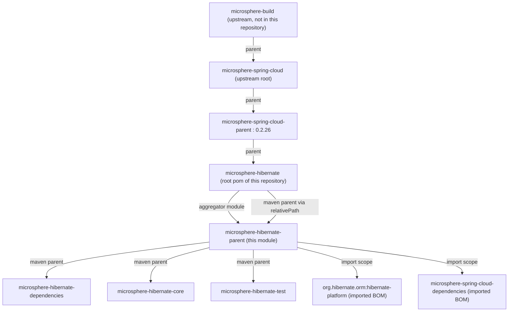
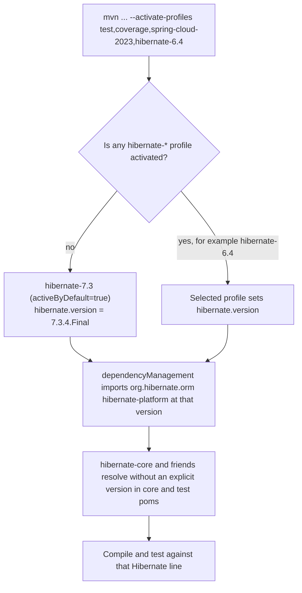
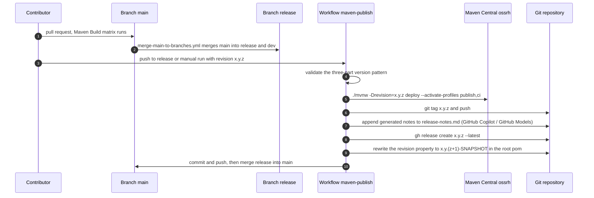

# microsphere-hibernate-parent — 开发者文档

模块：`microsphere-hibernate-parent` · packaging：`pom` · 坐标：
`io.github.microsphere-projects:microsphere-hibernate-parent:${revision}`
文件：[`microsphere-hibernate-parent/pom.xml`](../../../../microsphere-hibernate-parent/pom.xml)

该模块承载**整个项目的版本策略**：编译时对接哪条 Hibernate ORM 版本线、由哪些 BOM 提供依赖版本、
`${revision}` 这个 CI 友好版本如何贯穿 reactor。它**不声明任何构建插件、依赖和子模块**，是一个纯粹的
继承型 parent。

---

## 1. 在 POM 层级中的位置



两个容易让人意外、但必须保持的结构事实：

1. **根 pom 既是聚合器，又是 `microsphere-hibernate-parent` 的 Maven parent。**
   根 pom 里有 `<module>microsphere-hibernate-parent</module>`，而该模块内部又写
   `<parent>microsphere-hibernate</parent>`。Maven 通过 `<relativePath>../pom.xml</relativePath>` 解析，
   reactor 因此无环；但由于 parent 是一个**模块**，它会作为可被继承的 artifact 一并构建与部署。
2. **`microsphere-hibernate-parent` 不聚合任何模块。** 子模块（dependencies / core / test）通过
   `<relativePath>../microsphere-hibernate-parent/pom.xml</relativePath>` 显式指向它；聚合关系只由根 pom 拥有。

---

## 2. POM 结构解析

```xml
<parent>
    <groupId>io.github.microsphere-projects</groupId>
    <artifactId>microsphere-hibernate</artifactId>   <!-- the root aggregator -->
    <version>${revision}</version>
    <relativePath>../pom.xml</relativePath>
</parent>

<artifactId>microsphere-hibernate-parent</artifactId>
<version>${revision}</version>
<packaging>pom</packaging>

<properties>
    <microsphere-spring-cloud.version>0.2.26</microsphere-spring-cloud.version>
</properties>

<dependencyManagement>
    <dependencies>
        <dependency>  <!-- Hibernate line selected by profile -->
            <groupId>org.hibernate.orm</groupId>
            <artifactId>hibernate-platform</artifactId>
            <version>${hibernate.version}</version>
            <type>pom</type><scope>import</scope>
        </dependency>
        <dependency>  <!-- everything else microsphere-related -->
            <groupId>io.github.microsphere-projects</groupId>
            <artifactId>microsphere-spring-cloud-dependencies</artifactId>
            <version>${microsphere-spring-cloud.version}</version>
            <type>pom</type><scope>import</scope>
        </dependency>
    </dependencies>
</dependencyManagement>
```

### 2.1 import 的优先级

*本* pom 的 `dependencyManagement` 优先于从 `microsphere-spring-cloud-parent` 继承的内容；而在多个
`<scope>import</scope>` 之间，**先声明者生效**（同一坐标）。这就是 `hibernate-platform` 排在第一位的原因：
Hibernate 管理的 artifact（`hibernate-core`、`hibernate-maven-plugin`、JPA metamodel 辅助件等）会解析到
profile 选定的 Hibernate 版本，而不是某个 Spring Boot BOM 恰好提到的版本。
调整这两项的顺序属于功能性改动，评审时必须给出理由。

### 2.2 本模块刻意不包含的东西

| 缺失的元素 | 实际所在位置 |
|------------|--------------|
| `<modules>` | 根 `pom.xml` |
| 非 managed 的 `<dependencies>` | 叶子 jar 模块（`core`、`test`） |
| `<build>`、插件、编译配置 | 上游父级链（`microsphere-build`） |
| `<distributionManagement>` / GPG / staging | 上游父级链，由 `publish` / `ci` profile 激活 |
| JUnit / Surefire / Jacoco 调优 | 上游的 `test` 与 `coverage` profile |

结论：如果构建失败与 compiler release、jar manifest、sources jar 或 Central 部署有关，**不该在这里修**，
先用 `-X` 复现并确认是哪一段上游插件配置在起作用。

---

## 3. 版本管理机制

### 3.1 `${revision}`（CI 友好版本）

每个模块 —— root、parent、dependencies、core、test —— 都写 `<version>${revision}</version>`，而
`revision` 只在根 pom 定义一次：

```xml
<properties>
    <revision>0.2.11-SNAPSHOT</revision>
    <java.version>17</java.version>
</properties>
```

由此产生的规则：

* `${revision}` 也出现在每个子模块的 `<parent><version>` 中。这是合法的，因为该属性定义在被当作 parent
  读取的 pom（根 pom）里，Maven 能够完成插值。
* 该值**可以在命令行覆盖**，CI 正是依赖这一点：`./mvnw -Drevision=0.0.1-SNAPSHOT test`（构建）与
  `./mvnw -Drevision=${{ inputs.revision }} deploy`（发布）。任何模块 pom 中都不要写死具体版本。
* 以字面量 `${revision}` 发布的 pom 对消费者是不可用的。本仓库的发布依赖上游父级链配置的 **Flatten Maven
  Plugin** —— 证据是 `.gitignore` 中的 `# flatten ignore` / `.flattened-pom.xml`，以及发布 workflow 使用了
  `-Dsurefire.useSystemClassLoader=false` 并 `--activate-profiles publish,ci`。若要改变发布行为，
  先看上游的 `flattenMode`，再动这个 pom。

### 3.2 Hibernate 版本 profile



| Profile | `hibernate.version` | Hibernate 大版本 | 贡献者须知 |
|---------|---------------------|------------------|------------|
| `hibernate-7.3` | `7.3.4.Final` | 7 | 默认，参考配置 |
| `hibernate-7.2` | `7.2.14.Final` | 7 | |
| `hibernate-7.1` | `7.1.25.Final` | 7 | |
| `hibernate-7.0` | `7.0.10.Final` | 7 | 首个 Jakarta 2.x / `org.hibernate.event.spi` 的 7 线 |
| `hibernate-6.6` | `6.6.50.Final` | 6 | |
| `hibernate-6.5` | `6.5.3.Final` | 6 | |
| `hibernate-6.4` | `6.4.10.Final` | 6 | |
| `hibernate-6.3` | `6.3.2.Final` | 6 | |
| `hibernate-6.2` | `6.2.52.Final` | 6 | 最老支持线；涉及 API 的改动合并前必须跑 |

profile 语义上值得记住的点：

* 一旦**同一个 pom 内**的其它 profile 被激活，`hibernate-7.3` 的 `activeByDefault` 就失效。只激活
  `spring-cloud-2022`（定义在上游）不会关闭默认值，所以 CI 总是每个族各传一个 profile。
* 同时激活两个 `hibernate-*`，生效的 `hibernate.version` 取决于 effective POM 中 profile 的顺序。
  不要这样做，也不要依赖观察到的结果。
* 新增一条版本线意味着**同一个 PR 里的两处改动**：这里的 profile，以及
  `.github/workflows/maven-build.yml` 中的 `maven-hibernate` 矩阵项。删除一条线也要两处一起删，否则 CI 会以
  “profile does not exist” 失败。

### 3.3 Spring Cloud / JDK 对齐

`<java.version>17</java.version>`（根 pom）加上从 `microsphere-spring-cloud-parent` 继承的
`spring-cloud-*` profile，共同定义了 0.2.x 线的兼容性契约：

| 维度 | 该 parent 实际约束的范围 |
|------|--------------------------|
| JDK | 最低 17（CI：17、21、25） |
| Spring Cloud | 2022.0.x … 2025.0.x（`spring-cloud-2022` … `spring-cloud-2025`） |
| Hibernate ORM | 6.2.x … 7.3.x |
| microsphere-java-core 等 | 由 `microsphere-spring-cloud-dependencies:0.2.26` 管理 |

---

## 4. 发布生命周期（版本如何流转）



由 workflow 源码可得的事实：

* 跳过签名（`-Dgpg.skip=true`），凭据与签名材料通过 `MAVEN_USERNAME` / `MAVEN_PASSWORD` / `SIGN_KEY*`
  环境变量注入给上游 `publish` profile 使用 —— 这个 pom 里不含任何凭据相关信息。
* 版本递增用 `sed` 只改写**根** `pom.xml`，因为 `revision` 只定义一处。若将来某个模块写死了版本，
  自动化会静默漏掉它。
* 该线的 tag 形如 `x.y.z`（例如 `0.2.10`）；1.x 线用自己的 tag（`0.1.10`）。

---

## 5. 实践指引

### 5.1 如何确认实际构建使用的 Hibernate 版本

```bash
./mvnw -q -o help:evaluate -Dexpression=hibernate.version -DforceStdout -P hibernate-6.2
./mvnw -pl microsphere-hibernate-core dependency:tree -Dincludes=org.hibernate.orm
```

`core` 与 `test` 声明 `org.hibernate.orm:hibernate-core` 时**不写版本**；解析出的版本才证明 profile 装配生效。

### 5.2 新增或调整被管理的第三方库

1. **不要**在 `core/pom.xml` / `test/pom.xml` 里写版本。
2. 若该库属于 Hibernate 或 Spring 体系，被 import 的 BOM 已经管理好了 —— 只声明坐标即可。
3. 若是全新库，优先在这里加 `<dependencyManagement>` 条目（项目级策略），而不是加到可发布 BOM
   （`microsphere-hibernate-dependencies` 管的是*本项目自己的* artifact，见
   [`microsphere-hibernate-dependencies.md`](./microsphere-hibernate-dependencies.md)）。

### 5.3 本模块的评审清单

- [ ] 每个 profile 恰好一个 `hibernate.version`，且不引入 `-SNAPSHOT` 的 Hibernate 版本。
- [ ] `hibernate-platform` 仍是 `dependencyManagement` 中的**第一个** import。
- [ ] 新增 profile 已同步到 `.github/workflows/maven-build.yml`。
- [ ] `microsphere-spring-cloud.version` 升级伴随完整 CI 矩阵运行。
- [ ] 没有插件、依赖或模块配置混入此 pom。
- [ ] 除非发布 workflow 自行修改，否则 `<revision>` 保持原样。

### 5.4 常见故障模式

| 症状 | 可能原因 | 处理方式 |
|------|----------|----------|
| `Could not find artifact …:microsphere-hibernate-parent:${revision}` | 从仓库解析时未传 `-Drevision`，或本地仓库中残留未 flatten 的 pom | 从 reactor 根构建（`-pl <module> -am`），或带 flatten 重新 install |
| `Non-resolvable parent POM … microsphere-spring-cloud-parent:0.2.26` | 离线模式 / 缺少镜像 | 恢复网络或预先填充本地仓库 |
| 与 `org.hibernate.event.spi` 类型相关的编译错误 | 实际生效的 Hibernate 线与代码预期不一致 | 检查激活的 profile 与 `dependency:tree` |
| 本地测试通过，CI 某个 JDK 失败 | 未复现矩阵单元 | 用 `-Drevision=0.0.1-SNAPSHOT --activate-profiles test,coverage,spring-cloud-<x>,hibernate-<y>` 重跑 |

---

下一篇：[`microsphere-hibernate-dependencies.md`](./microsphere-hibernate-dependencies.md) ·
[`microsphere-hibernate-core.md`](./microsphere-hibernate-core.md) ·
[索引](./README.md)
