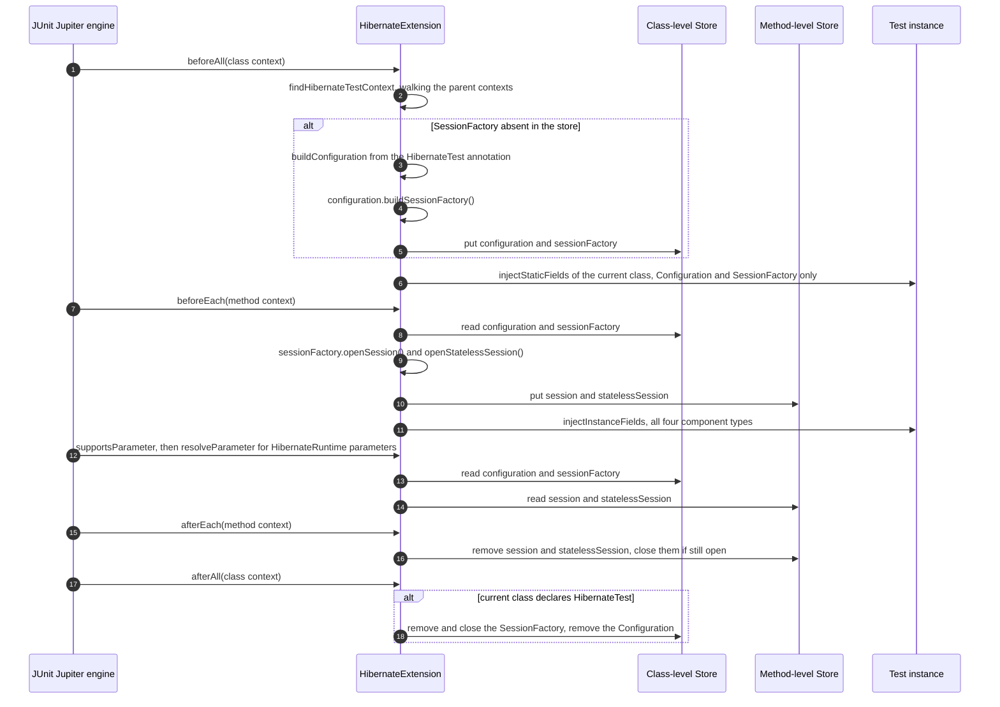
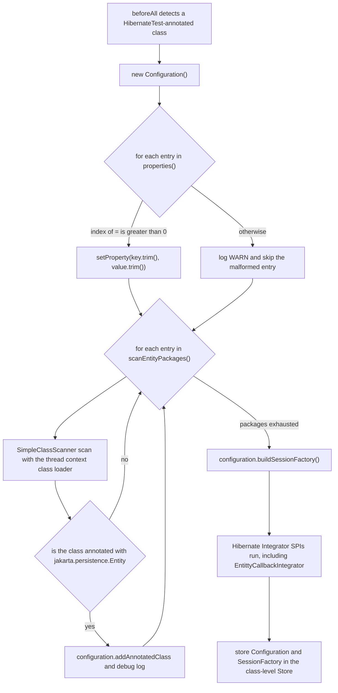
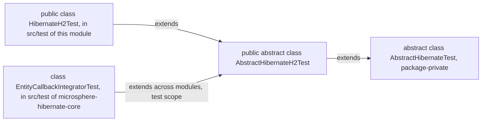
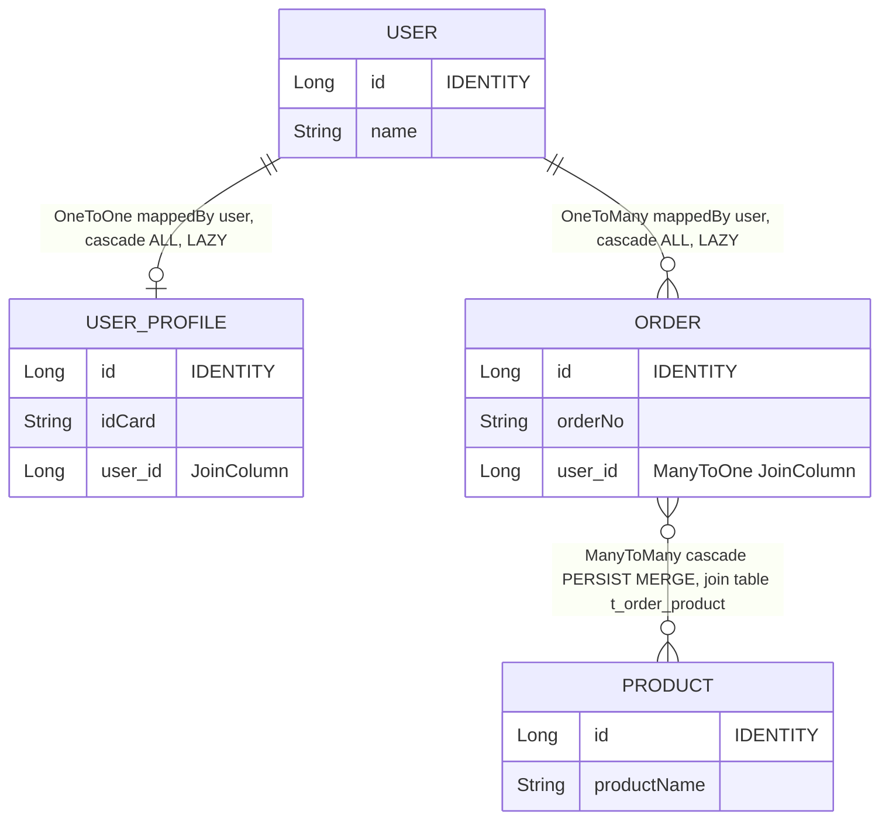

# microsphere-hibernate-test — 开发者文档

模块：`microsphere-hibernate-test` · packaging：`jar` · 坐标：
`io.github.microsphere-projects:microsphere-hibernate-test:${revision}`
POM：[`microsphere-hibernate-test/pom.xml`](../../../../microsphere-hibernate-test/pom.xml)
源码：`microsphere-hibernate-test/src/main/java/io/microsphere/hibernate/test/`

本模块是项目的**测试框架**：一个 JUnit 5 扩展，为测试类引导一个真实的 Hibernate
`SessionFactory`（以及 `Session` / `StatelessSession`）；一套注解驱动的配置模型；以及一组带现成 H2
实体图的抽象 fixture。`microsphere-hibernate-core` 在 `test` scope 使用它来跑自己唯一的集成测试，
因此它同时是*测试工具*与*项目验证策略的一部分*。

---

## 1. 构建构成

所有依赖都是 `<optional>true</optional>`（compile scope），包括测试库：

| 依赖 | scope | 说明 |
|------|-------|------|
| `io.github.microsphere-projects:microsphere-annotation-processor` | optional | 元数据生成，与 `core` 一致 |
| `io.github.microsphere-projects:microsphere-java-core` | optional | `SimpleClassScanner`、`io.microsphere.logging` |
| `io.github.microsphere-projects:microsphere-java-test` | optional | 共享的 microsphere 测试辅助类 |
| `org.hibernate.orm:hibernate-core` | optional | `Configuration`、`SessionFactory`、`Session`、`StatelessSession` |
| `com.h2database:h2` | optional | harness 自带 H2 fixture，因此驱动属于已发布的 API 表面 |
| `org.junit.jupiter:junit-jupiter` | optional | `Extension`、`@Nested`、断言 |
| `org.mockito:mockito-core`、`mockito-junit-jupiter` | optional | 供使用者可用；本模块自身的测试并未使用 |
| `ch.qos.logback:logback-classic` | optional | `io.microsphere.logging` 的日志后端 |

带来的后果：

* 因为 JUnit 是*optional* 而不是 `test` scope，本模块发布的是依赖 JUnit 的 **main** 源码
  （`HibernateExtension` 实现了 JUnit 接口）。这是有意为之——它本身就是一个测试库——但这也意味着
  使用者必须自己声明 JUnit，并且本模块自身的 `src/test` 使用同一份 classpath 运行。
* 本模块中不存在 `META-INF/services/org.junit.jupiter.api.extension.Extension` 描述文件：
  扩展**只**通过 `@HibernateTest` 上的 `@ExtendWith` 元注解激活，从不通过 JUnit 扩展自动发现。
  不要添加自动发现描述文件——它会在无关的测试里悄悄引导 Hibernate。

目录结构：

```text
io/microsphere/hibernate/test/
├── HibernateTest.java                 (public annotation, @Target(TYPE), @Inherited, @ExtendWith)
├── HibernateRuntime.java              (public annotation, @Target({FIELD, PARAMETER}))
├── HibernateExtension.java            (public JUnit 5 extension)
├── AbstractHibernateTest.java         (package-private template-method base class)
├── AbstractHibernateH2Test.java       (public H2 base class with entity fixtures and @Nested tests)
└── entity/                            (User, UserProfile, Order, Product)
```

---

## 2. `HibernateExtension`：JUnit 5 契约

```java
public class HibernateExtension implements BeforeAllCallback, BeforeEachCallback,
        AfterEachCallback, AfterAllCallback, ParameterResolver
```

五个回调，一个 namespace，四个 store key：

```java
private static final Namespace NAMESPACE = Namespace.create(HibernateExtension.class);
private static final String CONFIGURATION_KEY   = "configuration";
private static final String SESSION_FACTORY_KEY = "sessionFactory";
private static final String SESSION_KEY         = "session";
private static final String STATELESS_SESSION_KEY = "statelessSession";
```

| Key | 存放位置 | 生命周期 | 注入到静态字段 |
|-----|----------|----------|----------------|
| `configuration` | `@HibernateTest` 注解类上下文的 store | 一个测试类（与嵌套类共享） | 是 |
| `sessionFactory` | 同一个 class 级 store | 一个测试类 | 是 |
| `session` | **method** 上下文的 store | 一个测试方法 | **否**（保持 `null`） |
| `statelessSession` | 同一个 method 级 store | 一个测试方法 | **否**（保持 `null`） |

class 级 store 通过 `findHibernateTestContext(context)` 获取，它会沿着 `ExtensionContext` 的父链向上查找，
直到找到一个测试类带有 `@HibernateTest` 的上下文。这正是让 `@Nested` 类共享外层 `SessionFactory`、
而不是每一层嵌套都新建一个工厂的原因。

### 2.1 生命周期



值得保留的设计细节：

* **`beforeAll` 幂等。** `if (store.get(SESSION_FACTORY_KEY) == null)` 这个守卫加上父链查找，
  使得外层类与内层类都会调用 `beforeAll`，却不会构建两个工厂。
* **`afterAll` 的归属规则。** 只有其类**字面**声明了 `@HibernateTest` 的上下文才会关闭工厂
  （`testClassOpt.get().isAnnotationPresent(HibernateTest.class)`）；否则先结束的 `@Nested` 类
  会把工厂拆掉，影响它的兄弟类。
* **关闭是尽力而为。** `afterEach`/`afterAll` 把 `close()` 包在 `try/catch` 中并记录 warning
  （`"Failed to close Session"`、`"Failed to close StatelessSession"`、`"Failed to close SessionFactory"`），
  而不是让测试失败。因此资源泄漏的噪声出现在日志里，而不会出现在测试报告中。
* **到处都有提前返回。** 缺少测试类、缺少 `@HibernateTest` 祖先，或者 `SessionFactory` 为 `null`，
  都会静默 return，所以把该扩展作用到非 Hibernate 类上是无害的。
* **注入按字段类型驱动，而非按名字驱动。** `resolveValueForType` 精确映射
  `Configuration` → configuration、`SessionFactory` → sessionFactory、`Session` → session、
  `StatelessSession` → statelessSession；其他类型返回 `null`，字段就保持原样不动。
  `isSupportedType` 对参数应用同一份白名单，因此不支持的带注解参数会落到其他 resolver 上。
* `getAllDeclaredFields` 沿类层次向上遍历到 `Object`（但不包含 `Object`），所以从基类继承的
  `@HibernateRuntime` 字段也会被注入；`field.setAccessible(true)` 意味着 `private` 没问题，
  但 `final` 字段会抛 `IllegalAccessException`——不要把被注入的字段标记为 `final`。

### 2.2 注解模型

`@HibernateTest`（`RetentionPolicy.RUNTIME`、`ElementType.TYPE`、`@Inherited`、`@Documented`，
并以 `@ExtendWith(HibernateExtension.class)` 作为元注解）：

| 属性 | 格式 | 在 `buildConfiguration` 中的行为 |
|------|------|----------------------------------|
| `properties()` | `String[]`，形如 `key=value` | 按**第一个** `'='` 切分；`key` 与 `value` 都会 trim；索引 `<= 0` 的条目（缺 `'='`、空 key、或以 `'='` 开头）会记录 `WARN` 并跳过。value 本身可以包含 `'='`。 |
| `scanEntityPackages()` | `String[]` 包名 | 每个包用 `SimpleClassScanner.INSTANCE.scan(classLoader, packageName, true, true)` 扫描，classLoader 取 `Thread.currentThread().getContextClassLoader()`；只有带 `@jakarta.persistence.Entity` 的类才会通过 `configuration.addAnnotatedClass(...)` 注册（debug 日志）。 |

因为注解是 `@Inherited` 的，被注解测试类的子类会继承 `@HibernateTest`，并连带继承扩展注册；
属性是从 `hibernateTestContext.getRequiredTestClass()` 读取的，也就是从那个带注解的祖先类读取，
而不是从子类读取。

**不存在默认配置**：一个空的 `@HibernateTest` 得到的 `Configuration` 既没有属性也没有实体，
`buildSessionFactory()` 会在引导阶段失败。务必提供连接属性（见 `HibernateAnnotationTest`），
或者直接改为继承 `AbstractHibernateH2Test`。



步骤 `K` 正是本模块对 `core` 有意义的地方：每个注解驱动的测试同时也走了一遍
`EntityCallback` 的引导路径。

---

## 3. 抽象 fixture：模板方法家族



`AbstractHibernateTest`（package-private）——一个带 `final` 生命周期的 Template Method 基类：

```java
@BeforeEach final void setUp()  { configuration = buildConfiguration();
                                 customizeConfiguration(configuration);
                                 sessionFactory = configuration.buildSessionFactory();
                                 session = sessionFactory.openSession();
                                 statelessSession = sessionFactory.openStatelessSession();
                                 init(); }
@AfterEach  final void tearDown(){ destroy(); session.close(); statelessSession.close(); sessionFactory.close(); }
```

| 钩子 | 类型 | 用途 |
|------|------|------|
| `buildConfiguration()` | `abstract`，必须实现 | 提供属性与注解类 |
| `customizeConfiguration(Configuration)` | 可覆盖的空实现 | 无需重建的最后微调 |
| `init()` / `destroy()` | 可覆盖的空实现 | 每个测试方法前后的 fixture 数据构造 / 清理 |

需要注意的语义：

* 字段 `configuration`、`sessionFactory`、`session`、`statelessSession` 是 `protected`，
  而 `setUp`/`tearDown` 是 `final`——子类无法破坏生命周期，只能定制。
* 工厂是**每个测试方法**重建一次（而不是每个类），这一点与 `HibernateExtension` 不同。
  换来的是隔离性（全新的 Hibernate 缓存，没有 `@Cacheable` 残留），代价是可测量的时间开销；
  如果可以接受每类一个工厂，请优先使用 `@HibernateTest`。
* 可见性是必须记住的耦合点：`AbstractHibernateTest` 是 package-private，所以在
  `io.microsphere.hibernate.test` 包之外的测试只能继承 `AbstractHibernateH2Test`。
  这恰恰是 `EntityCallbackIntegratorTest`（包 `io.microsphere.hibernate.entity`，另一个模块）所做的。

`AbstractHibernateH2Test` 额外提供：

* `buildConfiguration()` → 四个注解类，加上 H2 内存配置：
  `org.h2.Driver`、`jdbc:h2:mem:test_db;DB_CLOSE_DELAY=-1`、`sa` / 空密码、`org.hibernate.dialect.H2Dialect`、
  `hibernate.format_sql=true`、`hibernate.show_sql=true`、`hibernate.hbm2ddl.auto=update`。
* `protected User user`，由可覆盖的工厂方法 `createUser()`（User + UserProfile + Order + Product 图）
  在 `init()` 中创建。
* `doInAction(Runnable)` — 在**无事务**的情况下断言“不抛异常”。
* 两个 `@Nested` 套件 `SessionTest` 与 `StatelessSessionTest`，它们各自的 `doInTransaction` 辅助方法
  把动作包在 `assertDoesNotThrow` + `beginTransaction`/`commit` 里。覆盖范围包括 `persist`、`get`、`find`、
  `merge`、`remove`、`replicate(LATEST_VERSION)`、`flush`、`detach`、`evict`、`lock(READ)`、`refresh`、
  HQL `FROM User`；stateless 侧覆盖 `insert`、`get`、`update`、`delete`、`refresh`、`fetch`。

这些嵌套测试事实上就是整个项目的契约测试：它们在 `test` 模块跑一次，然后通过
`EntityCallbackIntegratorTest` 在 `core` 中（`EntityCallback` 桥接处于激活状态）再跑一次。

---

## 4. 实体 fixture



| 实体 | 表 | 关系 | 为什么存在于 harness 中 |
|------|-----|------|--------------------------|
| `User` | `t_user` | `@OneToOne(mappedBy="user", cascade=ALL, fetch=LAZY) UserProfile`、`@OneToMany(mappedBy="user", cascade=ALL, fetch=LAZY) List<Order>`，另有维护双向的 `addOrder(Order)` | 级联 + 集合事件（`onPersist` 级联、`PRE/POST_COLLECTION_*`） |
| `UserProfile` | `t_user_profile` | 拥有侧 `@OneToOne User`，带 `@JoinColumn(name="user_id")` | `OneToOne` 级联，以及 `testPersistAndRemove` 中类似 `orphanRemoval` 的删除 |
| `Order` | `t_order` | `@ManyToOne User`、`@ManyToMany(cascade={PERSIST,MERGE}) Set<Product>`，连接表 `t_order_product` | 集合的 recreate/update/remove 事件 |
| `Product` | `t_product` | `@ManyToMany(mappedBy="products", fetch=LAZY) Set<Order>` | 反向侧，通过 `StatelessSession` 来验证 |

四个实体都使用 `@Id @GeneratedValue(strategy = IDENTITY)`，并基于 `(id, 业务字段)` 实现
`equals`/`hashCode`，采用 Java 17 的模式匹配写法（`if (!(o instanceof User user1)) return false;`）。
`IDENTITY` 策略是刻意选择的：`session.persist()` 会立即插入，因此 `PRE_INSERT`/`POST_INSERT`
回调在 `persist` 期间就触发，而不是等到 flush——`core` 的集成测试中的断言时机依赖这一点。
修改它时要小心：换成 `SEQUENCE`/`TABLE` 生成策略后，回调会移到提交时触发，
`StatelessSessionTest` 里 `testInsertAndGet` 之类的断言含义就变了。

实体单元测试（`src/test` 下的 `UserTest`、`OrderTest`、`ProductTest`、`UserProfileTest`）
是纯 POJO 测试——构造器默认值、getter/setter、`addOrder` 的双向性以及 `equals`/`hashCode` 契约。
它们的存在是为了在不引导 Hibernate 的前提下保证 fixture 可信。

---

## 5. 本模块的自测

| 测试 | 机制 | 断言重点 |
|------|------|----------|
| `HibernateH2Test`（`public`，继承 H2 基类） | 模板方法家族；覆盖 `customizeConfiguration` 并调用 `super` | 证明 `AbstractHibernateH2Test` 能启动，且继承来的全部嵌套套件通过 |
| `HibernateAnnotationTest`（`@HibernateTest`，6 个属性加 `scanEntityPackages`） | 注解/扩展家族 | 三个 `@Nested` 类：实例字段拿到全部四个组件；静态字段拿到 `Configuration`/`SessionFactory`，而 `Session`/`StatelessSession` **必须保持 null**；构造器参数上标注 `@HibernateRuntime` 的四种类型都能解析 |
| `entity/*Test` | 仅 POJO | fixture 正确性 |

`HibernateAnnotationTest` 同时也是扫描器的文档：`io.microsphere.hibernate.test.entity` 在运行期被发现，
其四个 `@Entity` 类在没有任何 `addAnnotatedClass` 调用的情况下被注册。如果你把实体移到别的包，
这个测试会最先失败——两处一起改。

---

## 6. 扩展本模块的准则

1. **保持 harness 有用。** 你在 `core` 中新增的任何 Hibernate 能力，都应该在这里有一条断言路径
   （`AbstractHibernateH2Test` 里的一个嵌套套件，或者 `core` 中继承它的专项测试）。
2. **绝不让 `test` 在 compile scope 引用 `core`。** 那会形成真正的 Maven 环（见
   [索引](./README.md)）；`core` 只在 `test` scope 依赖 `test`，这也是 `core` 被放在最后构建的原因。
3. **增加第二种数据库 flavor**：继承 `AbstractHibernateTest`（同一个包，因此 package-private 可用），
   返回不同的 `Configuration`，并让 `buildConfiguration()` 保持无副作用，好让子类能覆盖
   `customizeConfiguration`。若要注解驱动的等价方案，请给 `@HibernateTest` 增加属性
   （保留默认值），而不是另造注解。
4. **隔离性提醒**：`jdbc:h2:mem:test_db;DB_CLOSE_DELAY=-1` 加上 `hbm2ddl.auto=update`，
   再复用同一个 Surefire JVM，意味着同一模块内表和行会跨测试类累积。请采用类似 `@DirtiesContext`
   的纪律（在 `destroy()` 里删掉自己插入的行），或者在你新增的基类里使用不同的
   `DB_CLOSE_DELAY`/数据库名。
5. **嵌套套件中的事务纪律**：`doInAction` 是故意在**无事务**下运行的（`detach`、`evict`、`lock`
   正是这样被验证的）。不要把它们“修正”成 `doInTransaction`——它们验证的是这些操作在事务边界之外
   不抛异常。
6. **风格**：本模块是项目约定最集中的地方（ASF header、`@author`、`@since`、带分节的 javadoc）。
   `HibernateExtension` 目前有两处偏离——`getAllDeclaredFields` 里内联使用的
   `java.util.List`/`java.util.ArrayList`/`java.util.Arrays`，以及其他地方 `getLockMode` javadoc
   的全限定名写法——新代码请使用真正的 import。
7. **不要把 JUnit 的 scope 从 `optional` 改成 `compile`**，除非你已经决定让所有使用者都传递性继承 JUnit；
   这是一个与 1.x 分支共用的发布策略变更。

---

## 7. Reviewer 检查清单

- [ ] 新增的扩展回调保留“找不到 `@HibernateTest` 就提前返回”的行为。
- [ ] class 级与 method 级 store key 使用一致（`session` 绝不能落到 class store 里）。
- [ ] `afterAll` 仍然只从带注解的类关闭工厂。
- [ ] 注入白名单在*三处*都同步更新：`resolveValueForType`、`resolveComponent`、`isSupportedType`。
- [ ] 畸形 `key=value` 的处理仍然是告警并跳过，而不是抛异常。
- [ ] 实体包扫描仍然使用线程上下文 class loader，并且仍然按 `@Entity` 过滤。
- [ ] `AbstractHibernateTest` 仍然保持 package-private，其 `setUp`/`tearDown` 仍然保持 `final`，
      除非有记录在案的理由。
- [ ] fixture 的变更已同步反映到 `core` 的集成测试，以及 `docs/current/developer-guide` 和
      `docs/current/developer-guide/zh` 两处文档。

---

上一篇：[`microsphere-hibernate-core.md`](./microsphere-hibernate-core.md) ·
[索引](./README.md)
